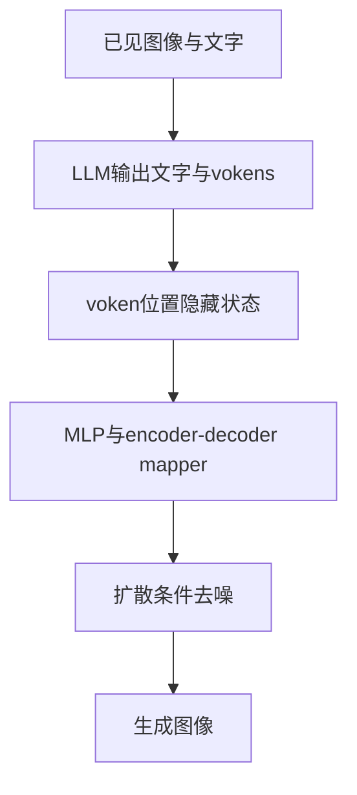

# 生成输出接口：读入图片、输出文字、合成图片分别由谁完成？

“多模态生成”首先要问**输出是什么对象、模型用什么表示交给下一组件**。VLM的captioning生成文字，grounding生成坐标串；MiniGPT-5进一步生成交错文字与图像条件，实际图像由扩散模型合成。共用语言序列并不意味着所有模态都由同一种token预测器直接生成像素。

## 从条件语言到结构化答案

BLIP的causal decoder在图像条件下预测caption；CoCa后半段decoder也做captioning，而它的前段负责独立文本表示。BEiT-3可用非对称mask让图像只读图像、文本读图像与过去文本，避免未来caption通过图像状态泄漏。三者都包含语言生成，但下游VQA可能仍用有限答案分类或候选排序；有decoder不等于所有报告分数来自自由生成。[[raw/papers/architecture/pretraining/BLIP.pdf#page=3|S012 · p.3 §3.2]] [[raw/papers/architecture/pretraining/CoCa.pdf#page=10|S013 · p.10 §4.2.3]] [[raw/papers/architecture/pretraining/BEiT-v3.pdf#page=6|S015 · pp.6–7 §3.1]]

Qwen-VL把框、指代短语与OCR四边形组织成带标记的文本；DeepSeek-VL2也把对象与坐标串共同输出。这些标记把监督与下游解析接起来，例如“红杯子”→归一化坐标，但它们不直接执行点击或抓取，定位分数也不等于交互完成率。[[raw/papers/models/qwen/Qwen-VL.pdf#page=4|S026 · p.4 §2.2、p.19 AppendixB.1]] [[raw/papers/models/deepseek/DeepSeek-VL2.pdf#page=7|S032 · pp.7–9 Grounding/Conversation]]

## MiniGPT-5：输入特征与输出vokens不是同一种位置

MiniGPT-5输入图像经过MiniGPT-4视觉桥形成32个视觉特征，输出端新增默认8个image vokens。输入特征表示已见图像；输出vokens在生成序列里标记“此处要合成图”，其隐藏状态再经mapper转换成Stable Diffusion条件。Vicuna没有在普通词表里逐RGB像素解码。[[raw/papers/architecture/generation/MiniGPT-5.pdf#page=3|S021 · pp.3–4 §3.1–3.2、Fig.2]]

图为本库按原文重组的信息传递关系。mapper生成条件特征，U-Net预测去噪量，VAE负责潜变量/图像转换；“decoder”一词出现在不同模块并不表示职责相同。语言loss教文字与插图位置，扩散loss将目标图像监督反传到可训练接口：

$$L_{\rm LDM}=\mathbb E_{\epsilon,t}\|\epsilon-\epsilon_\theta(z_t,t,\hat h_{voken})\|_2^2.$$

冻结U-Net权重仍可对输入条件求导。第一阶段还用caption文本编码器的MSE监督；第二阶段不要求每幅图另配详细caption，但仍有故事/对话文本。因此description-free只适用于相应阶段，不能读成全流程从未用文字描述。[[raw/papers/architecture/generation/MiniGPT-5.pdf#page=4|S021 · pp.4–5 §3.2–3.3、式2–5]] [[raw/papers/architecture/generation/MiniGPT-5.pdf#page=12|p.12 AppendixA]]

## 输出有图，还需怎样判断成功

图像和前文语义相近、图文对人有吸引力、分布级FID较低、跨图主体身份保持，是不同要求。MiniGPT-5的VIST人评比较连贯性、图像质量和图文一致性；分布FID与逐对象纹理保持没有逻辑等价关系，报告也承认纹理维持困难。MMDialog只保留至多一个历史turn，不能由此断言任意长对话一致。[[raw/papers/architecture/generation/MiniGPT-5.pdf#page=6|S021 · pp.6–8 Tables1–8、§4–5]] [[raw/papers/architecture/generation/MiniGPT-5.pdf#page=12|pp.12–15 AppendixA/B]]

S002把交错多模态中间表示与环境反馈作为未来native reasoning方向，属于作者展望；MiniGPT-5提供了一种具体输出接口，却没有因此验证完整的原生多模态推理愿景。继续到[[wiki/evaluation/Judges-and-Task-Success|裁判与任务完成]]区分指标对象，到[[wiki/reasoning/Overview|推理与交互]]区分生成物、工具动作与实际终态。[[raw/surveys/Perception, Reason, Think, and Plan A Survey on Large Multimodal Reasoning Models.pdf#page=30|S002 · pp.30–31 §4.3]]

## 实际来源入口

[[wiki/surveys/Perception, Reason, Think, and Plan A Survey on Large Multimodal Reasoning Models|S002 Multimodal-Reasoning-Survey]] · [[wiki/papers/architecture/pretraining/BLIP|S012 BLIP]] · [[wiki/papers/architecture/pretraining/CoCa|S013 CoCa]] · [[wiki/papers/architecture/pretraining/BEiT-v3|S015 BEiT-v3]] · [[wiki/papers/architecture/generation/MiniGPT-5|S021 MiniGPT-5]] · [[wiki/papers/models/qwen/Qwen-VL|S026 Qwen-VL]] · [[wiki/papers/models/deepseek/DeepSeek-VL2|S032 DeepSeek-VL2]]。原始定位在上文；唯一页保存身份、读取范围和实验条件。
