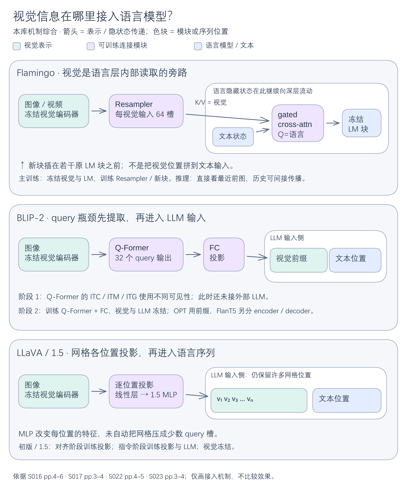

# 可见性、路由与连接：视觉信息在哪里与语言相遇？

一张架构图至少要读三层：**权重共享回答“复用谁”，attention可见性回答“这次能读谁”，路由回答“这位置经过谁”。** 它们共同决定信息流，但不能互相替代。连接器再决定视觉信息在输入端还是语言层内部进入。

## 先把共享参数与联合输入分开

VLMo在不同运行模式复用同层attention权重，FFN按模态与层位置选择。双塔ITC分别编码图和文，能缓存独立向量；融合路径把图文联合输入，底层attention已经跨模态交互，尽管图像token走V-FFN、文字走L-FFN；顶部才改用VL-FFN。Base顶部2层、Large顶部3层，不能解释为“到最后几层才第一次融合”。这里是固定规则路由，不是学得的top-k专家选择。[[raw/papers/architecture/pretraining/VLMo.pdf#page=3|S014 · pp.3–6 Figs1/3、§3.1–3.3]]

BEiT-3继承multiway分工，把主预训练统一为masked data modeling；同一骨干仍有纯视觉、纯文本、融合、双塔和条件生成的不同路径。图像patch embedding是输入，离散视觉token是遮蔽预测目标；“统一目标”没有取消目标空间、mask或任务读出的区别。其1.9B总参数也不是纯视觉路径每次全激活。[[raw/papers/architecture/pretraining/BEiT-v3.pdf#page=3|S015 · pp.3–5 §2、Figs2–3、Table2]]

**本库教学例子：**两段输入即使使用同一套attention矩阵，只要分别前向，当前图像和当前句子就不会在编码时交换信息。反过来，联合attention已经把文字信息混入视觉位置后，视觉位置走“视觉FFN”也不能再称其输入完全是纯视觉信息。

## 对齐表示与融合表示各有什么用

| 机制 | 独立表征路径 | 条件交互路径 | 其设计要点 |
| --- | --- | --- | --- |
| ALBEF | ITC比较两塔CLS | 文本通过cross-attention读取视觉，做ITM/MLM | 对齐帮助候选检索及难负例抽样；三目标联合优化 |
| BLIP MED | 双向文本编码参与ITC | 双向融合做ITM，causal融合做LM | encoder/decoder的SA参数分开，CA/FFN等共享 |
| CoCa | causal decoder前段不看图，末尾CLS参与contrastive | 后段causal decoder加视觉CA，做caption | 前段计算复用给后段；默认pooler为256→1串联 |

证据：[[raw/papers/architecture/pretraining/ALBEF.pdf#page=3|S011 · pp.3–4 §3.1–3.2]]、[[raw/papers/architecture/pretraining/BLIP.pdf#page=2|S012 · pp.2–3 Fig.2、§3.2]]、[[raw/papers/architecture/pretraining/CoCa.pdf#page=4|S013 · pp.4–5 Fig.2、§3.2]]、[[raw/papers/architecture/pretraining/CoCa.pdf#page=12|p.12 Table8f]]。共享参数会节省权重或复用中间计算，但不能由此断言所有任务只跑一次文本路径。

ALBEF/BLIP可先用独立表示选top-k，再只为这些候选做融合重排；CoCa检索则直接比较冻结的独立向量。全库点积还可能有$NM$项，节省的是重型图文联合编码次数，不是证明端到端检索总计算必线性。[[raw/papers/architecture/pretraining/ALBEF.pdf#page=9|S011 · p.9 §6.4、Table6]] [[raw/papers/architecture/pretraining/BLIP.pdf#page=6|S012 · p.6 §5.1]] [[raw/papers/architecture/pretraining/CoCa.pdf#page=9|S013 · p.9 §4.2.2]]

## 视觉接入LLM的三条通路

**Flamingo：先压缩，再从语言层内部反复读取。** Resampler将每视觉输入变成64个latents，新增gated cross-attention以语言状态为Q、视觉latents为K/V，随后进入冻结LM块。gate从0开始，让新残差分支初始不改变LM。文本直接看最近前图，早图影响仍能经历史语言状态传播；“最近一图”不等于只能接单图。[[raw/papers/architecture/connectors/Flamingo.pdf#page=4|S016 · pp.4–6 §2、Figs3–4]] [[raw/papers/architecture/connectors/Flamingo.pdf#page=24|p.24 Fig.7]]

**BLIP-2：先学习query瓶颈，再变成LLM输入前缀。** 32个768维query在Q-Former里读取冻结视觉特征，FC投影后作为LLM的soft visual prompt。第一阶段的三种mask非常关键：ITC隔离query与text，ITM允许双向交互，ITG让text看query及过去文字、query不看text；这样生成不能经query偷读未来答案。第二阶段由外部冻结OPT/FlanT5生成，不等于第一阶段Q-Former文本分支的ITG。[[raw/papers/architecture/connectors/BLIP-2.pdf#page=3|S017 · pp.3–4 §3.1–3.3、Figs2–3]]

**LLaVA：保留网格，逐位置投影后进入语言序列。** 初版用线性层，1.5用两层MLP；MLP改变特征维度和变换能力，不像固定query模块自动把许多位置压成少数槽位。1.5在336/14下有576个patch位置的几何预算。两类接口保留的信息与后端长度不同，但没有跨所有任务、同数据同预算的通用胜者。[[raw/papers/models/llava/LLaVA.pdf#page=4|S022 · pp.4–5 §4、Fig.1]] [[raw/papers/models/llava/LLaVA-1.5.pdf#page=3|S023 · pp.3–4 §3.1–3.3]]

[编辑图源](../assets/diagrams/visual-entry/visual-entry.excalidraw)。本库机制综合，箭头表示表示/隐状态传递；query压缩与跨模态交互的位置分开标出。依据Flamingo S016 pp.4–6 §2 Figs3–4、BLIP-2 S017 pp.3–4 §3 Figs2–3、LLaVA S022 pp.4–5 §4与S023 pp.3–4 §3（原始定位见上文）。图只对照接入通路与主训练边界，不作效果排名；BLIP-2下游解冻例外见[[wiki/papers/architecture/connectors/BLIP-2|唯一页]]。PNG与图源同版本，Obsidian内显示未测。

## query是否知道当前任务

InstructBLIP让指令在Q-Former里与query交互，只有query输出经投影进入LLM，指令另一路还进LLM。相同图像的冻结ViT特征不变，变化的是任务条件化提取。BLIP-2的监督VQA微调原本也会把问题送入Q-Former，因此不能说InstructBLIP是“第一个让任何query读文字”的证明。[[raw/papers/architecture/connectors/InstructBLIP.pdf#page=4|S018 · pp.4–5 §2.3、Fig.3]] [[raw/papers/architecture/connectors/BLIP-2.pdf#page=13|S017 · p.13 Fig.7，配合p.7正文冻结边界]]

MiniGPT-4主方案冻结已有BLIP-2的ViT与Q-Former，只训到Vicuna的线性层；“一个线性层成功”背后已有预训练视觉桥。mPLUG-Owl的abstractor同样用learnable tokens读视觉，但结果接在LLM输入端；其第一阶段会训练ViT与abstractor。两者都不能因接口名称轻量就推断既有预训练或前向计算消失。[[raw/papers/architecture/connectors/MiniGPT-4.pdf#page=2|S019 · p.2 Fig.1、p.4 §3.1]] [[raw/papers/architecture/connectors/mPLUG-Owl.pdf#page=4|S020 · pp.4–5 Fig.2、§3.1–3.2]]

InternVL带QLLaMA的Chat同时有直接网格和query两支，防止把全部信息误画成经过96-query瓶颈；Qwen3-VL DeepStack则把三个视觉深度经merger加到LLM前三层隐藏状态，不增加序列长度。**输入位置增多、每位置通道增多、多层注入是三种独立改动。**[[raw/papers/models/internvl/InternVL.pdf#page=5|S025 · p.5 Fig.4d]] [[raw/papers/models/qwen/Qwen3-VL.pdf#page=3|S028 · pp.3–4 §2.2、Fig.1]]

输出图像的接口进入[[wiki/architecture/Generative-Output-Interfaces|生成输出接口]]；冻结和指令目标进入[[wiki/training/Supervision-and-Stages|监督与阶段]]，输入长度进入[[wiki/vision/Resolution-and-Token-Budget|视觉预算]]。课程中的CogVLM视觉专用Q/K/V与FFN仍只由[[raw/lectures/VLM-2.pdf#page=74|S003 · pp.74–75]]提供转述，不补建未读论文身份；它可帮助看清“专用参数”与这里的输入端连接是不同设计轴。

## 实际来源入口

[[wiki/lectures/VLM-2|S003 VLM-2]] · [[wiki/papers/architecture/pretraining/ALBEF|S011 ALBEF]] · [[wiki/papers/architecture/pretraining/BLIP|S012 BLIP]] · [[wiki/papers/architecture/pretraining/CoCa|S013 CoCa]] · [[wiki/papers/architecture/pretraining/VLMo|S014 VLMo]] · [[wiki/papers/architecture/pretraining/BEiT-v3|S015 BEiT-v3]] · [[wiki/papers/architecture/connectors/Flamingo|S016 Flamingo]] · [[wiki/papers/architecture/connectors/BLIP-2|S017 BLIP-2]] · [[wiki/papers/architecture/connectors/InstructBLIP|S018 InstructBLIP]] · [[wiki/papers/architecture/connectors/MiniGPT-4|S019 MiniGPT-4]] · [[wiki/papers/architecture/connectors/mPLUG-Owl|S020 mPLUG-Owl]] · [[wiki/papers/models/llava/LLaVA|S022 LLaVA]] · [[wiki/papers/models/llava/LLaVA-1.5|S023 LLaVA-1.5]] · [[wiki/papers/models/internvl/InternVL|S025 InternVL]] · [[wiki/papers/models/qwen/Qwen3-VL|S028 Qwen3-VL]]。原始定位在上文；唯一页保存身份、读取范围和实验条件。
