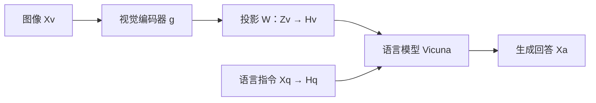

# Vision Language Models – II：从模态专家到多模态大模型

这讲回答的核心问题是：**图像与文字怎样共享计算、怎样连接已有语言模型，以及怎样把复杂图像与视频转成语言模型能利用的信息？** 前半讲从 VLMo / BEiT-3 的共享注意力与模态专家，走到 BLIP-2、InstructBLIP、LLaVA 的连接与指令训练；后半讲用动态分辨率、位置编码和模型家族说明视觉输入、连接器、LLM 与训练目标怎样共同变化，最后回到 SigLIP 2 的视觉表征训练。

> [!important] 阅读身份与边界
> 本页直接阅读的是 **92 页课程讲义 S003**。下文模型介绍均为“讲义转述”，包括讲义嵌入的论文图表；本次没有据此核读被引论文、代码或外部网页。能力案例、作者比较与路线归纳不等于独立性能验证。代数整理和跨页比较明确标为“本库解释”，不增加来源等级。

读完应把握四件事：

- **共享什么与专用什么要分开看。** VLMo 的共享注意力搭配模态专用 FFN；CogVLM 把视觉专用参数放入 LLM 内部。它们与可学习 router 选择稀疏专家的 MoE 不宜混称。[[raw/lectures/VLM-2.pdf#page=4|p.4–7 · VLMo]]、[[raw/lectures/VLM-2.pdf#page=74|p.74 · CogVLM]]
- **连接器形式和可训练范围是两个维度。** Q-Former、线性投影、MLP merger、cross-attention 是信息传递机制；冻结视觉编码器或 LLM 是训练选择，不能凭“adapter”一词推断。[[raw/lectures/VLM-2.pdf#page=22|p.22–23 · BLIP-2]]、[[raw/lectures/VLM-2.pdf#page=30|p.30 · LLaVA]]
- **高分辨率不是单一方案。** 原生变长 patch 序列、整图加局部切片、双视觉编码器及 token 合并，分别改变细节保留、序列组织和计算负担。[[raw/lectures/VLM-2.pdf#page=37|p.37 · Mini-Gemini]]、[[raw/lectures/VLM-2.pdf#page=39|p.39–40 · Preliminary]]、[[raw/lectures/VLM-2.pdf#page=68|p.68 · DeepSeek-VL2]]
- **路线图不等于机制贡献的因果实验。** 一代模型同时改变编码器、数据、训练和位置编码，不能从家族演进图推出某组件单独带来多少增益。[[raw/lectures/VLM-2.pdf#page=48|p.48–52 · Qwen VL 系列]]

## 来源登记与页段地图

| 字段 | 已核内容 |
| --- | --- |
| 原件 | [[raw/lectures/VLM-2.pdf\|VLM-2.pdf]]，92 页 |
| 标题与课程 | 首页：Advanced Computer Vision，THU×SENSETIME – 80231202；Chapter 3 – Section 12；Vision Language Models – II |
| 署名与日期 | 首页 Dr. Li Yali；Acknowledge: Zeyuan Wu；Friday, May 22, 2026 |
| 来源性质 | 用户提供的本地课程原件；公开下载 URL 未确认，未将页脚被引论文网址当成本讲义网址 |
| 版本 | 首页日期 2026-05-22；PDF 元数据创建与修改日期均为 2026-05-22；其他修订历史未确认 |
| SHA-256 | a81bcec1ed8f630632c2abccbba88bf3ddeaaab95f47aaa5fdf68596233b1a64 |
| 本次读取 | 2026-10-31；逐页读取 p.1–92 的文字和渲染原页，覆盖正文、图表、公式、演示案例、导航与结束页 |
| 重点原页核对 | p.5–16、20–32、33–47、53–70、73–90 的架构、冻结标记、表格、公式和训练流程；p.27、35、37、45、71、72、74、82、83 等另作单页放大 |
| 未读与未做 | 本 PDF 无跳过页段；被引论文正文、链接网页、源码未在此任务核读；未复现实验，未验证示例输出；Obsidian 内显示未测 |
| 旧笔记输入 | S003 无独立旧总结输入登记；其他模型的冻结旧笔记不是本页证据 |
| 整合状态 | 本页已通过登记范围的独立内容审查并接入初始主题/索引；完整来源综合、结构与主 Agent 最终验收仍待收尾，状态保持 integrating |

页码均从 PDF 首页计数；原幻灯片未见独立印刷页码，以下不另造页码。

| PDF 页段 | 课程内容 | 本页阅读重点 | 深度 |
| --- | --- | --- | --- |
| 1–2 | 封面与导航 | 课程身份和三条主线 | brief |
| 3–7 | MoE、VLMo | 模态专家、共享注意力、单塔/双塔与训练 | core |
| 8–13 | BEiT-3 | 统一掩码建模、任务形态、带条件阅读结果 | core |
| 14–16 | Meta-Transformer | 模态专属 tokenization 与共享编码器 | medium |
| 17–18 | Florence-2 | 图像、区域、短语三个标注粒度 | brief |
| 19–23 | 导航、BLIP-2 | Q-Former、注意力 mask、两阶段桥接 | core |
| 24–27 | InstructBLIP | 指令感知视觉提取与回答形式 | core |
| 28–30 | LLaVA | 投影连接、指令数据、冻结范围 | core |
| 31–37 | MoE-LLaVA、MiniGPT-4、Mini-Gemini | 稀疏专家、轻量对齐、双分辨率特征 | medium |
| 38–47 | 导航、NaViT、AnyRes、位置编码 | 原生分辨率与切片；RoPE 到 M-RoPE | core |
| 48–63 | Qwen VL 系列 | 演进轴、时空编码、DeepStack、训练阶段 | core |
| 64–71 | DeepSeek-VL / VL2 | 混合视觉编码、动态切片、MoE、训练范围 | core |
| 72–77 | CogVLM / CogVLM2 | LLM 内视觉专家、grounding 监督、视频 | medium |
| 78–82 | Kimi-VL / Kimi K2.5 | 原生分辨率、分阶段训练、Agent 交互环 | medium |
| 83–84 | InternVL | 扩大视觉编码器与分阶段对齐 | medium |
| 85–90 | 导航、SigLIP 2 | 全局图文、定位、蒸馏、密集特征目标 | core |
| 91–92 | 展望与结束 | 讲者提出的方向，不作已证结论 | brief |

## 1. 共享计算与模态专用参数

### 1.1 VLMo：共享注意力，切换模态专家

> 来源：[[raw/lectures/VLM-2.pdf#page=3|p.3–7 · Preliminary / VLMo]]\
> 重点：core

**讲义机制。** p.3 先用门控网络选择功能性专家的普通 MoE 图引入专家思想；p.4 随后把 VLMo 的 Mixture-of-Modality-Experts（MoME）定义为具体安排：用模态专家替代 Transformer 的单一 FFN，按输入 token 的模态执行 hard routing；不同模态复用 self-attention 参数。在图文融合任务中，联合 token 序列通过注意力交互，专用 FFN 保留模态相关变换；双塔分别编码时共享参数，并不意味着两塔的图文 token 实际互相读取。

p.5 的 Multiway Transformer 包含视觉 V-FFN、语言 L-FFN 与视觉语言 VL-FFN。右侧不是三套互不相关的模型，而是同一参数框架对应三个预训练任务的使用方式：

| 任务 | 图中的信息组织 | 学习信号 |
| --- | --- | --- |
| Image-Text Contrastive Learning | 图像和文字分别编码 | 比较图像表示与文本表示是否匹配 |
| Image-Text Matching | 图文拼接后从底层 self-attention 交互；低层分模态 FFN、顶层 VL-FFN | 判断配对是否匹配，图中还标出 hard negative mining；讲义图见 [[raw/lectures/VLM-2.pdf#page=5\|p.5]]，原论文补核见 [[raw/papers/architecture/pretraining/VLMo.pdf#page=4\|S014 · p.4–5 · §3.1–3.2 / Fig.3]] |
| Masked Language Modeling | 遮蔽部分文本；联合图文从底层 attention 交互以预测被遮蔽词 | 依据可见文字与图像恢复被遮挡词；讲义图见 [[raw/lectures/VLM-2.pdf#page=5\|p.5]]，原论文补核见 [[raw/papers/architecture/pretraining/VLMo.pdf#page=16\|S014 · p.16 · Appendix A]] |

**三阶段训练要看冻结状态。** p.6 先用纯图像训练视觉专家与共享注意力；再冻结二者，用纯文本 MLM 训练语言专家；最后用图文对训练整体模型。不能概括成“从一开始所有参数都用图文共同训练”。

**任务形态可以变化。** p.7 对检索采用双塔，图文各自编码；对视觉语言分类采用单塔融合，建模更深的图文交互。本库解释：双塔便于分别计算图文表示；单塔可让一对输入在内部充分交互。这里比较的是计算组织，不是课程证明了双塔或单塔普遍更优。

### 1.2 BEiT-3：统一训练目标与多种下游形态

> 来源：[[raw/lectures/VLM-2.pdf#page=8|p.8–13 · BEiT-3]]\
> 重点：core

**讲义机制。** p.8 将图像、文本、图文对都送入 Multiway Transformer，顶部统一写为 Masked Data Modeling。p.9 展示视觉编码器、语言编码器、融合编码器、双编码器和图像到文本生成五种用法。应理解为共享多路框架与掩码建模思路，而不是“所有任务的输入、mask、输出头与推理流程完全一样”。

视觉专家支持分类、语义分割、检测；语言专家支持文本掩码建模；融合编码器处理 VQA / NLVR2；双编码器用于检索；生成分支依据图像及已有词预测后续文本。图中将**预训练共性与任务使用方式的差异**放在一起。

**结果怎样读。** p.12 报告的配置为 40 层、hidden size 1408、MLP size 6144、总参数约 1.9B；训练材料列 21M 图文对、14M ImageNet-21K 图像与 160GB 文本。p.13 按任务与划分报告：

| 任务与划分 | 指标 | 讲义嵌入表中 BEiT-3 值 | 定位 |
| --- | --- | --- | --- |
| VQAv2 test-dev / test-std | VQA score | 84.19 / 84.03 | [[raw/lectures/VLM-2.pdf#page=13\|p.13 · Table 4]] |
| NLVR2 dev / test-P | Accuracy | 91.51 / 92.58 | [[raw/lectures/VLM-2.pdf#page=13\|p.13 · Table 4]] |
| COCO Karpathy test split | CIDEr | 147.6，表注说明未使用 CIDEr optimization | [[raw/lectures/VLM-2.pdf#page=13\|p.13 · Table 4]] |

p.10 雷达图与 p.11 汇总表展示被引作者的多任务比较。不能把不同指标的径向距离当成可加总的“通用能力”，也不能把不同基线视作预算完全匹配的消融。此页段没有足以独立核验所有比较的完整训练与评测协议，本页不据此宣称最新领先。

### 1.3 Meta-Transformer 与 Florence-2：两种“统一”

> 来源：[[raw/lectures/VLM-2.pdf#page=14|p.14–18 · Meta-Transformer / Florence-2]]\
> 重点：Meta-Transformer 为 medium；Florence-2 为 brief

Meta-Transformer 的统一落在**编码器参数**。p.14 列图像、文本、音频、红外、视频、表格、时序、图、高光谱、IMU、X-ray、点云 12 类模态；p.15 的 Data-to-sequence tokenization 展示不同前端：文本解析为子词，图像切 patch，点云经 FPS / KNN 组织局部点，音频谱图切 patch，再投影成序列。p.16 送入共享且图示为冻结的编码器，前端和下游学习部分保留可训练标记。**共享 encoder 不等于相同原始输入处理，也不自动意味着学会任意模态之间的联合推理。**

Florence-2 在本讲主要说明**监督粒度与视觉任务的统一**。p.17 从整图 caption、区域标注到 text-phrase-region 关联，区分图像级/区域级及粗/细语义；p.18 在同一雨天街景上展示检测加分割和短语 grounding。教学重点是“输出既可描述图像，也可将文字对应到具体区域”。这两页没有展开完整结构和训练配方，不能从示例补写未知参数。

## 2. 把视觉模型接入语言模型

### 2.1 BLIP-2：Q-Former 是可学习的信息接口

> 来源：[[raw/lectures/VLM-2.pdf#page=20|p.20–23 · BLIP-2]]\
> 重点：core

**问题。** 已有视觉编码器和 LLM 都有预训练能力，但视觉表示不天然就是语言模型可利用的输入。讲义用 frozen image encoder 与 frozen LLM 之间的 Querying Transformer（Q-Former）说明怎样学习接口。

p.22 的 learned queries 经 cross-attention 读取图像特征；query 与文本部分之间的 self-attention 可见性随目标改变。三种 mask 约束什么信息可以进入预测：

| 目标 | p.22 的 mask 语义 | 对学习的作用 |
| --- | --- | --- |
| Image-Text Contrastive | query 与文本分支不互相读取 | 分别获得图像相关表示与文本表示进行匹配 |
| Image-Text Matching | query 与文本双向交互 | 根据细粒度关系判断匹配 |
| Image-Grounded Text Generation | 文本可读 query 和此前文本，不能读未来文本；query 不借用待生成文本 | 让视觉信息支持因果文本生成 |

**两阶段不能合并成含糊的“对齐”。** 第一阶段在冻结视觉编码器之上进行 vision-language representation learning，使用上述三个目标；第二阶段把 query 输出经 fully connected 层映射至 LLM 输入维度，进行 vision-to-language generative learning。[[raw/lectures/VLM-2.pdf#page=21|p.21–23 · 两阶段与 Fig.2–3]]

p.23 画出两种接口：对 decoder-only 模型（示例 OPT），视觉软提示进入解码器；对 encoder-decoder 模型（示例 FlanT5），视觉软提示与 prefix text 进入 encoder，再由 decoder 生成 suffix。软提示是特征向量，不是先把图像手工写成一段文字。该页段没有给出全部超参数，本页不据记忆补 query 数、隐藏维度或层数。

### 2.2 InstructBLIP：让指令参与“看什么”

> 来源：[[raw/lectures/VLM-2.pdf#page=24|p.24–27 · InstructBLIP]]\
> 重点：core

p.26 将 instruction 同时送入 Q-Former 与 LLM。Q-Former 提取 instruction-aware visual features，图像编码器与 LLM 保持冻结。指令不仅决定输出形式，还参与视觉信息提取：同一幅图在不同问题下，可以需要不同细节。

p.24 汇集 captioning、VQA、推理、知识问答、视频问答、OCR 等数据集，用颜色区分 held-in 与 held-out；p.25 展示改写任务的模板，包括“简短描述”“简短回答”“根据答案生成问题”。本库解释：共享输入/输出形式有利于混合任务，但模板统一不保证对所有未见任务泛化。

**例子服务于意图。** p.27 左侧只问《蒙娜丽莎》是谁画的，InstructBLIP 给出姓名；右侧要求详细介绍画作，则输出更长回答。图注强调长回答并非总是更好。例子支持理解回答长度应服从问题，不足以证明整体优于 LLaVA 或 MiniGPT-4；图注还说明所比较回答来自不同来源，不能视作统一协议评测。

### 2.3 LLaVA：简单投影也需要数据与训练

> 来源：[[raw/lectures/VLM-2.pdf#page=28|p.28–30 · LLaVA]]\
> 重点：core

p.28 用视觉编码器 $g$ 产生特征，再用投影 $W$ 接入 Vicuna：

$$
Z_v=g(X_v),\qquad H_v=WZ_v.
$$

$X_v$ 为图像，$Z_v$ 为视觉特征，$H_v$ 为映射至语言模型输入空间的表示；语言指令另有表示 $H_q$。公式说明表示空间的桥接，不意味着乘一个矩阵就自动获得完整视觉推理能力。

此图依据 p.28 整理；箭头表示特征输入，不表示训练阶段或效果因果。

p.29 的例子把 caption 和 bounding boxes 作为内容，形成 conversation、detailed description、complex reasoning 三类回答，从“车是什么”问到“这些人面临什么困难”。p.30 第一阶段把 CC3M 筛为 595K 图文对并转成 instruction-following data，进行 feature alignment；第二阶段继续冻结视觉编码器，同时训练 projection 与 LLM。**讲义称第二阶段为 end-to-end，但紧邻文字明确视觉编码器冻结；不能写成所有权重都更新。**

### 2.4 MoE-LLaVA、MiniGPT-4 与 Mini-Gemini

> 来源：[[raw/lectures/VLM-2.pdf#page=31|p.31–37 · 三个扩展模型]]\
> 重点：medium

**MoE-LLaVA 改变容量与激活方式。** p.31–32 先只训练 MLP，再训练除视觉编码器以外的参数，最后复制 FFN 权重初始化专家并训练 MoE 层。图注写每 token 激活两个专家；它由 router 选专家，与 VLMo 按模态 hard routing 不同。p.31 散点图横轴为 activated parameters，纵轴为 POPE 的 Adversarial / Random / Popular 子集平均表现，不是所有任务的平均能力；讲义也未给出独立核验公平比较的完整条件。

**MiniGPT-4 用小接口连接冻结大模块。** p.33 的 ViT + Q-Former 与 Vicuna 均标冻结，中间训练线性投影。p.34 转述约 4 张 A100、10 小时的训练说法，不能算成包含上游预训练的完整成本。p.35 用街景详述和鸟形台灯广告展示按指令扩写或创作；输出丰富不替代事实准确性检查。“可比 GPT-4 演示能力”也仅为讲义转述的主张。

**Mini-Gemini 用低分辨率 query 读取高分辨率细节。** p.37 不是简单拼接两个分支：低分辨率特征形成 $N$ 个 query，高分辨率特征按区域窗口提供 key/value，经 patch info mining 的 cross-attention 得到 $N$ 个 mined tokens，再与文本输入 LLM。每个低分辨率位置对应一个高分辨率区域窗口；可理解为把细节汇入已有数量的 query，课程未报告各设置实际节省多少成本。右侧有可选 SDXL 图像生成分支，因此图像输出不等于“LLM 的文字解码器直接输出像素”。p.36 的案例和成绩图不能替代机制消融。

## 3. 原生分辨率、动态切片与位置编码

### 3.1 NaViT 与 AnyRes：不同的数据组织

> 来源：[[raw/lectures/VLM-2.pdf#page=39|p.39–40 · Preliminary]]\
> 重点：core

NaViT 的 Patch n' Pack 图从不同尺寸、长宽比图像出发，各自 patchify，并示意 token drop，再把多个样本的 token 装入同一序列。**装在一个序列里不等于图像之间互相注意。** p.39 标注 self-attention 的感受范围限制在同一样本内部；padding 在 attention、pooling、loss 的相应位置被 mask。图示重点是支持可变输入并组织计算，不是把无关图像混成一个场景。

AnyRes / LLaVA-NeXT 的 p.40 走另一条路：一条分支把高分辨率图拆成局部块，另一条把整图 resize 成全局视图；分别编码后 flatten，送入 LLM。该页候选网格为 $\{2\times2,\ 1\times\{2,3,4\},\ \{2,3,4\}\times1\}$。它不是“让任意尺寸原图不经处理进入固定分辨率编码器”。

**本库比较。** 前者改变视觉编码器接收的序列组织；后者增加局部视图并保留全局上下文。评价时需记录原图尺寸、patch/切片规则、最终视觉 token 数和 LLM 上下文成本；仅写“支持高分辨率”不足以比较。

### 3.2 从绝对位置到 RoPE：相对位移怎样进入注意力

> 来源：[[raw/lectures/VLM-2.pdf#page=41|p.41–46 · Positional Encoding]]\
> 重点：core

**绝对位置编码。** p.41 把 token 内容 $x_i$ 与位置向量 $p_i$ 相加，再投影为 query/key/value。按一致索引，可将该页正弦位置公式整理为：

$$
\begin{aligned}
p_{i,2t}&=\sin\!\left(i/10000^{2t/d}\right),\\
p_{i,2t+1}&=\cos\!\left(i/10000^{2t/d}\right),\\
f_a(x_i,i)&=W_a(x_i+p_i),\quad a\in\{q,k,v\}.
\end{aligned}
$$

$i$ 为 token 位置，$t$ 为成对通道索引，$d$ 为向量维度。**符号整理说明：**讲义分子写为 $k$，外围位置索引为 $i$；本页统一为 $i$，避免误认成另一已定义量。

**RoPE 的操作。** p.42–44 将位置转为旋转角，作用于 query / key 的成对特征维度。单个二维子空间上的旋转为：

$$
R(m\theta)=
\begin{pmatrix}
\cos(m\theta)&-\sin(m\theta)\\
\sin(m\theta)&\cos(m\theta)
\end{pmatrix}.
$$

若 $d$ 为偶数，把多个二维旋转块放在对角线上得到 $R_{\Theta,m}^{d}$；频率按 p.45 取

$$
\theta_j=10000^{-2(j-1)/d},\qquad j=1,\ldots,d/2.
$$

设 $q_m=R_{\Theta,m}^{d}W_qx_m$、$k_n=R_{\Theta,n}^{d}W_kx_n$。由旋转矩阵性质，

$$
\begin{aligned}
(R_{\Theta,m}^{d})^\top R_{\Theta,n}^{d}
&=R_{\Theta,n-m}^{d},\\
q_m^\top k_n
&=x_m^\top W_q^\top R_{\Theta,n-m}^{d}W_kx_n.
\end{aligned}
$$

因此内积中的位置因子依赖位置差 $n-m$：用绝对位置决定旋转，内积体现相对位移。这里没有证明模型能无限外推上下文。

> [!warning] 讲义公式与标签的歧义
> **本库代数校正：**p.45 最右展开项写成 $x_m^\top W_qR_{\Theta,n-m}^{d}W_kx_n$，其中 $W_q$ 缺转置；上文按同页 $q_m$ 定义补为 $W_q^\top$。\
> **标签解释：**p.43 称单个二维旋转块为“1D RoPE”，p.44–46 标为“2D RoPE”，但展示公式仍只有位置索引 $m$，是对 $d$ 维特征使用多个二维旋转块。不能仅凭标题当作图像 height/width 两个独立坐标的完整公式；后者需看实际多轴定义。[[raw/lectures/VLM-2.pdf#page=43|p.43–46 · 原页]]

### 3.3 M-RoPE 与 Interleaved-MRoPE：轴与频率是两件事

> 来源：[[raw/lectures/VLM-2.pdf#page=47|p.47 · M-RoPE / Interleave MRoPE]]、[[raw/lectures/VLM-2.pdf#page=58|p.58 · Qwen2-VL]]\
> 重点：core

M-RoPE 的课程图把位置通道分给时间 $t$、高度 $h$、宽度 $w$。文字沿一维序列前进，图像需要二维位置，视频再加时间。p.58 用视频帧上的三元组和后续文本位置展示它们进入同一个多模态序列的方式。

p.47 对比频率分配：普通示意把连续频率维度按 TTTT / HHHH / WWWW 分段，Interleaved 示意改为 THWTHW…，使三轴都覆盖较分散的频率范围。**本库解释：**轴决定空间/时间坐标，交错分配改变各轴使用的频率通道，不能混为“把所有位置简单编号”。该页未给出完整实现配置；页脚统一列 RoFormer，也不意味着 M-RoPE 的所有后续设计都可直接归给那篇文献。

## 4. Qwen VL 系列：按变化轴读

### 4.1 四条变化轴与各代定位

> 来源：[[raw/lectures/VLM-2.pdf#page=48|p.48–52 · Qwen VL 系列]]、[[raw/lectures/VLM-2.pdf#page=53|p.53–61 · 各代架构]]\
> 重点：core

先横向比较，再逐代展开；下表保留课程归纳身份：

| 课程所列模型 | 视觉输入与编码 | 桥接 / 融合 | 位置与时间 | 课程强调的任务变化 |
| --- | --- | --- | --- | --- |
| Qwen-VL | 固定分辨率，ViT-bigG | 单层 cross-attention，固定 256 tokens | adapter 保留二维位置信息 | caption、VQA、OCR、grounding、多图对话 |
| Qwen2-VL | 动态分辨率、token 可变 | 两层 MLP merger | M-RoPE 的 t/h/w | 统一图像与视频理解 |
| Qwen2.5-VL | 动态分辨率；窗口与全局注意力交错 | 两层 MLP，课程提到 RMSNorm | 时间轴对齐真实 absolute time | 文档、长视频、GUI / agent、point grounding |
| Qwen3-VL | 动态视觉输入进入长交错序列 | MLP merger 加 DeepStack 跨层注入 | Interleaved-MRoPE；显式文本时间戳 | 长上下文、thinking、tool-integrated RL |
| Qwen3.5 / Qwen3.5-VL（讲义命名） | 课程归纳为向 early fusion 推进 | 更原生的多模态融合 | 此页段未展开 | Gated Delta Networks 与 sparse MoE、agent RL |

最后一行只出现在概览，没有展开完整结构与训练表；正式型号、实现和效果不能由这行推定。early fusion 是讲义的分类词，不自动意味着移除所有视觉编码与连接步骤。

**Qwen-VL 的入口。** p.54 写 Qwen-7B 初始化、OpenCLIP ViT-bigG 初始化、patch stride 14，以及用可训练 query 从视觉特征读取信息的单层 cross-attention adapter。p.55 三阶段分别是：冻结 QwenLM、训练 ViT 与 cross-attention；三者训练；冻结 ViT、训练 cross-attention 与 QwenLM。图中数据也从较低分辨率图文对，扩展为高分辨率多任务/交错数据，再到聊天数据。[[raw/lectures/VLM-2.pdf#page=54|p.54–55 · Qwen VL]]

**Qwen2-VL 的变长序列。** p.57 用长文档、小图、普通照片和视频展示不同数量视觉 tokens，再与文本输入 decoder。应读出 token 随输入变化，不能把某一个样本的 token 数当成固定配额。p.59 的 Qwen2.5-VL 图加入窗口注意力、动态采样和绝对时间对齐；右侧成绩图仍是被引工作展示，不是预算匹配的代际因果比较。

### 4.2 Qwen3-VL：多层注入与长上下文训练

> 来源：[[raw/lectures/VLM-2.pdf#page=60|p.60–63 · Qwen3 VL]]\
> 重点：core

**结构。** p.60 的 DeepStack 将视觉编码器不同深度的特征送入 LLM 不同层，不能只画成“最底部接一串视觉 token”。p.61 介绍 SigLIP-2 编码器、动态分辨率继续训练、2D-RoPE 加绝对位置插值，以及两层 MLP 把 $2\times2$ 视觉特征合为一个 token，再对齐 LLM hidden dimension。课程默认列 SigLIP2-SO-400M，小规模 2B / 4B LLM 使用 SigLIP2-Large（300M）。

该页列 Qwen3-VL-2B/4B/8B/32B 与两个 MoE 型号，并称 235B-A22B 总参数 235B、每 token 激活 22B。**内部文字不一致：写“three dense variants”却列四个尺寸。** 本页保留列举并标记数量矛盾，不擅自删除，也不把课程阅读升级为官方型号核验。

**预训练。** p.62 是四阶段表：

| 阶段 | 目标 | 可训练范围（原表） | Token budget（原表） | Sequence length |
| --- | --- | --- | --- | --- |
| S0 | Vision-Language Alignment | Merger | 67B | 8,192 |
| S1 | Multimodal Pre-Training | All | 约 1T | 8,192 |
| S2 | Long-Context Pre-Training | All | 约 1T | 32,768 |
| S3 | Ultra-Long-Context Adaptation | All | 100B | 262,144 |

这是讲义嵌入的预算和长度，不是本库测出的成本；All 的实现参数清单未展开。训练 token 总预算与单条序列长度不能混为一谈。

**后训练。** p.63 的 SFT 从 32k 扩展到 256k，重点为长文档与长视频；non-thinking 与 thinking 使用不同数据格式，后者显式使用 CoT。strong-to-weak distillation 描述为用纯文本微调 LLM backbone；RL 分 Reasoning RL 与 General RL，覆盖数学、OCR、grounding、指令遵循等。它们不能单独证明“长 CoT 必然可靠”或任意工具任务已解决。

## 5. DeepSeek-VL 与 DeepSeek-VL2

> 来源：[[raw/lectures/VLM-2.pdf#page=64|p.64–71 · Deepseek VL / VL2]]\
> 重点：core

**DeepSeek-VL 的混合视觉编码。** p.64–65 图中有 SAM-B 与 SigLIP-L 两个视觉分支，经 VL adaptor 接入语言模型。三阶段区别需读正文，不能只看最后阶段的大火焰标记：

1. 训练 adaptor，冻结混合视觉编码器与语言模型。
2. 训练 adaptor 与语言模型；图中视觉编码器仍冻结，数据含交错 VL 与纯语言序列。
3. SFT 时训练低分辨率 SigLIP-L、adaptor 与语言模型；正文没有说两个视觉分支全部解冻。

p.64 骑车人相对手提包位置的回答是空间问答案例，不是跨场景空间推理正确率实验。

**DeepSeek-VL2 的切片。** p.66–67 定义为视觉编码器、VL adaptor、MoE LLM 的 LLaVA-style 结构。p.68 同时保留整图与局部 tiles，分别 encode & merge 后放入 view separator token 与 new line token，以保留视图和行结构；不是不加组织地串起所有局部特征。

**型号有不同配置。** p.69 的 Tiny、Small、VL2 分别列 12 / 27 / 30 层；Tiny 为 Multi-Head Attention，后两者为 MLA（rank=512）；路由专家数 64 / 64 / 72，共享专家均 2，top-K 均 6；Tiny / Small router 为 Softmax，VL2 为 Sigmoid，只有 VL2 列 expert correction bias。该表未展开 MLA 推导或负载均衡，本页不补写。[[raw/lectures/VLM-2.pdf#page=69|p.69 · Architectural configuration]]

**训练范围也变了。** p.70 第一阶段明确训练视觉编码器与 adaptor MLP、冻结语言模型；不同于 DeepSeek-VL 第一阶段只训 adaptor。后续为视觉语言预训练与 SFT，但没有完整列出后两阶段冻结明细。p.71 的场景、地标、知识、诗歌、图表和 OCR 拼图用于展示任务种类，不能视作六类能力都通过独立评测。

## 6. 其他模型怎样补充主线

### 6.1 CogVLM / CogVLM2：视觉适配进入 LLM 内部

> 来源：[[raw/lectures/VLM-2.pdf#page=72|p.72–77 · CogVLM / CogVLM2]]\
> 重点：medium

p.73 保留 ViT + MLP adapter + LLM 的外部结构，但 p.74 的 visual expert 不只是输入端 adapter：视觉 token 使用专用 Q/K/V 投影与 FFN，文本 token 使用文本分支参数，而注意力在组合序列上进行。按该页行向量记法：

$$
\begin{aligned}
Q&=\operatorname{concat}(X_IW_I^Q,\ X_TW_T^Q),\\
K&=\operatorname{concat}(X_IW_I^K,\ X_TW_T^K),\\
V&=\operatorname{concat}(X_IW_I^V,\ X_TW_T^V),\\
\operatorname{FFN}(X)&=\operatorname{concat}
\bigl(\operatorname{FFN}_I(X_I),\operatorname{FFN}_T(X_T)\bigr).
\end{aligned}
$$

$X_I/X_T$ 为视觉/文本位置特征，$W_I/W_T$ 为专用投影。**关键是专用参数变换加联合注意力交互**，不能画成始终独立的双塔。讲义用 Tril 简记因果 attention；这里不把它解释成“softmax 前只把上三角设零”的可执行代码。

p.75 第一阶段用 captioning 的文本 next-token prediction；第二阶段混合 captioning 与 Referring Expression Comprehension（REC）。REC 把“描述对应哪个物体”转为问答，回答为坐标四元组 $\lbrack\lbrack x_0,y_0,x_1,y_1\rbrack\rbrack$，坐标 000–999 表示归一化位置，loss 只计算 Answer 部分。课程列第一阶段 1.5B 图文对、120k iterations、batch 8192；第二阶段 60k iterations、batch 1024，最后 30k iterations 将分辨率从 $224\times224$ 提至 $490\times490$，可训练参数 6.5B。数据量、步数、分辨率各有含义，不能简化为一个跨模型可比的“训练规模”。

p.72 案例有 OCR、图表、grounding 和知识问答，其中世界知识不能由视觉定位机制独自解释。p.76–77 的 CogVLM2 图扩展至高分辨率图像或视频帧，经 ViT 与 adapter 输入 visual language decoder，并画出帧特征和时间标记。图中注明 decoder 可带或不带 visual expert，不能将整个 family 都等同于单一专家结构。

### 6.2 Kimi-VL 与 Kimi K2.5：流水线与 Agent 环境

> 来源：[[raw/lectures/VLM-2.pdf#page=78|p.78–82 · Kimi-VL / Kimi K2.5]]\
> 重点：medium

**Kimi-VL。** p.78 用 MoonViT 原生分辨率编码器、两层 MLP projector、MoE decoder 连接小图、细粒度图像、长视频、GUI 截图及特殊长宽比 OCR。p.79 介绍 MoonViT 的图文对比变体 $L_{\mathrm{siglip}}$ 和以图像为条件的 caption 交叉熵 $L_{\mathrm{caption}}$；未给权重与完整公式，不能擅自写成等权总损失。

同页流程依次列 Joint Pre-training、Joint Cooldown、Joint Long-context Activation，强调 progressive multimodal ratio、后段高质量文本/多模态数据，以及长文本、长视频、长文档。p.80 从 Joint SFT 得到 Kimi-VL，再经 Long-CoT SFT 与 RL 得到 thinking 分支；图注写在线 RL on Answer Only，并列 length penalty / difficulty control。该页没有足以重建 reward 与采样算法的定义。

**Kimi K2.5 的 Agent 图。** p.81 连接 rollout manager、工具/judge/prompt 组件、core agent loop、黑盒/白盒环境、推理服务与训练服务。observation 从环境回到 Agent，action 指向环境。这是交互并收集训练轨迹的系统视角，不只是模型内部多生成几步文字。

p.82 的 Toggle 前后雷达图同时画 performance 与 token usage：标出 5 项 performance improved、2 项 degraded，7 项 token usage reduced、0 项 increased。**图中呈现成本与性能权衡，不能说降 token 后所有任务都变好。** 这两页未定义 Toggle 操作或完整实验协议，不能反推出可复现算法；各轴也不全是独立基准，其中包括 Overall。

### 6.3 InternVL：扩大视觉骨干与分阶段对齐

> 来源：[[raw/lectures/VLM-2.pdf#page=83|p.83–84 · Intern-VL]]\
> 重点：medium

p.84 对比传统监督视觉预训练、图文对比预训练与 InternVL，后者突出扩大视觉编码器至 6B 并对齐 LLM。p.83 拆为：

- **对比预训练：**图中训练 InternViT-6B 与 LLaMA-7B，支持零样本分类、图文检索。
- **生成预训练：**图中冻结 InternViT 与 QLLaMA 主体，训练 cross-attention；列 matching、contrastive、generative 目标，并加入零样本 captioning。
- **监督微调：**视觉与 QLLaMA 信息经 MLP 接向 Vicuna-13B，转为对话/VQA。原图在 Vicuna 上并置可训练/冻结标记，本页不据此指定单一冻结策略。

InternViT 在此是 InternVL 的视觉组件，不能因为两个名字就把讲义引用计成两篇已读论文。图支持理解分阶段增加接口和任务用途，不提供所有阶段的数据配方与独立消融。

## 7. SigLIP 2：视觉编码器不只学全局图文匹配

> 来源：[[raw/lectures/VLM-2.pdf#page=86|p.86–90 · SigLIP-2]]\
> 重点：core

后半讲多次把视觉编码器当作 MLLM 组件，这里返回训练信号：**整图与一句话匹配，不直接等于每个局部位置都具有可供定位、OCR、密集任务使用的特征。** 这是从课程组合目标得到的本库问题表述；各目标改善多少仍需原论文实验。

p.86 总图保留图像/文本编码器的 sigmoid 图文目标，加上自回归 decoder 的 location-aware captioning，以及 EMA teacher 支持的自蒸馏 / masked prediction。p.87–89 分别放大：

| 目标 / 模块 | 图中操作与监督 | 与全局图文匹配的区别 |
| --- | --- | --- |
| LocCa | captioning、automatic referring expression（AREF）、grounded captioning（GCAP）；关联文本、区域坐标、描述 | 语言监督对应局部区域，而非只给整图相似度 |
| SILC | local-to-global self-distillation；student 处理局部裁剪，EMA teacher 提供全局视图目标；teacher 分支 stop gradient | 增加局部视图与全局视觉语义的一致性学习 |
| TIPS | 并列 contrastive、self-distillation、masking loss；student 输入 masked patches，teacher 提供目标 | 为局部/被遮挡位置添加密集预测约束 |
| MAP head | multi-head pooling attention 汇聚表示，用于图文匹配分支 | pooling 的全局输出与局部特征是不同使用层次 |

**图例不宜过度解释。** 总图把 sigmoid / LocCa 标为 100%，SILC/TIPS 标为 20%；讲义没有就近解释其精确训练日程含义，本页不直接当作 loss 系数或数据配比。p.87 正文把 LocCa 拼为 LocLa，页脚及图中为 LocCa；这里按页脚题名统一，并保留原件拼写问题。[[raw/lectures/VLM-2.pdf#page=87|p.87 · LocCa]]

**数据与计算条件。** p.86 列 WebLI 的 10B images、12B alt-texts、109 languages，90% English / 10% non-English；batch size 32k、20k warmup、累计 40B examples、2048 TPUv5e chips。10B 为数据集图像规模，40B 为训练累计量，不能相加为不同原始图像数。本页只记录课程条件，没有核验网页来源、筛选或各变体训练日程。

p.90 列 ViT-B（86M）、L（303M）、So400m（400M）、g（1B），另说明 NaFlex models 支持可变长宽比和分辨率。不能从“存在 NaFlex 变体”推出所有 SigLIP 2 检查点有相同接口，也不能把本讲中使用 SigLIP 系列的下游模型当作用了同一版编码器。

## 8. 跨模型比较与复习

以下为**本库依据讲义形成的比较框架**，不是讲者证明的统一理论，也不是对未读论文的结论。

| 需要回答的问题 | 应记录的具体条件 | 可回看的课程例子 |
| --- | --- | --- |
| 视觉细节在哪里压缩？ | resize、patch、局部块、query 数、merger 比例、最终 token 数 | Mini-Gemini p.37；AnyRes p.40；Qwen3-VL p.61；DeepSeek-VL2 p.68 |
| 哪些参数专属于视觉？ | 输入投影、encoder、模态 FFN、LLM 内 QKV / FFN | VLMo p.4–7；LLaVA p.28；CogVLM p.74 |
| 指令在哪里生效？ | 只输入 LLM，还是也影响视觉提取 | InstructBLIP p.26；LLaVA p.28 |
| 多阶段改变了什么？ | 分别记录数据、目标、分辨率、上下文长度、可训练模块 | Qwen-VL p.55；Qwen3-VL p.62–63；DeepSeek-VL p.65 |
| “支持视频”是什么？ | 帧采样、时间标记、位置编码、token 预算、长上下文训练 | Qwen2-VL p.58；Qwen2.5-VL p.59；CogVLM2 p.76 |
| 成绩和案例证明什么？ | 任务、划分、指标、规模、预算、基线、是否为演示 | BEiT-3 p.11–13；MoE-LLaVA p.31；Kimi K2.5 p.82 |

自测问题：

1. VLMo 模态专家、MoE-LLaVA 稀疏专家、CogVLM 视觉专家，为什么不能只用“用了 MoE”解释？
2. BLIP-2 三种 mask 分别允许哪些信息流？生成任务提前看到未来文本会破坏什么？
3. 指令进入 InstructBLIP 的 Q-Former，与仅在 LLM 端附加指令有什么结构差别？
4. 为什么本课程的 LLaVA end-to-end 不能直接译为所有参数都训练？
5. NaViT pack 多个样本后为什么还要限制 attention 的样本边界？
6. 如何从 $R_m^\top R_n=R_{n-m}$ 推出相对位置项，并解释 p.45 为何需要 $W_q^\top$？
7. token 更少但成绩有升有降，怎样报告 trade-off 才不会变成无条件优越性结论？

## 9. 课程勘误与整合边界

p.91 展望包括扩展模态、跨模态推理、人机协作、将 GPT 类预训练用于多模态任务；p.92 为结束页。这是讲者提出的方向，不是本讲已验证的成果，也不自动启动论文摄入。[[raw/lectures/VLM-2.pdf#page=91|p.91–92 · New Research Directions / 结束]]

本次留下的课程问题：p.41 公式索引不统一；p.44–46 的 2D RoPE 标题与单位置索引公式容易混淆；p.45 缺 $W_q$ 转置；p.61 dense variants 数量表述矛盾；p.87 LocCa 拼写不统一。均已在概念旁保留说明，Raw 原件不修改。

本页没有把 Meta-Transformer、Florence-2、MoE-LLaVA、Mini-Gemini、CogVLM、Kimi-VL、Kimi K2.5 等扩展为新来源页。讲义存在引用只说明课程覆盖过，不能据此将原论文登记“已读”；与既有工作对象重叠的模型，也须由其唯一来源页的独立核读承担直接证据。

## 10. 本库主题落点

本讲已实际整合到下列初始地图，课程转述、课程勘误与本库教学整理的身份保持不变；讲义引用不替代其他唯一来源页的原论文阅读。

- [[wiki/overview|总览]] 与 [[wiki/foundations/Formalization|基础]]：信息流、token、冻结和任务证据的区别。
- [[wiki/vision/Overview|视觉]] 与 [[wiki/architecture/Overview|架构]]：原生分辨率、切片、位置组织、共享/专用参数和连接位置。
- [[wiki/training/Overview|训练]] 与 [[wiki/efficiency/Overview|效率]]：数据、目标、开放范围、累计预算与长度，以及前端/接口/语言计算的分账。
- [[wiki/reasoning/Overview|推理]]：课程 Agent 图中的动作—观察方向与轨迹/训练服务接口。
- [[wiki/evaluation/Overview|评测]] 与 [[wiki/models/Overview|模型演进]]：案例、任务分数和可复现证据的区别，以及跨代机制变化轴。

全部当前来源入口与施工状态见 [[wiki/index|索引]]。
