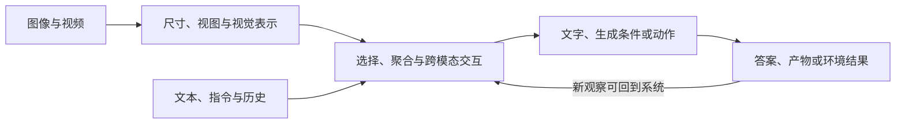

# MLLM：沿视觉证据、学习接口与任务结果建立理解

理解多模态大语言模型，先跟踪一条信息流：**原图保留什么 → 视觉表示受到什么监督 → 信息从哪里进入语言计算 → 哪些参数学到任务行为 → 输出与环境结果怎样验证。** 编码器、连接器、LLM是有用的组件地图，却不是每篇工作的必需三段式；VLMo/BEiT-3共享骨干，Flamingo在LM内部接视觉，MiniGPT-5还把输出状态接到扩散生成器。[[raw/surveys/Efficient Multimodal Large Language Models A Survey.pdf#page=4|S001 · pp.4–7 §2]] [[raw/papers/architecture/multimodal-backbones/VLMo.pdf#page=3|S014 · pp.3–5]] [[raw/papers/architecture/visual-interfaces/Flamingo.pdf#page=4|S016 · pp.4–5]] [[raw/papers/architecture/generative-interfaces/MiniGPT-5.pdf#page=3|S021 · pp.3–4]]

图为本库综合的信息关系，不要求各模型都有独立模块，也不代表每次回答都执行闭环。监督决定哪些路径被学习，评测决定哪些结果算成功。[[raw/surveys/Perception, Reason, Think, and Plan A Survey on Large Multimodal Reasoning Models.pdf#page=26|S002 · pp.26–31 §4]]

## 八个入口，各自保留一个核心问题

| 入口 | 问题与深入页 |
| --- | --- |
| [[wiki/foundations/Formalization\|基础]] | token、冻结、共享、能力证据各指什么？先区分信息、参数与任务。 |
| [[wiki/vision/Overview\|视觉]] | 目标保留什么信息？接[[wiki/vision/Objectives-and-Transfer\|预训练与迁移]]、[[wiki/vision/Resolution-and-Token-Budget\|分辨率与token]]。 |
| [[wiki/architecture/Overview\|架构]] | 谁能读谁，在哪相遇？接[[wiki/architecture/Visibility-and-Connections\|可见性与连接]]、[[wiki/architecture/Generative-Output-Interfaces\|生成输出接口]]。 |
| [[wiki/training/Overview\|训练]] | 什么监督更新谁？接[[wiki/training/Supervision-and-Stages\|数据、目标与阶段]]。 |
| [[wiki/efficiency/Overview\|效率]] | 省的是哪笔资源？接[[wiki/efficiency/Resource-Ledger\|资源账本]]。 |
| [[wiki/reasoning/Overview\|推理]] | 更多计算、新观察与环境控制各改变什么？ |
| [[wiki/evaluation/Overview\|评测]] | 谁按什么证据判断成功？接[[wiki/evaluation/Judges-and-Task-Success\|裁判与任务成功]]。 |
| [[wiki/models/Overview\|模型]] | 每一代联合改变了什么？接[[wiki/models/Family-Changes\|家族变化轴]]。 |

## 用一个问题串起地图

**本库教学例子：**给模型一页有小字的票据，要求读金额并核对合计。看不清可能来自输入缩放、编码表示或后续压缩；多写推理不能补回已丢失笔画。裁剪原图改变可用视觉证据，调用计算器改变计算接口；最后还要分别确认转写数字、算术结果、引用位置和完整要求。视觉token少、答案长、工具成功返回，均不能单独证明任务完成。输入机制依据ViT/NaViT与Qwen2-VL，证据分解依据S002，例子本身不是新增实测。[[raw/papers/vision/representation/ViT.pdf#page=4|S004 · p.4 §3.2]] [[raw/papers/vision/representation/NaViT.pdf#page=3|S006 · pp.3–5]] [[raw/papers/models/qwen/Qwen2-VL.pdf#page=4|S027 · pp.4–5]] [[raw/surveys/Perception, Reason, Think, and Plan A Survey on Large Multimodal Reasoning Models.pdf#page=26|S002 · pp.26–28 Figs6–8]]

初读走“基础→视觉→架构→训练”；评估研究结果时加“效率→评测”；关心工具、Agent、长视频再读推理和家族变化。来源唯一页负责版本、实际阅读范围和原始证据；主题负责跨来源解释。两综述与讲义分别从[[wiki/surveys/Efficient Multimodal Large Language Models A Survey|S001]]、[[wiki/surveys/Perception, Reason, Think, and Plan A Survey on Large Multimodal Reasoning Models|S002]]、[[wiki/lectures/VLM-2|S003]]进入，全部来源在[[wiki/index|索引]]。

本轮以视觉—语言为主，综述/讲义里的音频、3D或范围外论文只保留转述身份；旧笔记冻结在Raw，不增加学术证据等级。本库未复现实验，Obsidian内显示未测。摄入状态仍以来源登记与终审为准。

## 实际来源入口

[[wiki/surveys/Efficient Multimodal Large Language Models A Survey|S001 Efficient-MLLM-Survey]] · [[wiki/surveys/Perception, Reason, Think, and Plan A Survey on Large Multimodal Reasoning Models|S002 Multimodal-Reasoning-Survey]] · [[wiki/papers/vision/representation/ViT|S004 ViT]] · [[wiki/papers/vision/representation/NaViT|S006 NaViT]] · [[wiki/papers/architecture/multimodal-backbones/VLMo|S014 VLMo]] · [[wiki/papers/architecture/visual-interfaces/Flamingo|S016 Flamingo]] · [[wiki/papers/architecture/generative-interfaces/MiniGPT-5|S021 MiniGPT-5]] · [[wiki/papers/models/qwen/Qwen2-VL|S027 Qwen2-VL]]。原始定位在上文；唯一页保存身份、读取范围和实验条件。
