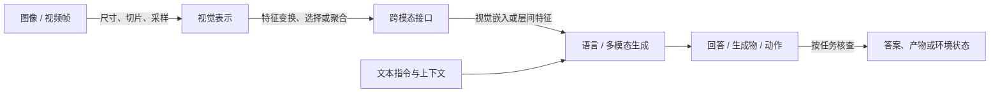

# MLLM：从视觉证据到生成与行动

理解 Multimodal Large Language Models，先跟踪一条具体的信息流：**输入保留了什么，视觉表示怎样形成，哪些信息进入语言模型，训练怎样使接口有效，输出又怎样被检验。** S001 的编码器—连接器—语言模型框架提供组件地图，S003 展示这些组件怎样共享、专用或跨层交互；S002 则追问生成答案之后，解释和环境任务是否真的成立。以下是本库据三份材料组织的阅读地图。[[raw/surveys/Efficient Multimodal Large Language Models A Survey.pdf#page=4|S001 · §2 · pp.4–7、Fig.3]] [[raw/lectures/VLM-2.pdf#page=4|S003 · VLMo · pp.4–7]] [[raw/surveys/Perception, Reason, Think, and Plan A Survey on Large Multimodal Reasoning Models.pdf#page=26|S002 · §4.1–4.2 · pp.26–30]]

本轮独立材料以视觉—语言为主；音频、3D 与其他模态目前主要由综述或讲义提供地图性介绍，不意味着已有相应一手论文覆盖。

## 先沿信息走一遍

箭头表示信息传递和核查关系，不表示所有模型都有互相分离的三个模块。连接可能位于输入端、cross-attention 或语言模型内部；有些系统还会把工具结果和新观察再次输入模型。训练决定哪些接口与参数被学习，评价决定上述哪一项可观察结果算成功。[[raw/lectures/VLM-2.pdf#page=22|S003 · BLIP-2 · pp.22–23]] [[raw/lectures/VLM-2.pdf#page=60|S003 · DeepStack · p.60]] [[raw/lectures/VLM-2.pdf#page=74|S003 · CogVLM · p.74]] [[raw/surveys/Perception, Reason, Think, and Plan A Survey on Large Multimodal Reasoning Models.pdf#page=41|S002 · §5.5 · p.41]]

例如，小字看不清可能发生在 resize 时、视觉编码时，或后续 token 压缩时。增加语言推理长度不能保证补回已经丢失的字形；重新裁剪原图则改变了可用证据。前一句是本库沿信息流的分析，后一句有 S002 图6的工具个案作为说明，个案并未证明普遍收益。[[raw/surveys/Efficient Multimodal Large Language Models A Survey.pdf#page=7|S001 · §2.4 · pp.7–9]] [[raw/surveys/Perception, Reason, Think, and Plan A Survey on Large Multimodal Reasoning Models.pdf#page=26|S002 · §4.1、Fig.6 · p.26]]

## 八个视角回答八类问题

| 入口 | 持续追问的问题 | 先保留的判断 |
| --- | --- | --- |
| [[wiki/foundations/Formalization\|基础定义]] | token、编码器、连接器与能力描述分别指什么？ | 先把输入、参数和任务证据分开，再谈模型强弱。 |
| [[wiki/vision/Overview\|视觉表示]] | 图像细节怎样变成可用特征？ | 分辨率、patch、局部视图、位置和压缩分别作用于不同环节。 |
| [[wiki/architecture/Overview\|架构与接口]] | 视觉和语言在哪里交互，共享什么？ | 共享参数、联合读取 token、专用模块与冻结范围是不同维度。 |
| [[wiki/training/Overview\|训练与数据]] | 什么数据和目标更新了哪些参数？ | 阶段名不够；要同时记录监督内容、目标、开放参数和预算。 |
| [[wiki/efficiency/Overview\|效率与成本]] | 节约的资源发生在哪里？ | 输入 token、激活参数、训练状态、解码和工具成本须分别记账。 |
| [[wiki/reasoning/Overview\|推理与交互]] | 增加步骤、搜索或观察，怎样改变解题？ | 长解释、正确答案、实际行动和目标完成各需证据。 |
| [[wiki/evaluation/Overview\|评测与证据]] | 测的是哪项要求，谁来判，条件是什么？ | 分数的任务范围、数据划分和判分协议限定其含义。 |
| [[wiki/models/Overview\|模型演进]] | 一代模型究竟同时改变了什么？ | 用变化轴读家族，不能把联合升级解释为单组件的因果贡献。 |

这些视角是本库的组织方式，来自 S001 的组件/训练/效率地图、S002 的推理/任务/判分地图和 S003 的机制教学，并非三份材料共同提出的一套分类。[[raw/surveys/Efficient Multimodal Large Language Models A Survey.pdf#page=2|S001 · §1–2 · pp.2–4]] [[raw/surveys/Perception, Reason, Think, and Plan A Survey on Large Multimodal Reasoning Models.pdf#page=32|S002 · §5、Fig.10 · p.32]] [[raw/lectures/VLM-2.pdf#page=2|S003 · 课程导航 · p.2]]

## 材料身份决定怎样读

本库把视觉编码器论文、视觉语言预训练模型（VLM）、接入大语言模型的 MLLM 和官方文档放在相应目录。**这首先是阅读对象的区分，不是互斥的学术命名标准。** 视觉编码器研究可能不含对话 LLM；VLM 可以研究检索、匹配、掩码建模和生成；MLLM 的接口问题还涉及语言骨干与指令学习。课程中的 BEiT-3 多任务形态与 BLIP-2 冻结骨干接口展示了这种差别。官方文档则按其版本和公开功能核读，不能仅凭模型名称套用方法论文的实验结论。[[raw/lectures/VLM-2.pdf#page=8|S003 · BEiT-3 · pp.8–13]] [[raw/lectures/VLM-2.pdf#page=20|S003 · BLIP-2 · pp.20–23]]

初读可走“基础 → 视觉 → 架构 → 训练”；要评估一项结果，接“效率 → 评测”；关心 Agent 或多模态思考，再读“推理 → 模型变化轴”，回到具体任务的证据。三份地图材料分别从 [[wiki/surveys/Efficient Multimodal Large Language Models A Survey|S001 效率综述]]、[[wiki/surveys/Perception, Reason, Think, and Plan A Survey on Large Multimodal Reasoning Models|S002 推理综述]]、[[wiki/lectures/VLM-2|S003 课程讲义]] 进入。

当前是施工中的初始综合：本页及八视角的学术事实以已审查的 S001–S003 为依据；所引模型机制仍保留综述/讲义转述身份。其他来源的获取、阅读与审核进度见 [[wiki/index|索引]] 和 [[maintenance/source-registry.json|来源登记]]。Obsidian 内显示未测。
