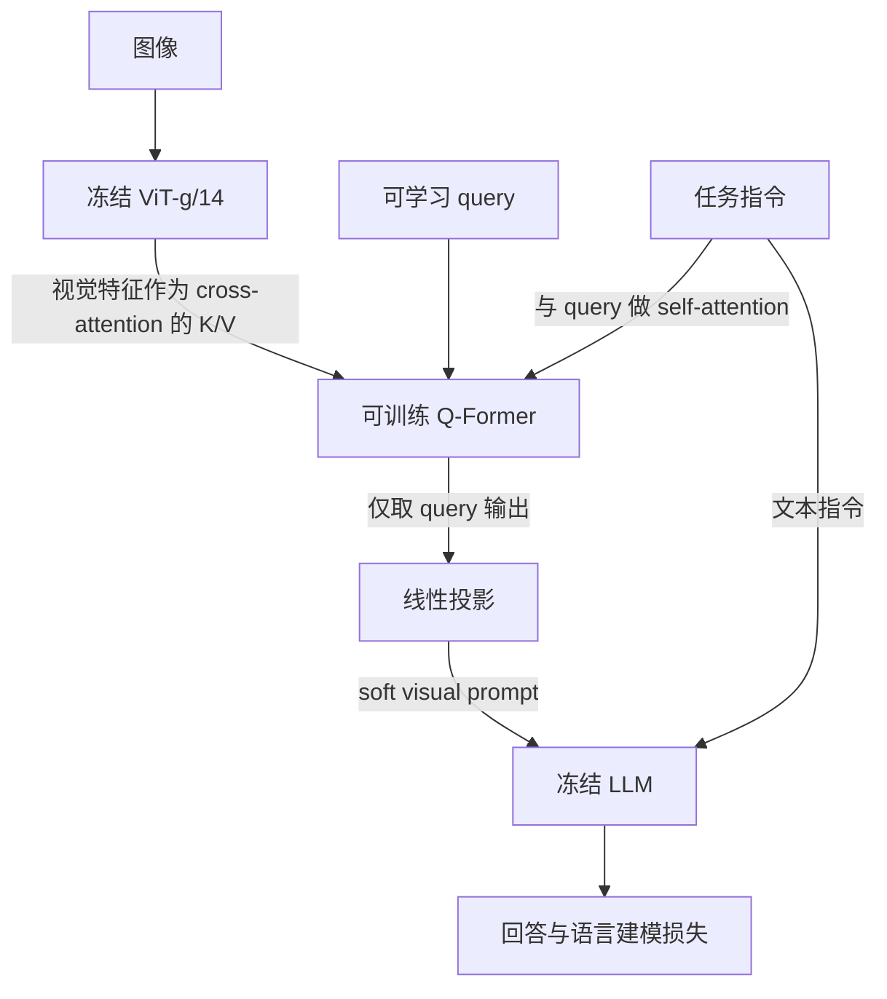

# InstructBLIP：在视觉特征被压缩之前引入任务指令

> [!important] 核心判断
> InstructBLIP 不只把指令交给最后的LLM：它也让指令token与Q-Former的query交互，使传入LLM的视觉表示随任务变化。实验同时改变了指令数据覆盖、采样策略和特征提取方式；模型总成绩不能全归功于“instruction-aware”一项。held-out是本轮指令微调的留出评估，其中有留出数据集，也有留出整个任务类别；不是证明所有预训练阶段都从未接触相关知识。[[raw/papers/architecture/connectors/InstructBLIP.pdf#page=4|§2.2–2.3]] [[raw/papers/architecture/connectors/InstructBLIP.pdf#page=5|图3]]

## 来源、版本和阅读

- **身份**：Wenliang Dai、Junnan Li、Dongxu Li 等，*InstructBLIP: Towards General-purpose Vision-Language Models with Instruction Tuning*；Salesforce Research、HKUST、NTU。首页标为Preprint / Under review；此处不借后来的发表信息改写固定版本。
- **版本与原件**：arXiv:2305.06500v2，2023-06-15；[固定URL](https://arxiv.org/pdf/2305.06500v2)，[[raw/papers/architecture/connectors/InstructBLIP.pdf]]，17页。SHA-256：`31c03f3ee54016e6da875593ed9d98419899d4164af638dc8cca76a4871beb35`，已复核。
- **实际阅读**：2026-10-31；正文pp.1–10、附录pp.13–17（风险、案例、数据集、指令模板、推理prompt）；参考文献逐项未核。渲染查看pp.4–9的任务划分图、架构／采样公式、结果和消融。以下PDF页序与印刷页一致。未审计代码、运行实验或实测Obsidian。
- **冻结旧输入**：[[raw/notes/多模态经典/2023-InstructBLIP总结.tex]]与[[raw/notes/多模态经典/Latex_out/2023-InstructBLIP总结.pdf]]；本次对照TeX说明与其代码摘录，编译PDF只作包成员登记。旧解释不是新增证据。

## 为什么同一张图需要不同的视觉表示

图像描述、问局部颜色、阅读文字和选择正确选项需要保留的视觉信息不同。如果Q-Former在读到任务之前就把图压成固定视觉前缀，后续LLM只能在已经保留的信息里回答。作者因此让任务在“提取”阶段就生效。这里改变的是**Q-Former输出**，冻结ViT对同一图的原始特征不会随指令改变；也不意味着32个槽位必然保全所有任务细节。[[raw/papers/architecture/connectors/InstructBLIP.pdf#page=4|§2.3]] [[raw/papers/architecture/connectors/InstructBLIP.pdf#page=5|图3与说明]]

本库依图3整理的信息流示意。两条指令路径作用不同：Q-Former路径改变取出的视觉表示，LLM路径规定如何生成回答。不是把Q-Former内部所有指令token输出都当视觉token塞给LLM。原文以 $K$ 表示query数量；沿用BLIP-2的32-query配置可从已核BLIP-2结构理解，但本版本§2.6未单列 $K$ 的数值，不能仅凭旧代码摘录声称本轮完成配置审计。[[raw/papers/architecture/connectors/InstructBLIP.pdf#page=5|图3]] [[raw/papers/architecture/connectors/BLIP-2.pdf#page=3|§3.1，32 queries]]

> [!note] 与BLIP-2的区别要限定场景
> 本文比较的是BLIP-2的zero-shot图到文生成接口。已核读的[[wiki/papers/architecture/connectors/BLIP-2|BLIP-2]]在**监督VQA微调**时本来就把问题输入Q-Former（其p13图7）。因此不能说InstructBLIP首次让任何Q-Former读取文字；它把这种任务条件化用于广泛指令训练和留出泛化研究。[[raw/papers/architecture/connectors/BLIP-2.pdf#page=7|§4.3]] [[raw/papers/architecture/connectors/BLIP-2.pdf#page=13|图7]]

## 训练不是重新训练视觉与语言骨干

模型从两阶段预训练的BLIP-2初始化；使用同一个ViT-g/14，LLM为FlanT5-XL（3B）、FlanT5-XXL（11B）、Vicuna-7B／13B。Vicuna没有原BLIP-2 checkpoint，作者先按BLIP-2流程另做预训练。指令阶段冻结视觉编码器与LLM、微调Q-Former桥接部分，用条件回答的language modeling loss；不是将三个BLIP-2预训练loss直接当指令训练目标。[[raw/papers/architecture/connectors/InstructBLIP.pdf#page=5|§2.3]] [[raw/papers/architecture/connectors/InstructBLIP.pdf#page=6|§2.6]]

图像224×224；最多60k steps，每3k步验证，选一个checkpoint用于所有数据集。3B／7B／11或13B分别batch192／128／64；16张A100 40GB，指令阶段报告1.5天内完成。此预算不包含先前BLIP-2、视觉模型或LLM预训练。[[raw/papers/architecture/connectors/InstructBLIP.pdf#page=6|§2.6]] [[raw/papers/architecture/connectors/InstructBLIP.pdf#page=8|§3.5]]

## 26项数据如何组成held-in／held-out

论文将数据／任务组合组织为26项、11类，其中13项held-in用于指令训练、13项held-out用于zero-shot评估。这个计数不是26份互不相干的原始图像库：图2里VQAv2、OKVQA、A-OKVQA还分别承担question generation，LLaVA-Instruct分成对话、复杂推理、详细描述三项。[[raw/papers/architecture/connectors/InstructBLIP.pdf#page=4|图2]]

| 留出层级 | 含义 | 代表数据 |
| --- | --- | --- |
| 数据集留出，任务类型已见 | 测已知任务上的分布迁移 | NoCaps/Flickr30K caption、VizWiz VQA、TextVQA |
| 整个任务类别留出 | 指令训练没有该任务类别 | 视觉推理GQA/VSR/IconQA；视频QA；Visual Dialog；HatefulMemes分类 |

held-in包括COCO caption、Web CapFilt（14M图文对）、TextCaps、VQAv2、OKVQA、A-OKVQA、OCR-VQA及相应VQG／LLaVA指令组成。作者声明选择数据时避免跨数据集评估样本进入held-in训练；本次未重新运行图像去重，也不能把该声明推广为全部历史骨干数据无重叠。具体split包括NoCaps val、Flickr30K test、GQA balanced test-dev、VSR zero-shot split test、TextVQA val、Visual Dialog val、ScienceQA test的image-context子集。[[raw/papers/architecture/connectors/InstructBLIP.pdf#page=4|§2.2]] [[raw/papers/architecture/connectors/InstructBLIP.pdf#page=16|附录C，表4]]

模板把任务说明与输入合并；有些模板明确要求short／briefly，目的是让短答案与指令条件关联，而不是训练模型对所有问题都简答。LLaVA-Instruct已有自然指令，不再加模板。场景文字任务会额外输入OCR tokens，TextVQA效果不能解释成单凭224像素视觉特征自行读字的能力。[[raw/papers/architecture/connectors/InstructBLIP.pdf#page=3|§2.1]] [[raw/papers/architecture/connectors/InstructBLIP.pdf#page=17|附录D–E]]

采样按数据集规模平方根平衡：

$$
p_d=\frac{\sqrt{S_d}}{\sum_{i=1}^{D}\sqrt{S_i}}.
$$

这里是选数据集的概率，不是每个样本同样的全局概率；还手调降低多选A-OKVQA、提高开放OKVQA权重。不能把最终混合配比说成完全由公式自动决定。[[raw/papers/architecture/connectors/InstructBLIP.pdf#page=5|§2.4]]

## 评估接口直接影响分数含义

caption与开放VQA通常直接生成；ScienceQA、IconQA、A-OKVQA多选、HatefulMemes、Visual Dialog、MSVD、MSRVTT采用候选答案log-likelihood ranking。二分类还扩展yes/true等verbalizer。视频仅均匀取4帧，各帧独立经ViT与Q-Former后拼接视觉表示；本轮未用时序视频数据训练，成功不等于验证连续视频跟踪或精确时序定位。[[raw/papers/architecture/connectors/InstructBLIP.pdf#page=5|§2.5]] [[raw/papers/architecture/connectors/InstructBLIP.pdf#page=6|§2.5续]]

| held-out任务 | BLIP-2 FlanT5-XL | InstructBLIP FlanT5-XL | 指标与边界 |
| --- | ---: | ---: | --- |
| NoCaps val | 104.5 | 119.9 | CIDEr；不是VQA百分比 |
| GQA test-dev | 44.0 | 48.4 | top-1 accuracy |
| ScienceQA image-context test | 54.9 | 70.4 | 候选排序accuracy；仅图像子集 |
| TextVQA val | 43.1 | 46.6 | 表1top-1；输入包含OCR tokens |
| iVQA test | 40.4 | 53.1 | iVQA accuracy；4帧 |

数据来自表1。论文“13项均达到新SotA”是**模型家族在所列比较范围中的最佳结果**，不是每一个InstructBLIP变体对每个BLIP-2变体都提高；例如FlanT5-XXL在VSR为65.6，低于对应BLIP-2的68.2。Visual Dialog使用MRR，HatefulMemes使用AUC；不能与其他百分比简单当成同一种准确率。[[raw/papers/architecture/connectors/InstructBLIP.pdf#page=6|表1]] [[raw/papers/architecture/connectors/InstructBLIP.pdf#page=7|§3.1]]

## 消融支持哪些机制解释

- 在FlanT5-XL中，移除instruction-aware视觉提取，ScienceQA image-context由70.4到63.4、VizWiz32.7到25.1；Vicuna-7B的iVQA由52.2到36.8。这是在其训练／推理条件下支持指令进入Q-Former有用，不能证明注意力永远定位正确。[[raw/papers/architecture/connectors/InstructBLIP.pdf#page=7|表2]]
- 去掉balanced sampling通常降低结果，但不是每格都差，例如Vicuna-7B的IconQA反而43.1到43.5。表2held-in平均只算COCO Caption／OKVQA／A-OKVQA／TextCaps四项；不要和图4“全部held-in平均”混用。[[raw/papers/architecture/connectors/InstructBLIP.pdf#page=7|表2]]
- 同BLIP-2 FlanT5-XL骨干、同训练设置，图4中多任务plain input／dataset-name方案的held-out平均约45.5–46.8，完整指令训练52.9；该平均由8个指定held-out集组成。它支持这里自然语言指令格式优于所试多任务格式，不能推广为所有多任务方法无泛化能力。[[raw/papers/architecture/connectors/InstructBLIP.pdf#page=8|§3.4，图4]]
- ScienceQA image-context **90.7**来自另行下游微调的FlanT5-XXL（表3），不是表1的zero-shot70.6。这里保持视觉编码器冻结与224分辨率；与BLIP-2论文下游解冻ViT的配置不同。[[raw/papers/architecture/connectors/InstructBLIP.pdf#page=8|§3.5]] [[raw/papers/architecture/connectors/InstructBLIP.pdf#page=9|表3]]

## 旧笔记纠错与剩余边界

旧稿称“图片解释和推理优于GPT-4”，但附录B只有选择性案例，有些对照答案取自他人论文、有些来自在线demo；不是受控总体胜率评估。本页只保留作者展示了这些例子的事实。旧稿“确保不会遗漏关键细节”“同任务跨图实现信息转移”是过强机制解释，现改为待检验假设。[[raw/papers/architecture/connectors/InstructBLIP.pdf#page=13|附录B，图5]] [[raw/papers/architecture/connectors/InstructBLIP.pdf#page=15|图7]]

旧稿把BLIP-2第一阶段写成ITC／MLM／ITM；应为ITC／ITG／ITM，其中ITG是图像条件因果文本生成，不是普通masked language modeling。旧稿将输入`query_embeds`说成“Q-Former输出”也混淆了初始learned query与最终条件化表示；本页按实际结构区分。[[raw/papers/architecture/connectors/BLIP-2.pdf#page=3|§3.1–3.2]]

本文仍继承冻结LLM的幻觉与偏差；高分不等于回答一定有视觉依据。下一步可查：对于OCR与细粒度任务，提升来自外部OCR、任务数据还是instruction-aware取样；相同视觉token预算下何种指令改变最容易漏信息。当前为本库问题，不是已完成实验。[[raw/papers/architecture/connectors/InstructBLIP.pdf#page=13|附录A]]

本库整合主题：指令条件化视觉连接、指令数据与采样、held-out泛化及评测输入条件；实际双向主题关系见页末。

## 实际整合关系

支撑指令条件化视觉提取、数据采样与held-out层级；外部OCR及候选评分是结果条件。

- [[wiki/architecture/Visibility-and-Connections|可见性、路由与连接：视觉信息在哪里与语言相遇？]]。
- [[wiki/training/Supervision-and-Stages|监督与阶段：数据、目标、开放参数和预算如何一起改变？]]。
- [[wiki/evaluation/Judges-and-Task-Success|裁判与任务成功：答案、解释、生成物和终态怎样分别取证？]]。
- [[wiki/models/Family-Changes|家族变化轴：输入、接口、数据和计算怎样共同演进？]]。
