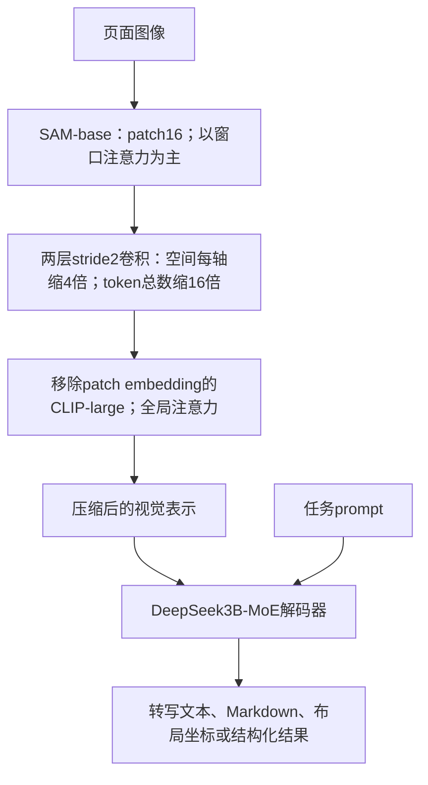

# DeepSeek-OCR：用较少视觉 token 解码文档，探索光学上下文压缩

> [!note] 主归属（本库导航判断）
> 主问题是视觉文本压缩与恢复的资源折中；直接证据限 OCR/文档解析，不能由 context-compression 目录推成一般长上下文推理已验证。 [[raw/papers/efficiency/context-compression/DeepSeek-OCR.pdf#page=3|§1；p.19 §6 明确限制]]

## 原件、版本与实读范围

Haoran Wei、Yaofeng Sun、Yukun Li（DeepSeek-AI），*DeepSeek-OCR: Contexts Optical Compression*；arXiv **2510.18234v1**，2025-10-21，22 页。[版本入口](https://arxiv.org/abs/2510.18234v1)。原件 [[raw/papers/efficiency/context-compression/DeepSeek-OCR.pdf]]，SHA-256 `a7297788968f8ad9ed21bcd273110814e4889efbbc99bfea86dca12205797a90`。旧稿指向官方 GitHub 同作 PDF，本页证据固定为上述 arXiv v1，不能把之后 OCR-V2 实现混入。

2026-10-31 实读 pp.1–19 正文（含全部定性研究与讨论文字）；pp.20–22 参考文献未追读，无另列实验附录。实际渲染核对 p.5 Figure 3、p.6 Figure 4 / Table 1 / Eq.(1)、pp.8–9 Figures 5–6、pp.10–12 Tables 2–4、pp.13、15 的 deep parsing 示例及 p.19 Figure 13。其他示例未逐字人工校验转写，非独立 OCR 质量审计。未运行代码、模型、基准或 Obsidian。

## 论文真正验证的命题

这篇报告将 OCR 作为“视觉压缩—文本解码”的试验台：把富含文字的二维页面编码为较少视觉位置，再让语言解码器生成原文或结构化标记。它直接测量的是 **给定文档分布、分辨率和视觉 token 预算下的转写/解析质量**。作者进一步设想把旧对话渲染为图像，并降低旧图分辨率来节省上下文；结论同时明确，OCR 本身不足以完全验证 context optical compression，数字/光学文本混合预训练、needle-in-a-haystack 等仍属未来工作。不能将约 97% OCR precision 写成“十倍压缩仍保持 97% 一般推理能力”，也不是整页 97% 概率完全无错。[[raw/papers/efficiency/context-compression/DeepSeek-OCR.pdf#page=3|§1]] [[raw/papers/efficiency/context-compression/DeepSeek-OCR.pdf#page=19|§5–6]]

## 信息通路：先压缩，再进入全局注意力

DeepEncoder 约 380M，主要为 SAM-base 80M 和 CLIP-large 300M；解码器为 DeepSeek3B-MoE，总参数约 3B、激活约 570M（64 routed experts 中选 6，加 2 shared）。570M 是**解码器**激活口径，不含整个视觉编码器，不能直接称系统总激活量。[[raw/papers/efficiency/context-compression/DeepSeek-OCR.pdf#page=5|§3.1]] [[raw/papers/efficiency/context-compression/DeepSeek-OCR.pdf#page=7|§3.3]]

Figure 3 是串联结构，不是第一代 VL 的独立 SAM/SigLIP 双塔。1024² 输入先有 $64\times64=4096$ patch token，两层卷积（kernel 3、stride 2、padding 1，通道从 256 到 1024）使 token 数降到 **256**，然后才进入全局注意力。这样避免让昂贵的全局模块处理全部 4096 位置；“16×”说的是 token **数量**，不是边长缩 16 倍。CLIP 的第一层图像 patch embedding 被移除，因为输入是上一模块的 token。原图还画出压缩特征绕过 CLIP 的旁路汇合，但正文没有给出完整合并算子/连接器维度；不从图中的圈号或旧代码截图强行推定 add/concat 的实现。[[raw/papers/efficiency/context-compression/DeepSeek-OCR.pdf#page=5|Figure 3 / §3.2.1]] [[raw/papers/efficiency/context-compression/DeepSeek-OCR.pdf#page=6|§3.2.1续]]

Eq.(2) 将解码器抽象为 $\hat X=f_{dec}(Z)$，由 $n$ 个 latent vision token 重建 $N$ 个文本位置（$n\le N$）。这是学习到的非线性解码关系，并非可逆编码定理。文本输出依然要逐 token 生成；节省输入视觉序列不意味着输出转写没有成本。[[raw/papers/efficiency/context-compression/DeepSeek-OCR.pdf#page=7|Eq.(2)]]

## 分辨率、实际 token 与有效 token

| 模式 | 输入处理 | 编码器输出 token |
| --- | --- | --- |
| Tiny | 直接 resize 512² | 64 |
| Small | 直接 resize 640² | 100 |
| Base | 保持宽高比并 padding 至 1024² | 256 |
| Large | 保持宽高比并 padding 至 1280² | 400 |
| Gundam | $n$ 张 640² 局部 tile + 1024² 全局图 | $100n+256$ |
| Gundam-M / Master | $n$ 张 1024² 局部 tile + 1280² 全局图 | $256n+400$ |

常规动态切块 $n\in[2,9]$，原图宽高都小于 640 时 $n=0$、Gundam 退化为 Base；Gundam-M 是在已训练模型上用 6M sampled data 继续训练得到，**不是与其他模式完全同一训练条件**。动态模式与多分辨率依赖位置编码插值；原文将切块方法归于 InternVL2，不把“动态分辨率”全部等同 NaViT 或一个特定 LLaVA 版本。[[raw/papers/efficiency/context-compression/DeepSeek-OCR.pdf#page=6|Table 1 / §3.2.2]] [[raw/papers/efficiency/context-compression/DeepSeek-OCR.pdf#page=7|Gundam / Master]] [[raw/papers/efficiency/context-compression/DeepSeek-OCR.pdf#page=9|§3.5]]

padding 后作者定义

$$
N_{valid}=\left\lceil N_{actual}\frac{\min(w,h)}{\max(w,h)}\right\rceil,
$$

即 Eq.(1) 的等价写法。它估计非 padding 区域对应的有效位置，**不能把实际 attention 预算由 256 自动改成 182**。Table 3 的 Base `256(182)`、Large `400(285)` 括号内就是此口径。Figure 4 示意中 $R$ 的文字写法与 Eq.(1) 不一致，本页采用正式公式并保留这一差异，不声称二者等价。[[raw/papers/efficiency/context-compression/DeepSeek-OCR.pdf#page=6|Figure 4 / Eq.(1)]] [[raw/papers/efficiency/context-compression/DeepSeek-OCR.pdf#page=11|Table 3 注释]]

## 数据、输出表示与训练责任

OCR 1.0 包括传统文档与自然场景文字。30M PDF 页约覆盖 100 种语言，其中中英约 25M、其他约 5M；粗标注从 fitz 提取，细标注将段落类别/坐标与文字交错，坐标归一到 1000 bins，包含中英各 2M 页及少数语言数据生成流程。另有 3M Word 数据、中英自然场景 OCR 各 10M 样本。**自动抽取或模型标注不是逐条人工正确性保证**。OCR 2.0 则有 10M 合成图表→HTML table、5M 化学结构→SMILES、1M 平面几何→线段/坐标字典；几何结构化不等于证明几何题。[[raw/papers/efficiency/context-compression/DeepSeek-OCR.pdf#page=7|§3.4.1]] [[raw/papers/efficiency/context-compression/DeepSeek-OCR.pdf#page=8|Figure 5 / OCR 1.0]] [[raw/papers/efficiency/context-compression/DeepSeek-OCR.pdf#page=9|Figure 6 / OCR 2.0]]

| 训练部分 | 更新与冻结 | 数据/目标 | 预算 |
| --- | --- | --- | --- |
| DeepEncoder 预训练 | 用小型语言模型作 next-token prediction 框架，训练视觉编码器；本节没有明确交代小语言模型各参数是否冻结 | 全部 OCR 1.0/2.0 + LAION 100M general samples | 2 epochs；batch 1280；长度 4096；AdamW、cosine、LR $5\times10^{-5}$ |
| DeepSeek-OCR 训练 | **SAM+compressor 冻结**在 PP0；CLIP 更新在 PP1；12 层 MoE decoder 分到 PP2/PP3 训练 | 70% OCR、20% general vision、10% text-only；长度 8192 | 20 节点×8 A100-40G；DP 40；global batch 640；AdamW、step schedule、初始 LR $3\times10^{-5}$ |

正文报告文本/多模态训练吞吐分别为 90B/70B tokens/day，但没有给该阶段总训练天数或总 token 暴露量，不能从数据占比替代计算预算。p.18 明确**没有 SFT 阶段，模型不是 chatbot**，部分能力要用 completion prompt 激活。20% 通用视觉数据主要保留接口，作者自己不把它定位成 general VLM。[[raw/papers/efficiency/context-compression/DeepSeek-OCR.pdf#page=9|§3.4.3–3.5]] [[raw/papers/efficiency/context-compression/DeepSeek-OCR.pdf#page=10|§3.5.1–3.5.2]] [[raw/papers/efficiency/context-compression/DeepSeek-OCR.pdf#page=18|Figure 12 图注]]

## 压缩实验：100 页英文材料上的解码曲线

压缩比定义为

$$r=\frac{\text{ground-truth 文本经本模型 tokenizer 的 token 数}}{\text{DeepEncoder 输出视觉 token 数}}.$$

分子不是字符数、单词数或原始字节；分母也不是图片文件大小。作者从现有 Fox benchmark 选出 **600–1300 token 的英文文档，恰好 100 页**，词表约 129K，用 `<image>\nFree OCR.` 控制无布局转写，比较 Tiny 64 与 Small 100 tokens。这个子集/实验用于观察压缩率边界，既非无限长文本，也没有证明不同 tokenizer 下倍率不变。[[raw/papers/efficiency/context-compression/DeepSeek-OCR.pdf#page=10|§4.1 / Table 2]]

| 文本长度分桶 | 页数 | 64 视觉 token：precision / 压缩比 | 100 视觉 token：precision / 压缩比 |
| --- | --- | --- | --- |
| 600–700 | 7 | 96.5% / 10.5× | 98.5% / 6.7× |
| 900–1000 | 14 | 85.9% / 15.1× | 96.8% / 9.7× |
| 1200–1300 | **4** | 59.1% / 19.7× | 87.1% / 12.6× |

这是 Table 2 的部分行，不把其分桶 precision 改称 exact-document accuracy。Figure 1 的个别小数与 Table 2 有 0.1 点差异，本页以 Table 2 为记录口径。报告未在 §4.1 进一步展开 precision 的字符/词匹配实现与置信区间，本次也未审 Fox 代码；作者称格式不匹配会低估准确性，但未给剔除格式误差后的人工复核数，不能替作者校正分数。低分辨率下文字模糊、长文布局更复杂是作者提出的可能解释，未用独立因素消融验证。[[raw/papers/efficiency/context-compression/DeepSeek-OCR.pdf#page=1|Figure 1]] [[raw/papers/efficiency/context-compression/DeepSeek-OCR.pdf#page=10|Table 2]] [[raw/papers/efficiency/context-compression/DeepSeek-OCR.pdf#page=11|§4.1续]]

## 实用文档解析：读文本，还要读公式、表格与顺序

OmniDocBench Table 3 的指标均标为 edit distance（越低越好），分英文/中文及 text、formula、table、order；不能把布局与读取顺序错误隐藏在单个 OCR 百分比里。关键条件如下：

| 作者报告配置 | 平均视觉 token/页 | 英文 overall ED | 中文 overall ED |
| --- | --- | --- | --- |
| GOT-OCR2.0 | 256 | 0.287 | 0.411 |
| DeepSeek-OCR Small | 100 | 0.221 | 0.284 |
| DeepSeek-OCR Large | 400（有效285） | 0.138 | 0.208 |
| MinerU2.0，end-to-end 行 | 6790 | 0.133 | 0.238 |
| DeepSeek-OCR Gundam | **795，平均值** | 0.127 | 0.181 |
| dots.ocr，200dpi | 5545 | 0.125 | 0.160 |
| DeepSeek-OCR Gundam-M，200dpi | **1853** | 0.123 | 0.157 |

这里“少于 800”是 Gundam 在这个数据集上的平均数，不是每页最大值；其公式在 $n=9$ 时为 1156。Gundam-M 的更好成绩使用更多 token、200dpi 输入处理以及继续训练，不能记在 795-token 配置名下。总体更低也不代表所有字段更低：200dpi dots.ocr 英文 text ED 0.032 优于 Gundam-M 的 0.049。表内 pipeline MinerU-2.1.1 与 end-to-end MinerU2.0 还是不同列组/版本，不得混为一个基线。[[raw/papers/efficiency/context-compression/DeepSeek-OCR.pdf#page=11|Table 3]]

Table 4 分类结果提示信息密度很关键：Tiny 的 slides ED 0.116，而 newspaper 0.94；报纸到 Gundam 为 0.122、Master 为 0.099。它不能证明“文档越难只需固定倍率就可解决”。该表 Gundam financial report 的原数为 **0.289**，不按邻行趋势擅改为 0.0289；Table 4 的 overall（如 Gundam 0.083）与 Table 3 英/中 overall 并非直接相同数值，报告未在此充分交代聚合差异，本页并列保留，不合并作一个总榜。[[raw/papers/efficiency/context-compression/DeepSeek-OCR.pdf#page=12|Table 4 / §4.2]]

deep parsing 是先解析文档布局，再**二次调用**模型处理其中的图表、化学式、几何或自然图像，常用 `Parse the figure.`；图表可输出 HTML 表、化学结构输出 SMILES。示例展示接口可组合，不代表单次页面调用自动准确完成所有科学推理，也没有此处逐类量化准确率。论文关于单 A100-40G 每日 200k+ 页、20 节点每日 33M 页的数据生产能力是作者生产报告，未给统一页长、输出长度、失败重试和质量阈值，不能当本库独立测速或等质量跨模型比较。[[raw/papers/efficiency/context-compression/DeepSeek-OCR.pdf#page=12|§4.3.1]] [[raw/papers/efficiency/context-compression/DeepSeek-OCR.pdf#page=13|Figure 7]] [[raw/papers/efficiency/context-compression/DeepSeek-OCR.pdf#page=15|Figure 9]] [[raw/papers/efficiency/context-compression/DeepSeek-OCR.pdf#page=1|摘要]] [[raw/papers/efficiency/context-compression/DeepSeek-OCR.pdf#page=3|§1]]

## 旧稿修订、未验证方向

冻结二手包：[[raw/notes/MLLM实例/Deepseek/DeepSeek-OCR总结.tex]]、[[raw/notes/MLLM实例/Deepseek/Latex_out/DeepSeek-OCR总结.pdf]]；本次实际对照 TeX 正文，保留全部旧附件，不回写。

- 旧稿“先对齐，再 Instruction Tuning”与“猜测全参数训练”被原文纠正：第二阶段 SAM/compressor 冻结，且没有 SFT。旧稿后文其实已写冻结配置，现统一其内部矛盾。
- 旧稿第一阶段“冻结 LLM”没有在所读 §3.5.1 中明确依据，本页保留未确认，不用常见配方补空。
- 旧稿 OCR-V1 `2048→1280`、OCR-V2 `896→1280` 以及 `DeepEncoder V2` 来自代码/后续版本解释，不能放进本 arXiv v1 的已核方法；本次没有审相应实现。
- 区分编码器内的 local/global attention 与动态模式局部 tiles/全局 thumbnail，它们是不同层次的“局部/全局”；不把串行编码器重新说成两个并行独立塔。
- 旧稿“实测 dots.ocr 更好”保留为旧输入的个人观察，本次无复现配置；本页仅比较原报告有条件的各字段，不继承未经复核的实测身份。
- Figure 13 的人类遗忘类比是作者提案。缩图会丢掉哪些事实、少量字符错误是否破坏代码/数字推理、encoder与渲染成本何时抵消 KV 节省，均需后续任务实验。论文说可沿用 VLM infrastructure，并不证明真正“零额外开销”。[[raw/papers/efficiency/context-compression/DeepSeek-OCR.pdf#page=12|§4.1续]] [[raw/papers/efficiency/context-compression/DeepSeek-OCR.pdf#page=19|Figure 13 / §6]]

## 主题落点

[[wiki/vision/Overview]] / [[wiki/architecture/Overview]]：压缩置于全局注意力前；[[wiki/efficiency/Overview]]：输入 token 数、有效位置与运行成本分离；[[wiki/evaluation/Overview]]：OCR 转写、布局解析和长上下文推理是不同测量目标；[[wiki/reasoning/Overview]]：OCR 不能替代跨文档推理；[[wiki/training/Overview]]、[[wiki/models/Overview]]：领域数据与冻结模块。实际双向主题关系见页末。

英文检索词：contexts optical compression；DeepEncoder；window attention；vision-text compression ratio；valid vision tokens；document parsing；reading order；deep parsing；memory forgetting。

## 实际整合关系

支撑全局attention前压缩、实际/有效位置与领域转写训练，严格区分OCR/解析和一般长上下文推理。

- [[wiki/vision/Resolution-and-Token-Budget|分辨率、packing与tiling：预算到底在哪个位置？]]。
- [[wiki/efficiency/Resource-Ledger|资源账本：视觉token、激活参数、KV与系统预算分别省在哪里？]]。
- [[wiki/evaluation/Judges-and-Task-Success|裁判与任务成功：答案、解释、生成物和终态怎样分别取证？]]。
- [[wiki/reasoning/Overview|推理与交互：增加计算、改变观察、控制环境怎样分别起作用？]]。
- [[wiki/models/Family-Changes|家族变化轴：输入、接口、数据和计算怎样共同演进？]]。
- [[wiki/training/Supervision-and-Stages|监督与阶段：数据、目标、开放参数和预算如何一起改变？]]。
