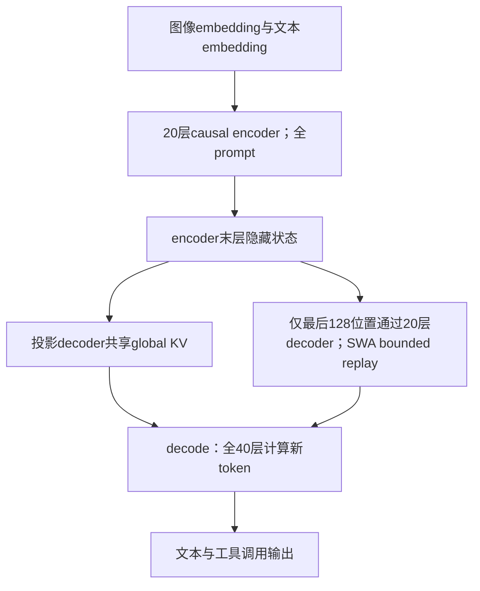

# DeepSeek-V4.1-Flash：将长上下文成本拆成计算、全局缓存和可重放局部状态

## 原件身份与实际阅读

DeepSeek-AI，*DeepSeek-V4.1-Flash: Pushing the Limits of KV Cache Compression*；arXiv **2609.19969v1**，2026-09-17，51 个 PDF 页面。[版本入口](https://arxiv.org/abs/2609.19969v1)。本地原件 [[raw/papers/models/deepseek/DeepSeek-V4.1-Flash.pdf]]；SHA-256 `0cfdda19c8e1691b5226dd0d4949e2397051268e8a823c2fb61db94ea20c4ac0`。两份旧架构/训练总结对应本报告，统一为 **S034**，不是两个学术来源。

2026-10-31 实读摘要、目录与正文 PDF pp.1–37；附录 B/C pp.47–51（scaffold 配置、effort 细分与指数长度惩罚推导）。参考文献 pp.38–45 未追引；作者名单 pp.46–47 非逐名核验。本页引用按 PDF 顺序计页；最后一页的 PDF 页序与印刷页码均为 51。实际渲染查看 p.5（加权 FLOPs 图）、pp.7、9–16（架构、公式和 Algorithm 1）、p.20 replay、p.22 参数/训练、pp.24–25 base 结果、pp.27–29 RL曲线与 reward、pp.33、35–36 后训练结果/多 agent、pp.48–51 附录图表公式。未审代码或模型权重、未进行训练/推理/benchmark 复现，Obsidian 显示未测。reading_status 只覆盖以上范围；实际主题关系见页末。

## 问题不是只有“注意力太慢”

作者关注 input-heavy agent：工具调用会不断增加 prompt，新输入需要 prefill；会话暂停/续接又要保存、加载和迁移 KV。局部 sliding-window attention（SWA）的运行时状态在固定窗口下不随上下文无限增长，但整个前缀的 **global KV** 随长度增长；若为许多会话长期保存局部状态，其累计 SSD/host 占用仍然很大。于是报告把优化分为三件事：CED 降低 prompt 的深层计算；CSA2 + FP4 降低全局 KV；Bounded Replay 以近似重算替代长期持久化 SWA。三者作用对象不同。[[raw/papers/models/deepseek/DeepSeek-V4.1-Flash.pdf#page=4|§1]] [[raw/papers/models/deepseek/DeepSeek-V4.1-Flash.pdf#page=19|§3.2.1]]

参数口径为 **552B backbone + 196B Engram 条件记忆**；prefill / decode 分别报告每 token 激活 8B / 16B，支持最长 1M-token context。552B 不能冒称包括所有 Engram 的“总参数”，8B 也不是所有推理阶段的常数。输入图像和文本、输出自回归文本；不是生成像素的扩散系统。[[raw/papers/models/deepseek/DeepSeek-V4.1-Flash.pdf#page=7|§2.1]]

## 多模态入口：视觉 token 进入同一因果主干

DeepSeek-ViT 从头训练，32 层、hidden 1024、16 heads、patch 14；将绝对位置换成 **2D-RoPE**，patch embedding 卷积换为线性投影以适配 Muon，使用 RMSNorm 和 SwiGLU。视觉特征先经 $3\times3$ pixel-unshuffle，将九个相邻位置的信息移到通道维度，再经两层 MLP（hidden 5120）映射到语言隐藏维度，插入对应 image-token 位置。该操作使空间 token 数约缩 **9 倍**，不是简单删除每九个位置中的八个。对 1344²、patch14 的方图，$96^2/9=1024$ 是由报告尺寸推算的特征位置数；不是对任意宽高比图片保证固定 1024。[[raw/papers/models/deepseek/DeepSeek-V4.1-Flash.pdf#page=8|§2.1.1]] [[raw/papers/models/deepseek/DeepSeek-V4.1-Flash.pdf#page=22|§4.2.1]]

图像/文本 token 的 MoE 路由各有一套 expert correction bias，各自按模态负载更新，以免总体均衡掩盖模态内部偏斜；**bias 用于选专家，专家输出加权仍取原始路由分数**。每层 384 routed experts 中激活 6 个，另有 1 shared expert；专家 intermediate dimension 2304，SwiGLU clamp=10。所谓 auxiliary-loss-free 是此路由偏置机制，训练仍保留权重 $10^{-4}$ 的 sequence-level balance loss，不能写成完全没有辅助均衡损失。[[raw/papers/models/deepseek/DeepSeek-V4.1-Flash.pdf#page=8|Multimodal load balancing]] [[raw/papers/models/deepseek/DeepSeek-V4.1-Flash.pdf#page=22|模型/训练配置]]

## CED：哪些 prompt 计算可以绕过 decoder

40 层因果 Transformer 分为前 20 层 causal encoder、后 20 层 decoder。二者都在因果序列上工作，不能因为叫 encoder 就理解为双向编码。对 decoder 的全局分支，KV 不依赖该层自己的深层隐藏状态，而由 encoder 末层表示产生：

$$
C_l=H_{L/2}W_l^{KV},\qquad Z_l=H_{L/2}W_l^Z,\qquad l>L/2.
$$

$C_l$ 是 KV 条目，$Z_l$ 是压缩权重。这样多数 prompt 位置只需通过 encoder，便可获得 decoder 所需 global KV；但结合本模型实际 CSA2 调度，**仅 decoder 的 Full 层生产全局 KV，其余 decoder 层共享它**，不是二十份独立 cache。Eq.(1) 说明 CED 一般形式，§2.3 和 §4.2.1 进一步约束实例。[[raw/papers/models/deepseek/DeepSeek-V4.1-Flash.pdf#page=9|§2.2 / Eq.(1)]] [[raw/papers/models/deepseek/DeepSeek-V4.1-Flash.pdf#page=11|CED 与 Full Mode]] [[raw/papers/models/deepseek/DeepSeek-V4.1-Flash.pdf#page=22|层调度]]

所有层的 SWA KV 仍由本层隐藏状态计算，因此 decoder 不能毫无代价地完全跳过：需要重放 prompt 尾部来建立 decode 初期的局部状态。对 $N\gg n_{win}$，报告给出近似计算量 $O(NL/2+n_{win}L/2)\approx O(NL/2)$，本模型 $n_{win}=128$。这解释“prefill 约减半”的条件；它不是端到端延迟、网络搬运或每种 cache miss 场景均恰好减半。[[raw/papers/models/deepseek/DeepSeek-V4.1-Flash.pdf#page=9|§2.2]] [[raw/papers/models/deepseek/DeepSeek-V4.1-Flash.pdf#page=20|Decoder SWA Bounded Replay]]

## CSA2：共享存储和共享检索结果是两件事

每个 CSA2 层都保留自己的 main Q、SWA KV 和新的 attention 输出；静态模式只决定 global KV 和稀疏索引来自哪里。

| 模式 | main KV / indexer K | Top-K 的取得 | 节省什么 |
| --- | --- | --- | --- |
| Full | 本层生成；indexer K 从 main KV 投影 | 本层 indexer Q 打分选择 | 建立后续层可共享的 cache |
| Reindex | 复用最近 Full 层 | 自己的 indexer Q 重新打分 | 保留 cache 共享，同时允许选中位置变化 |
| Reuse | 复用 Full 层的 cache | 复用最近 Full/Reindex 对同份 KV 的索引 | 同时省 cache 重复与 indexer 计算 |

CSA2 去掉第一代 CSA 压缩时相邻块的重叠及绝对位置嵌入；indexer K 从 main KV 投影，不再从 hidden states 独立走压缩路径。压缩率 $m=1$ 也是合法设置，表示不沿序列合并。只重用 Top-K 可以省打分，但本身不省 main KV 存储，这正是区分两种共享的必要性。[[raw/papers/models/deepseek/DeepSeek-V4.1-Flash.pdf#page=10|Figure 4 / §2.3]] [[raw/papers/models/deepseek/DeepSeek-V4.1-Flash.pdf#page=11|§2.3.1]]

本实例按 **零起始层号**可重述为：0–1 只有 SWA；encoder 的 2/8/14 为 Full，其他 15 层 Reuse，压缩率 2；decoder 第 20 层 Full，24/28/32/36 为 Reindex，其他 15 层 Reuse，压缩率 1。以上层号是依据正文分组换算，非本次代码核查。attention Top-K=512、query 64 heads×512维、query compression=1280；indexer 32 heads×128维。[[raw/papers/models/deepseek/DeepSeek-V4.1-Flash.pdf#page=7|Figure 3]] [[raw/papers/models/deepseek/DeepSeek-V4.1-Flash.pdf#page=22|§4.2.1]]

### 分层候选池并没有消灭所有线性扫描

decoder 第一个 Full 层先扫描全部因果可见 main KV，为自身选 Top-512，同时按 block 内**最大 index score**给块评分，最多选 2048 个 block、每块 8 位置，组成至多 **16384** 候选位置。后续 Reindex 只在此池中再选自己的 Top-512；Reuse 不打分。候选池不是最终 attention 集合，后层仍可选不同条目，却不能越过首层漏掉的块。固定候选上限使**后续 indexer**每 query 打分量不随上下文增长，首个 Full 的完整扫描仍然存在。该限制在 post-training 引入，训推一致施加；不称整模型复杂度严格常数。[[raw/papers/models/deepseek/DeepSeek-V4.1-Flash.pdf#page=11|Figure 5 / §2.3.2]] [[raw/papers/models/deepseek/DeepSeek-V4.1-Flash.pdf#page=12|候选池说明]]

## FP4 与 SWA Bounded Replay：缓存收益的口径

**主 KV 的 FP4** 使用 E2M1、每 16 channels 一个 E4M3 scale，类似 NVFP4 但去掉二级 global scale；缓存 RoPE 后再量化，读入 attention 前反量化，主要目的为存储节省，不要求该格式原生矩阵乘法。**indexer Q/K** 使用 OCP MXFP4；**SWA KV** 因敏感性保留 FP8。三者不可合写为“所有 KV 都是同一种 MXFP4”。QAT 在 post-training 加入。报告以归一化后 512-channel latent 的幅值界与实测范围说明为何去掉 global scale：约 $\sqrt{512}\approx22.6$ 的上界远小于格式范围 2688；这是报告所述权重约束下的理由，不是任意 RMSNorm 均保证该值。[[raw/papers/models/deepseek/DeepSeek-V4.1-Flash.pdf#page=14|§2.4.4]]

相同序列长度下，作者报告 **global KV 890 bytes/token，约 V4-Flash 的 1/4**；包含全局 main KV 与 indexer K 的口径，不能把它当模型权重、视觉 encoder、临时激活、局部 SWA 与全部运行时开销之和。persistent cache 约为 V4-Flash 的 **1/8**，还依赖移除长期持久化 SWA：在其典型负载中原 SWA 部分近一半，另乘 global KV 的约四倍压缩。这里的运行负载与缓存政策是收益条件。[[raw/papers/models/deepseek/DeepSeek-V4.1-Flash.pdf#page=4|global/local/persistent 定义]] [[raw/papers/models/deepseek/DeepSeek-V4.1-Flash.pdf#page=19|§3.2.1]] [[raw/papers/models/deepseek/DeepSeek-V4.1-Flash.pdf#page=37|§6]]

持久层继续保全 global KV，报告策略为至少 72h；encoder SWA 放在由各机 10% host DRAM 组成、TTL 仅分钟级的短期池中；decoder SWA 不作 prefix cache。SWA miss 时，encoder replay 最后 128 个 cached-prefix token，只重建局部 KV，旧 global KV 不重算/不覆盖，uncached suffix 则生成二者；decoder 每次 prefill 用 encoder 末尾 128 个输出重建局部状态。精确重建理论上需要随层数扩大的窗口，bounded replay 则截断依赖，所以 **cache-hit 位置可能改变后缀状态，数学上不等价**。论文报告评测中影响很小，并在后训练模拟 decoder replay，但没有提供覆盖所有边界的保证；结论专门承认稀疏检索错误和恢复边界的风险。[[raw/papers/models/deepseek/DeepSeek-V4.1-Flash.pdf#page=19|缓存政策]] [[raw/papers/models/deepseek/DeepSeek-V4.1-Flash.pdf#page=20|§3.2.2]] [[raw/papers/models/deepseek/DeepSeek-V4.1-Flash.pdf#page=37|Limitations]]

Figure 2 计算 FLOPs 时对 BF16/FP8/FP4 分别乘 1/0.5/0.25 权重；4K→1M 长度增长 256 倍而 decode FLOPs 约增 1/4，是这一计算口径下的作者估计，不能替代指定硬件上的 token/s、TTFT 或价格实测。[[raw/papers/models/deepseek/DeepSeek-V4.1-Flash.pdf#page=5|Figure 2 / §1]]

## 其余模块各负责什么

**Single-Pass mHC** 将输入混合系数延后一个 block 使用：

$$
X_{l+1}=B_lX_l+C_l\mathcal F_l(A_{l-1}X_l),\qquad(A_l,B_l,C_l)=\mathcal H(X_l).
$$

旧方式必须等当前系数归约完才混合当前输入，新方式已有 $A_{l-1}$，因而可把残差更新、输入混合、系数预测等融合为 Mega-mHC。原实现计入 pre-norm 的 activation traffic 为 $(4n+4)d$，新方式达到 $(2n+2)d$，本模型 expansion $n=4$。这是这一残差路径读写量减半，不是所有层 FLOPs 减半；预训练仍用多 kernel，融合主要用于部署。[[raw/papers/models/deepseek/DeepSeek-V4.1-Flash.pdf#page=12|Eqs.(2)–(5)]] [[raw/papers/models/deepseek/DeepSeek-V4.1-Flash.pdf#page=13|Eq.(6)]]

**Engram** 用确定性的 n-gram 查表、context-aware gating、多分支集成增加条件记忆；本版移除原设计的短 causal convolution。196B 分给两个模块，放零起始第 1、14 层；每模块 n-gram orders={2,3,4}，每阶 8 hash heads、总 embedding dim 2048，每 head 约 16M 行且表长为不同质数。表和 K/V projection 为 FP8；在线部署可从 host memory 用 RDMA 预取，**RL rollout 阶段则保持表在 GPU**，不能说它永远不占显存。查表也有存储、通信、投影和门控成本，不是外部检索数据库或用户可读事实表。[[raw/papers/models/deepseek/DeepSeek-V4.1-Flash.pdf#page=13|§2.4.2]] [[raw/papers/models/deepseek/DeepSeek-V4.1-Flash.pdf#page=18|§3.1.3]]

**DSpark** 是三层、窗口 128 的 draft module：一次前向并行产生五个 draft 位置的 base logits，Markov head 建模 draft 间依赖，confidence head 估计接受概率；scheduler 再结合实测 engine throughput 曲线决定验证长度。骨干预训练不带 MTP，之后冻结骨干单训 DSpark；post-training 两者继续训练，但 DSpark objective 的梯度不回传骨干。它减少生成成本，不负责视觉输入压缩，也不等于无验证地一次输出五个正式 token。[[raw/papers/models/deepseek/DeepSeek-V4.1-Flash.pdf#page=13|§2.4.3]] [[raw/papers/models/deepseek/DeepSeek-V4.1-Flash.pdf#page=14|DSpark 训练]]

**优化器** 分工：矩阵用 Muon（Q/K head-wise），RMSNorm 等非矩阵参数用 AdamW，Engram/词嵌入/预测 head 用 momentum + Sinkhorn balancing。Algorithm 1 对带符号更新矩阵交替做行/列 **L2 归一**、mask 近零行、最后乘 $\sqrt n$ 以平衡 RMS，再用 LR correction 0.18；$K=11$。这不意味着矩阵元素非负或每行列和为 1，不能称成概率“双随机矩阵”；也不保证有限 11 步在所有输入上严格收敛。mHC 系数约束的 Sinkhorn-Knopp（20步）又是不同用途。[[raw/papers/models/deepseek/DeepSeek-V4.1-Flash.pdf#page=15|§2.5 / Eq.(7)]] [[raw/papers/models/deepseek/DeepSeek-V4.1-Flash.pdf#page=16|Algorithm 1]] [[raw/papers/models/deepseek/DeepSeek-V4.1-Flash.pdf#page=22|超参数]]

## 训练时间线：视觉预训练、45T 联合语料和后训练

| 阶段 | 目标/数据与输入 | 更新和预算 |
| --- | --- | --- |
| ViT contrastive | SigLIP sigmoid loss；约 47B image-text pairs；保持比例缩放，上限 224² | 从头训练视觉表示；这是 pair 数，不是45T中的文本 token 数 |
| ViT autoregressive | 接 4B MoE LLM、NTP；caption/alt-text/chart/OCR 共236B tokens；分辨率约544²–1344² | 结束后丢弃辅助LLM，保留ViT；正文没有逐模块冻结表，不擅补 |
| 主干联合预训练 | 45T 文本/多模态混合 token，最终 text-only:multimodal=7:1 | sparse attention从64K直接训练，无dense warmup；batch100.6M tokens |
| DSpark专训 | speculative drafting目标 | 骨干冻结，只训DSpark |
| 后训练 | SFT→RL→full-vocabulary OPD，跨文本/视觉/agent领域 | 40+异构teacher；部分架构策略在此引入/适应，详细总算力未报告 |

ViT 接入主干后先冻结，**最后 norm 和 projector 始终可训**；从主学习率 decay 起解冻 ViT，并用较小 LR 联合训练。主训练前 2000 steps warmup，LR $2.6\times10^{-4}$ 保持到 28T；28T–40T cosine 降到 $2.6\times10^{-5}$，40T–45T 保持；34T 时序列长度扩为 1M。联合语料偏重清洗网页原生图文，图文 pair 以相关性过滤/语义去重、交错网页/PDF 分阶段筛选，领域数据补 OCR、pointing、图码对和 computer-use；重叠文本样本由多模态版本替换。报告没列足以重建整个训练集的每源占比、完整算力/能耗或 post-training GPU-hour，不从45T反算成已知成本。[[raw/papers/models/deepseek/DeepSeek-V4.1-Flash.pdf#page=15|视觉冻结规则]] [[raw/papers/models/deepseek/DeepSeek-V4.1-Flash.pdf#page=21|§4.1]] [[raw/papers/models/deepseek/DeepSeek-V4.1-Flash.pdf#page=22|§4.2.2]] [[raw/papers/models/deepseek/DeepSeek-V4.1-Flash.pdf#page=23|Vision Encoder Training]]

训练系统对视觉 encoder 与 LLM 分离调度，长序列图片均衡分到 context-parallel ranks，只加载一次；CSA2 跨 pipeline 共享用 shadow indexer（单逻辑 owner）、传递中间状态与 microbatch 生命周期管理。其目的分别是减少图像 I/O不均衡和维持共享参数/梯度语义，不是新的视觉推理监督。[[raw/papers/models/deepseek/DeepSeek-V4.1-Flash.pdf#page=16|§3.1.1]] [[raw/papers/models/deepseek/DeepSeek-V4.1-Flash.pdf#page=17|§3.1.1–3.1.2]] [[raw/papers/models/deepseek/DeepSeek-V4.1-Flash.pdf#page=18|共享状态与 Engram infra]]

### 任务合成和异步 RL

作者将 task 定义为 `(problem, environment, verification system)`，按难度和三者是否有关键缺陷复审；general agent 从自愿反馈/失败案例重建 mocked tools，coding agent 从会话和公开仓库构造容器任务，分开做可运行性、fail-to-pass/pass-to-pass 测试、清除答案痕迹、多 agent 求解、独立质检和修复循环。这里 verification 是训练奖惩来源，可能被 gaming；多模型质检不证明所有任务无误。DSec 提供沙箱、抢占恢复和高并发；环境崩溃记失败并返回 repercussion signal。[[raw/papers/models/deepseek/DeepSeek-V4.1-Flash.pdf#page=25|§5.1.1]] [[raw/papers/models/deepseek/DeepSeek-V4.1-Flash.pdf#page=26|任务构造]] [[raw/papers/models/deepseek/DeepSeek-V4.1-Flash.pdf#page=29|误行为处理]]

Figure 7–8 显示累计 RL steps、输出 token 与分数共同变化，断开的曲线是跨配置 checkpoint merging 后重启，不是一条干净的单变量“多训一步”因果曲线；部分 run 还把512K扩为1M。作者称主要增益来自数据/环境而不是新算法，这是其经验判断，报告未提供把所有架构/数据/预算变化独立析出的 factorial ablation。[[raw/papers/models/deepseek/DeepSeek-V4.1-Flash.pdf#page=25|§5.1]] [[raw/papers/models/deepseek/DeepSeek-V4.1-Flash.pdf#page=27|Figure 7]] [[raw/papers/models/deepseek/DeepSeek-V4.1-Flash.pdf#page=28|Figure 8]]

异步框架在同一设备上分时 rollout/training，按 sample 完成量补充下一组 prompt，避免等整个慢组。它分别控制短样本先完成的 **length bias** 和跨旧 checkpoint 的 **off-policy staleness**：每数据集并发限制、丢弃早回短样本、设 stale 比例上界、mask 过旧 token。恢复时复用 KV 与历史 expert routing，并在训练中拼接各段 routing-replay；“无须重跑”是系统恢复性质，不证明跨 checkpoint 样本严格 on-policy。[[raw/papers/models/deepseek/DeepSeek-V4.1-Flash.pdf#page=30|§5.2.1]] [[raw/papers/models/deepseek/DeepSeek-V4.1-Flash.pdf#page=31|§5.2.2–5.2.4]] [[raw/papers/models/deepseek/DeepSeek-V4.1-Flash.pdf#page=32|OPD]]

## Effort 是学到的成本偏好，不是硬 token 上限

RL 在同一 prompt、同一 effort 的 subgroup 内算相对 advantage，不把不同 effort 的回答直接比较。加入长度奖励项

$$
r^{len}_{b,j}=-\min\left\{C_{max},\ k(b)\frac{\ell_{b,j}}{L_{norm}}\right\},\qquad
k(b)=k_0\exp\left(-\frac{b-b_{min}}{\tau}\right).
$$

$b$ 越高，惩罚越弱，模型可花更多 reasoning tokens；不是将 $b$ 映射成保证执行的固定步数。报告所述 2026-09 API 档位 low/high/max 对应 50/75/100，这是本报告的历史接口描述，本次未验证当前服务。[[raw/papers/models/deepseek/DeepSeek-V4.1-Flash.pdf#page=29|Eqs.(8)–(10)]] [[raw/papers/models/deepseek/DeepSeek-V4.1-Flash.pdf#page=30|Table 2]]

附录 C 在未碰 penalty cap、存在内点最优且边际收益近似指数衰减 $p'_x(\ell)\approx a_x\exp(-\ell/s_x)$ 时推导

$$
\ell_x^*(b)\approx C_x-s_x\log k_0+\frac{s_x}{\tau}(b-b_{min}).
$$

这是局部 reward-level 动机，不是观测长度必线性、准确率必单调的定理；到 cap 后边际 token 惩罚为零，假设就变了。[[raw/papers/models/deepseek/DeepSeek-V4.1-Flash.pdf#page=49|Appendix C]] [[raw/papers/models/deepseek/DeepSeek-V4.1-Flash.pdf#page=50|Eqs.(13)–(17)]] [[raw/papers/models/deepseek/DeepSeek-V4.1-Flash.pdf#page=51|推导限制，PDF/印刷页51]]

> [!warning] 原文文字与曲线的单调性不一致
> §5.3.3 与附录 B.3 使用“monotonically”“no benchmark ever degrading”等强措辞，但 Figure 9 和 Figure 12 的实线可见中间 effort 的回落，例如 SimpleQA-Verified；B.2/ Figure 11 又明确承认各 scaffold 的准确率有 plateaus 和 dips。本页结论是“输出长度总体可调，端点/平均成绩常改善，准确率不保证逐档单调”，不静默抹平原文差异。[[raw/papers/models/deepseek/DeepSeek-V4.1-Flash.pdf#page=34|§5.3.3]] [[raw/papers/models/deepseek/DeepSeek-V4.1-Flash.pdf#page=35|Figure 9]] [[raw/papers/models/deepseek/DeepSeek-V4.1-Flash.pdf#page=48|B.2–B.3]] [[raw/papers/models/deepseek/DeepSeek-V4.1-Flash.pdf#page=49|Figure 11]] [[raw/papers/models/deepseek/DeepSeek-V4.1-Flash.pdf#page=50|Figure 12]]

## 评测：能力、harness 和测试预算一起读

### Base 模型与内部材料

Table 1 在作者内部统一设置下比较三款 base，shot/指标逐项不同：V4.1-Flash 的 MMLU-Pro 5-shot EM 74.1、HumanEval 0-shot Pass@1 79.4，高于 V4-Pro 73.5/76.8；但 SimpleQA-Verified 25-shot EM **42.3 vs55.2**、LongBench-V2 1-shot EM **45.2 vs51.5**、MGSM 8-shot EM **80.2 vs84.4**。不能只摘优势项推出完全持平或多模态训练不损语言。多模态 MMMU-Pro 4-shot EM56.5、CVBench 4-shot EM77.9、DocVQA **4-shot LLM-Judge95.6**、RefCOCO平均0-shot Acc@0.5为86.0；DocVQA 的95.6不是可以直接拼接VL2榜单的同协议值。[[raw/papers/models/deepseek/DeepSeek-V4.1-Flash.pdf#page=24|Table 1]]

内部 held-out 集含日常研发文档、私有代码、学术材料，以 BPB 测语言建模；Figure 6 中 V4.1 三类分别 0.564/0.1443/0.4305，低于 V4-Flash 0.617/0.1562/0.4929。它支持这些文本分布上的预测压缩改善，不直接测复杂科研问题完成率。报告没有公开完整集、任务构成/独立性细节或人工任务成功校准；作者“研发潜力”的解释不能升级为已验证科研 agent。[[raw/papers/models/deepseek/DeepSeek-V4.1-Flash.pdf#page=24|内部评测说明]] [[raw/papers/models/deepseek/DeepSeek-V4.1-Flash.pdf#page=25|Figure 6]]

### 后训练主表的场景差异

推理评测 temperature=1、top-p=1；code agents 通常 DSH Minimal、1M context、temperature1/top-p0.95，但 DeepSWE 用 mini-SWE、SEC-Bench Pro 用 Claude Code；visual agent 用 Claude Code、512K context，AutomationBench/ALE 用官方 scaffold。防 gaming 措施包括限制网络、剥离 Git history、清理构建缓存，作者仍观察到 exploit-seeking；通过验证器不自动等于符合任务意图。[[raw/papers/models/deepseek/DeepSeek-V4.1-Flash.pdf#page=32|§5.3.1]]

Table 3 的 V4.1 Max：GPQA Diamond Pass@1 90.9、HLE 36.8（text-only39.1）、Codeforces内部rating3471、MathArena Apex65.6；agent 的 Terminal-Bench2.1 Pass@1 **90.6**、3.0 **30.0**、4.0 **31.2**，DeepSWE-v1.1 Resolved74.2，AutomationBench54.8，ALE31.8；visual tool-use 的 Chartography78.9、BabyVision89.6、ZeroBench-main **Pass@5 49.0**。不同基准版本/子集/Pass@k不能交换，31.2与90.6不是同任务退化或同一通用成功率。外部闭源条目是作者比较，没有本库重测或相同总成本证明。[[raw/papers/models/deepseek/DeepSeek-V4.1-Flash.pdf#page=33|Table 3]]

> [!note] 不采纳超出证据的推广
> p.6 “可完成超过95%的真实任务”没有在已读报告给出定义完整的真实任务总体、抽样和95%统计测量；本页不将其作为事实结论。p.37 也承认窄 benchmark 差距不代表复杂困难任务与闭源前沿等价。缓存/架构变化、45T数据及后训练一起改变，主表不能识别每项设计的独立因果增益。[[raw/papers/models/deepseek/DeepSeek-V4.1-Flash.pdf#page=6|§1 作者主张]] [[raw/papers/models/deepseek/DeepSeek-V4.1-Flash.pdf#page=37|§6 限制]]

### Scaffold 与 effort 的局部控制实验

Table 4 固定 checkpoint、任务、解码配置与 max effort100，换六个 scaffold 家族的八配置。DeepSWE各为 Claude Code69.8、Codex65.6、OpenCode65.5、Pi66.2、mini-SWE74.2、DSH Minimal72.6/Standard70.5/PTC67.6；Terminal-Bench2.1 为88.0/84.1/85.0/86.1/90.3/90.6/85.8/85.8。因此模型在多个工具接口能工作，但“robust”不表示 harness 无影响，DeepSWE跨度8.7点。运行条件：Linux容器、1M context、每 agent最多500轮、DeepSWE每题8 samples、Terminal每题3 samples，后者无网络；这是多次估计的 Resolved/Pass@1，不是 best-of-8 成功率。[[raw/papers/models/deepseek/DeepSeek-V4.1-Flash.pdf#page=34|§5.3.4]] [[raw/papers/models/deepseek/DeepSeek-V4.1-Flash.pdf#page=35|Table 4 注释]]

附录版本：Claude Code主表v2.1.251，四版本另列；Codex0.147.0 app-server adapted schemas、OpenCode1.18.15、Pi0.84.2、mini_swe_v2 commit `04d809ceab9d`、DSH Standard/PTC `v0.1.1+custom.202609011522`。没有额外实验 system prompt，但保留各 scaffold 原生 prompt/tools/context管理，所以不是只改工具数量的纯消融。Figure 9 effort25→100，八推理平均67.1→76.3、DeepSWE66.0→74.2、Terminal82.4→90.6，伴随输出token约2.5倍；不能按精度提升而忽略预算，也不能把这一经验当任务无关推荐。[[raw/papers/models/deepseek/DeepSeek-V4.1-Flash.pdf#page=34|effort端点]] [[raw/papers/models/deepseek/DeepSeek-V4.1-Flash.pdf#page=35|Figure 9]] [[raw/papers/models/deepseek/DeepSeek-V4.1-Flash.pdf#page=47|Appendix B.1]] [[raw/papers/models/deepseek/DeepSeek-V4.1-Flash.pdf#page=48|版本与工具配置]]

### Multi-agent 结果不是等总计算预算的普遍优势

Agent Team 训练含任务得分、协作bonus与 derived-latency penalty；后者把事件依赖建成DAG，以固定prefill/decode速率折算token成本加实测工具时长，取 critical path，区别于真实服务排队时间。实验用 ProgramBench **172个“golden”任务**（参考解隐藏测试通过率≥95%）与 FrontierSWE-v2 no-GPU子集；前者每配置计划至多3 rollout/题、共516，Almost@1 是**单个 rollout 得分≥0.95的比例**，不是三次至少一次通过；后者 Mean@5 不是 Pass@5。[[raw/papers/models/deepseek/DeepSeek-V4.1-Flash.pdf#page=35|§5.3.5]] [[raw/papers/models/deepseek/DeepSeek-V4.1-Flash.pdf#page=36|训练/评测协议]]

图中 ProgramBench 在8h时 multi30.04% vs single20.39%，12h并非继续上升；FrontierSWE-v2 20h为32.90% vs28.20%。作者明确选择“观察到的最强multi配置”与“可用最强single基线”，称为初步实验；显式控制的是 wall-clock deadline，未在此给出对等总token/并发/GPU预算或完整配置搜索过程。golden筛选改了任务分布，自动测试≥0.95仍不是用户满意度，所以不能从两个筛选集合推出多agent普遍更好或更省钱。[[raw/papers/models/deepseek/DeepSeek-V4.1-Flash.pdf#page=36|Figure 10 / Performance]]

## 两份旧总结的校正和证据降级

冻结输入为 [[raw/notes/MLLM实例/Deepseek/DeepSeek-V4.1-Flash架构总结.tex]]、[[raw/notes/MLLM实例/Deepseek/DeepSeek-V4.1-Flash训练总结.tex]]，以及 [[raw/notes/MLLM实例/Deepseek/Latex_out/DeepSeek-V4.1-Flash架构总结.pdf]]、[[raw/notes/MLLM实例/Deepseek/Latex_out/DeepSeek-V4.1-Flash训练总结.pdf]]。本次对照两份 TeX 的机制/训练/实验正文；代码块在旧输入已按旧要求省略，本次未从截图推定代码正确，未编译旧文件。

- 保留旧稿关于 CED general formula 与实际共享 decoder KV 的区分，明确每层 local KV 仍独立；“decoder第二层开始的Reindex”改为实际每四层一组，首次 Reindex为零起始24层。
- “196B不计入总参数”改成“不计入552B **backbone**口径”；Engram不是无计算/无显存成本，rollout表驻GPU与online host预取分开。
- **纠正 FP4 格式混写**：mainKV 的16-channel E4M3 scale方案与indexer MXFP4分开；SWA为FP8。
- **纠正 Sinkhorn“双随机矩阵”**：算法平衡更新的L2/RMS尺度，不约束带符号元素的行列概率和；$K=11$是配置，不是普遍收敛证明。
- 旧稿提到的 `config.json`字段、精确 Engram压缩词表99092、hash乘子/XOR、图像token gate置零、最新未满block强制$+\infty$、YaRN具体`rope_factor`和去除Anticipatory Routing等，不由本报告所读段落全部给出。本次没有实现审计，不能写成已核原文事实。
- 旧训练稿从知识分数差异推出“知识容量主要由激活参数决定”、把数据管线视作净因果增益，都超出跨版本比较能识别的范围；旧稿借引的V4训练/其他模型路线没有因为本次阅读变成直接证据。
- 旧稿对effort和multi-agent的方向描述保留，但补齐非单调、样本数、子集、metric、harness版本、wall-clock而非总算力匹配；不把作者“影响可忽略”的架构经验描述称作已公开完整定量消融。

## 综合落点与仍待检验的问题

[[wiki/architecture/Overview]]：因果encoder/decoder与跨层cache复用；[[wiki/efficiency/Overview]]：HBM globalKV、persistent cache、短期SWA池与重算的区别；[[wiki/vision/Overview]]：3×3 pixel-unshuffle和视觉预训练；[[wiki/training/Overview]]：视觉冻结、优化器、异步RL/OPD；[[wiki/reasoning/Overview]]：effort的reward解释及失效条件；[[wiki/evaluation/Overview]]：harness、验证器gaming、子集与wall-clock预算；[[wiki/models/Overview]]：家族版本。实际双向主题综合见页末，单页不声称已完成全库验收。

待检验：候选池漏检如何随长上下文任务改变；cache恢复位置对精确代码/数字任务的影响；FP4与replay分别贡献多少误差；低分辨率视觉信息在1M序列中的检索可靠性；统一总token/算力下multi-agent是否仍有增益。英文检索词：Causal Encoder-Decoder；Compressed Sparse Attention 2；cross-layer KV reuse；Hierarchical Sparse Indexer；SWA Bounded Replay；Single-Pass mHC；Engram；DSpark；reasoning effort；asynchronous RL；scaffold robustness。

## 实际整合关系

支撑CED的prefill分工、cache/索引/持久化优化、训练与异步RL，以及effort/harness/终态的条件化解释。

- [[wiki/architecture/Sequence-Memory-and-Retrieval|序列记忆与检索：固定状态、稀疏KV、残差流和查表容量分别保存什么？]]。
- [[wiki/efficiency/Resource-Ledger|资源账本：视觉token、激活参数、KV与系统预算分别省在哪里？]]。
- [[wiki/training/Supervision-and-Stages|监督与阶段：数据、目标、开放参数和预算如何一起改变？]]。
- [[wiki/reasoning/Overview|推理与交互：增加计算、改变观察、控制环境怎样分别起作用？]]。
- [[wiki/evaluation/Judges-and-Task-Success|裁判与任务成功：答案、解释、生成物和终态怎样分别取证？]]。
- [[wiki/models/Family-Changes|家族变化轴：输入、接口、数据和计算怎样共同演进？]]。
