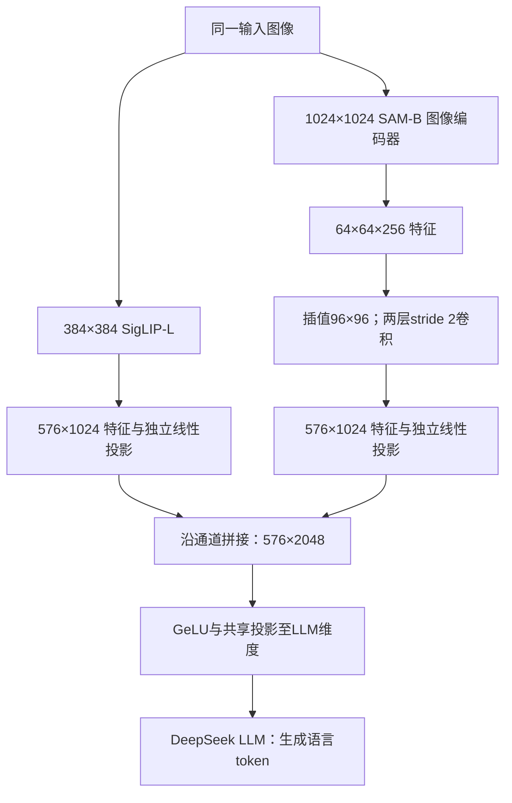

# DeepSeek-VL：在固定视觉序列内合并语义和细节，并控制语言遗忘

## 原件与本次阅读

原文为 Haoyu Lu、Wen Liu、Bo Zhang 等（DeepSeek-AI）的 *DeepSeek-VL: Towards Real-World Vision-Language Understanding*，arXiv **2403.05525v2**（PDF 标记 2024-03-11），33 页。[版本入口](https://arxiv.org/abs/2403.05525v2)。本地原件：[[raw/papers/models/deepseek/DeepSeek-VL.pdf]]；SHA-256：`09e6a250407a046b156a0f97c81ac681b57983d89c8287ccdc77d51e379692b9`。

2026-10-31 实读摘要、正文 PDF pp.1–23、附录 A pp.30–33；参考文献 pp.23–29 仅用于导航，未逐篇追读。实际渲染核对 p.10 架构尺寸、p.12 Figure 3 冻结标记、p.14 Figure 4、pp.16–17 Tables 4–6、p.19 Figures 6–7、pp.20–22 Tables 8–10 / Figures 8–10，以及 pp.30–31、33 的示例。p.32 示范已读文字，未逐个验证图中对象身份。未运行代码、模型或基准，未实测 Obsidian；read 表示完成上述原文阅读；实际主题关系见页末，摄入状态见页首。

## 具体解决什么问题

论文把问题拆成三个相互制约的环节：低分辨率语义编码容易漏掉小字和局部信息；把高分辨率全部展开又增加 LLM 序列开销；在语言模型上直接加入大量多模态训练，可能损伤语言能力。其方案是 **混合视觉编码器 + 固定 576 个视觉 token 的通道融合 + 联合视觉语言预训练及模态配比控制**。这里“真实世界”是训练/评测材料的设计方向，不是部署可靠性保证。[[raw/papers/models/deepseek/DeepSeek-VL.pdf#page=3|§1]] [[raw/papers/models/deepseek/DeepSeek-VL.pdf#page=10|§3.1]]

## 信息怎样进入语言模型

7B 系列使用 SigLIP-L 和 SAM-B 图像编码器的并行支路；1.3B 在 Table 4 中仅使用 SigLIP，不能将混合结构无条件归到整个家族。

此图是根据原文的机制重述：SAM 的原始特征并非直接就是 `576×1024`，中间有插值和卷积；两路合并保持 **576 个位置**，扩展的是每个位置的特征维度，不是变成 1152 个 token。作者称连接器为 two-layer hybrid MLP：先分别映射两路，再拼接并共同投影。SAM 分支在这里提供图像特征，没有把 SAM 的分割 mask 当作 LLM 输出。模型只在语言位置计算 next-token prediction，并不训练像素生成器。[[raw/papers/models/deepseek/DeepSeek-VL.pdf#page=10|§3.1]] [[raw/papers/models/deepseek/DeepSeek-VL.pdf#page=12|§3.2]] [[raw/papers/models/deepseek/DeepSeek-VL.pdf#page=16|Table 4]]

语言骨干从 DeepSeek LLM 的中间 checkpoint 开始：小模型约经历 500B 文本 token，7B 约 2T；这是语言底座已见的训练量，不能与本次多模态阶段的样本数相加当成独立数据量。[[raw/papers/models/deepseek/DeepSeek-VL.pdf#page=11|§3.1 Language Model]]

## 数据、目标与冻结阶段

| 阶段 | 训练对象 / 冻结对象 | 数据与目标 | 7B 预算（Table 4） |
| --- | --- | --- | --- |
| 1：adaptor warmup | 仅连接器；视觉编码器和 LLM 冻结 | ShareGPT4V 1.25M 图文对 + 2.5M 文档 OCR 渲染对；语言 next-token loss | 15K steps；batch 256；长度 512；LR $10^{-3}$ |
| 2：joint VL pretraining | 连接器与 LLM；视觉编码器冻结 | 图文交错、caption、图表、网页、OCR 与纯语言共同训练 | 42K steps；batch 2304；长度 4096；LR $4.2\times10^{-5}$；packing |
| 3：SFT | SigLIP、连接器、LLM；SAM 仍冻结 | 多模态指令与纯文本对话；仅回答及特殊 token 计 loss，system/user masked | 10K steps；batch 256；长度 4096；LR $2\times10^{-5}$ |

冻结依据是 Figure 3 图注和 §3.2.3 的具体文字，不把图中整体“Hybrid Vision Encoder”旁火焰理解为 SAM 也解冻；正文说明 SAM 因 GPU 内存约束保持冻结。小模型三阶段 steps 为 15K/96K/10K、batch 为 256/1024/256，stage 2 LR 为 $3\times10^{-5}$。作者报告 7B 训练约 5 天、64 节点、每节点 8 张 A100；小模型约 7 天、16 节点。本文未提供可用于跨架构公平比较的端到端推理能耗。[[raw/papers/models/deepseek/DeepSeek-VL.pdf#page=12|Figure 3 / §3.2.1]] [[raw/papers/models/deepseek/DeepSeek-VL.pdf#page=15|§3.2.3–3.3]] [[raw/papers/models/deepseek/DeepSeek-VL.pdf#page=16|Table 4]]

预训练混合 Table 1 中纯文本占 **70%**；其余为 interleaved 13.1%、caption 11.1%、table/chart 2.1%、web code 0.4%、scene OCR 1.2%、document OCR 2.1%。材料包含公开与自建数据：例如从 1.46M notebooks 提取图与代码后过滤为约 1.1M 单图样本，以及 arXiv/电子书渲染资料。SFT Table 2 的 text-only 为 47.9%，其余包括 in-house 10.5%、general multimodal 35.5%、table/chart 4.1%、web code 2.0%；**SFT 配比不等于 stage 2 配比**。[[raw/papers/models/deepseek/DeepSeek-VL.pdf#page=6|§2.1]] [[raw/papers/models/deepseek/DeepSeek-VL.pdf#page=7|Table 1]] [[raw/papers/models/deepseek/DeepSeek-VL.pdf#page=8|§2.2 / Table 2]]

> [!warning] 原文内的比例冲突
> §3.2.2、Table 1 和 modality warmup 示例均支持最终约“语言 70%、多模态 30%”；p.14 Figure 4 图注却写 `multimodal:language=70%:30%`。本页按正文与数据表记录配方，并保留图注反向这一冲突；不把它作为另一套已确认配方。图中的 ratio 消融也不意味着 7:3 在所有模型和数据下最优。[[raw/papers/models/deepseek/DeepSeek-VL.pdf#page=13|§3.2.2]] [[raw/papers/models/deepseek/DeepSeek-VL.pdf#page=14|Figure 4]] [[raw/papers/models/deepseek/DeepSeek-VL.pdf#page=21|Modality Warmup]]

为了减少训练不稳定，作者将语言比例从 1 逐步降至目标值；按 global step 分组采样纯语言或多模态 batch，避免较快的文本样本等待图像路径。作者在其训练配置下报告约 20% 效率改善；Figure 8–9 的具体消融使用多模态:语言=60:40，不能冒充最终 30:70 配方的严格对照。小模型训练诊断还用 Multi-choice PPL：比较选项位置 A/B/C/D 的困惑度，并加入少量 SFT；这与最终贪心自由生成后解析答案的公开多模态评测不同。[[raw/papers/models/deepseek/DeepSeek-VL.pdf#page=14|§3.2.2]] [[raw/papers/models/deepseek/DeepSeek-VL.pdf#page=20|Figure 8]] [[raw/papers/models/deepseek/DeepSeek-VL.pdf#page=21|Figure 9]]

## 结果支持到哪里

公开多模态实验采用 greedy decoding 后解析生成文本；MMBench/中文 MMBench 使用 **dev**，作者说明当时 test 下载链接不可用。7B 的 Table 5：MMMU 36.6、CMMMU 37.9、MMB 73.2、MMC 72.8、SEED 70.4、OCRBench 456、POPE 88.1、MathVista 36.1、MMVet 41.5。作者表中的 LLaVA-NeXT-7B 分别为 MMB 67.4、MathVista 34.6、MMVet 43.9，说明优势依任务而变；对外部模型的表格汇总也不能隔离混合编码器的净贡献。1.3B 的 MMB 64.6、MathVista 31.1 应与其单 SigLIP、小底座条件同时读。[[raw/papers/models/deepseek/DeepSeek-VL.pdf#page=16|§4.1]] [[raw/papers/models/deepseek/DeepSeek-VL.pdf#page=17|Tables 5–6]]

语言能力“保持”是有限结论：7B 对照 DeepSeek-LLM-7B Chat，HellaSwag 68.4 vs 68.5、MMLU 52.4 vs 49.4、MBPP 35.2 vs 35.2，但 GSM8K **55.0 vs 63.0**。MMLU/HellaSwag 使用选项 PPL，GSM8K/AGIEval 用生成评测；正文提及 Pile bits-per-byte，但 Table 7 没列 Pile 结果，消融曲线却将 Pile 轴标为 PPL，本页不强行合成一个统一数值。不能从结论段“does not compromise”措辞推出所有语言能力无损。[[raw/papers/models/deepseek/DeepSeek-VL.pdf#page=17|§4.2]] [[raw/papers/models/deepseek/DeepSeek-VL.pdf#page=18|Table 7]]

### 自建人工评测测量的是什么

作者用 100 问覆盖七类场景，沿用自建 SFT 的任务 taxonomy，图片来自免版税社区与研究者照片；类别包括识别、转换、分析、常识、逻辑、多图和评价。这更接近开放回答的有用性检查，补足封闭选项榜单，但“覆盖多数真实用途”仍是作者判断；同 taxonomy 不自动证明样本泄漏，也不自动保证独立代表性。已读章节没有给出完整的评委人数、评分 rubric、盲评顺序、评委一致性或置信区间，因而图中总分不宜解释为有校准误差条的真实任务成功率。Figure 6 总分 DeepSeek-VL 5.65、GPT-4V 6.30，逻辑 4.29 vs 5.36、多图 3.13 vs 8.13，不能用若干接近的识别指标替代整体结论。[[raw/papers/models/deepseek/DeepSeek-VL.pdf#page=9|Table 3]] [[raw/papers/models/deepseek/DeepSeek-VL.pdf#page=18|§4.3]] [[raw/papers/models/deepseek/DeepSeek-VL.pdf#page=19|Figure 6]]

另一个实验由 **GPT-4V 判两答案胜/负/平**，用了 99 个样本。Figure 7 是数量：对 Fuyu-8B 胜/平/负=91/6/2，对 CogVLM=61/25/13，对 InternLM-XComposer2-VL=57/29/13，对 GPT-4V=21/34/44。正文“对列出的开源模型均超过 60%”与 InternLM 的 57/99 不一致，不能照抄；胜加平也不等于胜率。未给人类评分与此判分的一致性检验，GPT 自评也有潜在偏差，所以它是这个样本集上的偏好证据。100 与 99 的差异原因在所读章节未说明。[[raw/papers/models/deepseek/DeepSeek-VL.pdf#page=19|Figure 7 / §4.3]]

### 哪些设计有消融支持

Table 8 从 2K 增到 80K stage-1 steps 后直接 SFT，平均分未改善（57.5→55.6），支持“仅扩大冻结主干的连接器训练在该设置收益有限”，不能证明所有连接器存在同一容量上限。Table 9 stage1+3 / stage2+3 / 全三阶段均值为 57.4 / 61.7 / 62.4，表明联合预训练及 warmup 在该设置有贡献。Table 10 同一 token 约束下 hybrid MLP 通道拼接均值 55.9，而 W/H token pooling 后序列拼接为 55.5/54.2；这不是不限制 token 时所有序列拼接都更差。Figure 10 缩短 stage 2 至 8K steps 比较的是 **训练 loss**，不直接证明所有下游能力提升。[[raw/papers/models/deepseek/DeepSeek-VL.pdf#page=20|Tables 8–9]] [[raw/papers/models/deepseek/DeepSeek-VL.pdf#page=21|§4.4]] [[raw/papers/models/deepseek/DeepSeek-VL.pdf#page=22|Figure 10 / Table 10]]

## 旧笔记校正与未解决项

冻结二手输入：[[raw/notes/MLLM实例/Deepseek/DeepSeek-VL总结.tex]]、[[raw/notes/MLLM实例/Deepseek/Latex_out/DeepSeek-VL总结.pdf]]。本次对照 TeX 全文；编译 PDF 保留为旧包，不作为新的原文证据。

- 旧稿写“多模态:文本=7:3”，现改为正文/Table 1 的 **3:7**，同时保留 Figure 4 图注冲突，避免假装旧稿完全无原文来由。
- “默认不处理，用 Adaptor 融合”补全为具体的独立投影、通道拼接和共同投影；SAM 原始输出到 576 token 的尺寸路径补齐。
- Stage 3 不再只写“SFT”：明确 SigLIP 解冻、SAM 冻结及回答 loss mask；小模型不套双编码器。
- 旧稿的 SigLIP 分布式 all-reduce 数量与 SAM 的 MAE 预训练追问，不由本论文阅读单独确认；须回各自原论文/实现另核，暂不提升为本页证据。
- 附录为挑选示例，不能当无错保证。例如 p.31 代码案例把 `sequence[1]` 描述成“赋索引而不是值”，这是示例回答自身的解释错误；本库依据代码语义判断，正确风险是长度为 1 时越界，而对长度≥2、遍历全序列的此最大值程序未必错误。未实际运行示例程序。[[raw/papers/models/deepseek/DeepSeek-VL.pdf#page=31|Figure 12]]

## 主题落点

可将固定 token 下的多编码器融合与其信息损失整合到 [[wiki/architecture/Overview]]、[[wiki/vision/Overview]]；将模态比例、冻结、warmup 与语言遗忘的条件整合到 [[wiki/training/Overview]]；自建人工评测与 GPT judge 的不同证据强度适合 [[wiki/evaluation/Overview]]；家族位置见 [[wiki/models/Overview]]。实际双向综合由页末主题承接，并保留原文定位与条件。

英文检索词：hybrid vision encoder；embedding concatenation；joint vision-language pretraining；modality warmup；modality group training；Multi-choice PPL；language forgetting。

## 实际整合关系

支撑固定576位置的双视觉通道融合、文本比例与冻结/遗忘条件；不把高分辨率前端当更多LLM位置。

- [[wiki/vision/Resolution-and-Token-Budget|分辨率、packing与tiling：预算到底在哪个位置？]]。
- [[wiki/training/Supervision-and-Stages|监督与阶段：数据、目标、开放参数和预算如何一起改变？]]。
- [[wiki/models/Family-Changes|家族变化轴：输入、接口、数据和计算怎样共同演进？]]。
