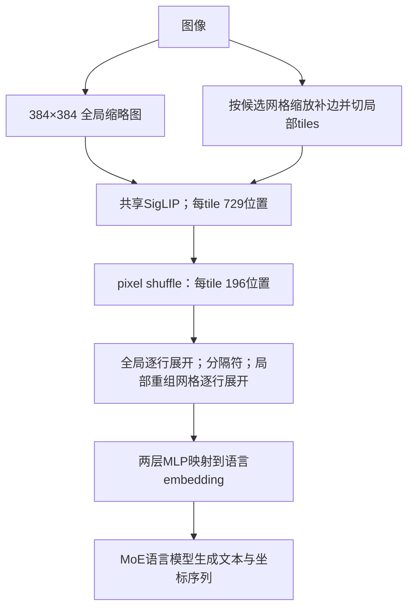

# DeepSeek-VL2：动态切块、稀疏语言模型与可定位的回答

## 身份与阅读范围

Zhiyu Wu、Xiaokang Chen、Zizheng Pan、Xingchao Liu、Wen Liu 等，DeepSeek-AI，*DeepSeek-VL2: Mixture-of-Experts Vision-Language Models for Advanced Multimodal Understanding*；arXiv **2412.10302v1**，2024-12-13，28 页。[版本入口](https://arxiv.org/abs/2412.10302v1)。原件 [[raw/papers/models/deepseek/DeepSeek-VL2.pdf]]，SHA-256 `cff2bd0ad1656769d7447f0e3cf3a1885902333894f123bdac27fce05c97459e`。

2026-10-31 实读 pp.1–20 全部正文（含 pp.13–19 定性实例文字）；pp.21–28 为参考文献，未追读所引论文，本版本无另附方法附录。实际渲染查看 pp.4–5 Figures 2–3 / Table 1、p.9 训练阶段、p.10 Table 2、pp.11–12 Tables 3–4、p.17 Table 5、p.15 Figure 6、pp.18–19 Figures 8–10。其他例图未逐个验证事实。未运行代码/模型/基准或实测 Obsidian。

## 变化针对哪一层瓶颈

相对 [[wiki/papers/models/deepseek/DeepSeek-VL]] 的固定 384/1024 双分支，VL2 用**同一个 SigLIP-SO400M-384 编码多个局部 tile 与一张全局缩略图**，让极端宽高比和密集文字获得更多局部位置。语言侧采用 MoE，以稀疏专家计算控制每 token 激活的参数量；Small 与主模型再用 MLA 压缩 KV cache。数据同时重新生成 caption/QA、加强 OCR、grounding 等监督。因此版本间成绩变化不能仅归因于动态分辨率或 MLA。[[raw/papers/models/deepseek/DeepSeek-VL2.pdf#page=3|§1]] [[raw/papers/models/deepseek/DeepSeek-VL2.pdf#page=4|§2]]

## 动态图像序列是如何构成的

候选网格满足 $m,n\ge1,\ mn\le9$，目标尺寸 $(384m,384n)$；图像保持宽高比缩放、补边，选择所需 padding 面积最小的候选。产生 $mn$ 张局部 tile，加一张全局 thumbnail。每张 tile 经 SigLIP 得到 $27\times27=729$ 个 1152 维 embedding，然后用原文称为 $2\times2$ pixel shuffle 的操作降到 $14\times14=196$ 个位置。论文给出了此尺寸变化，但没有在正文明确奇数 27 网格的 padding 实现；不能靠后续代码补写成本版本已经解释。[[raw/papers/models/deepseek/DeepSeek-VL2.pdf#page=4|§2 Dynamic Tiling]] [[raw/papers/models/deepseek/DeepSeek-VL2.pdf#page=5|§2 Vision-Language Adaptor]]

全局每行末尾加 `<tile_newline>`，有 $14\times15=210$ 个 token；局部 tile 先还原成 $(14m)\times(14n)$ 的二维网格，每一整行末尾再加 newline；两种 view 中间加 `<view_separator>`。因此视觉序列长度是

$$
N_v=210+1+14m(14n+1).
$$

例如 $3\times3$ 网格为 $210+1+42\times43=2017$ token，这是本库按原公式计算，尚未包含正文文字等其他位置。**196 是单 tile 压缩后位置数，不是整图总预算。** 超过 2 张图时作者关闭动态切块以控制上下文；InfoVQA 评测则例外扩到 $mn\le18$，不能与通常最大 9 tiles 的预算混用。[[raw/papers/models/deepseek/DeepSeek-VL2.pdf#page=5|Figure 3 / token 公式]] [[raw/papers/models/deepseek/DeepSeek-VL2.pdf#page=4|多图限制]] [[raw/papers/models/deepseek/DeepSeek-VL2.pdf#page=11|InfoVQA 脚注2]]

## 参数口径与注意力差异

| 变体 | LLM 总参数 / 激活参数 | 加视觉编码器后的报告激活量 | 注意力 | 专家与路由 |
| --- | --- | --- | --- | --- |
| Tiny | 3B / 0.57B | 约 1.0B | **Multi-Head Attention** | 64 routed + 2 shared；top-6；softmax |
| Small | 16B / 2.4B | 约 2.8B | MLA，rank 512 | 64 routed + 2 shared；top-6；softmax |
| 主模型 | 27B / 4.1B | 约 4.5B | MLA，rank 512 | 72 routed + 2 shared；top-6；sigmoid，expert correction bias |

视觉编码器约 0.4B；上述总参数首先是 Table 2 的 **LLM 口径**，不是精确到连接器的系统全参数。摘要对家族 MLA 的概述不能覆盖 Table 1 明确写出的 Tiny 例外。MLA 作用于注意力 KV 存储，MoE 作用于前馈稀疏计算，两者不是同一种“压缩”。本报告未展开 MLA 的完整推导，不能用其他报告公式冒充其正文证据。作者说 3B/16B/27B 可分别在单卡 10/40/80 GB 部署，但未在这里提供统一 batch、上下文、量化、吞吐延迟基准；激活量减半不推出权重显存或整体延迟减半。[[raw/papers/models/deepseek/DeepSeek-VL2.pdf#page=5|Table 1]] [[raw/papers/models/deepseek/DeepSeek-VL2.pdf#page=10|Table 2]] [[raw/papers/models/deepseek/DeepSeek-VL2.pdf#page=20|§6]]

## 数据与三阶段训练

| 阶段 | 更新/冻结 | 监督和数据 | 报告的 token 暴露量 |
| --- | --- | --- | --- |
| alignment | **视觉编码器和 MLP 更新，LLM 冻结** | 约 1.2M ShareGPT4V caption/conversation；text next-token loss | 三款各 2.0B |
| VL pretraining | 所有模块更新 | VL 与纯文本混合；图文交错、recaption、OCR、VQA、grounding | Tiny/Small/主模型：798.5B/808.9B/796.5B |
| SFT | 所有模块更新 | 回答与特殊 token loss；system/user masked；多模态及纯文本对话 | 19.5B/20.0B/19.5B |

§3.1 简称 alignment 训练 MLP，但操作性说明 §4.1 和 Table 2 明确视觉编码器也更新，区别于第一代 stage 1。Table 2 全阶段 sequence length 4096、视觉学习率为主学习率 0.1 倍；stage 2/3 packing。主模型 LR 为 $4.5\times10^{-4}/4.5\times10^{-4}/2\times10^{-5}$，batch 为 256/3360/64，stage 2 在 50%、75% steps 将 LR 各除以 $\sqrt{10}$；Tiny/Small stage 2 batch 为 2304。token 数是训练暴露量，不是独立样本数。训练 Tiny/Small/主模型分别报告 7/10/14 天、16/33/42 节点，每节点 8 张 A100，采用视觉层 pipeline 切分、tile 跨数据并行 ranks 负载均衡及专家并行。[[raw/papers/models/deepseek/DeepSeek-VL2.pdf#page=6|§3.1]] [[raw/papers/models/deepseek/DeepSeek-VL2.pdf#page=9|§4.1]] [[raw/papers/models/deepseek/DeepSeek-VL2.pdf#page=10|Table 2 / §4.2]] [[raw/papers/models/deepseek/DeepSeek-VL2.pdf#page=11|训练资源]]

VL2 的 pretraining 明写 **70% VL、30% text-only**，与第一代正文的语言 70% 配比不同，不能因两者都说“Following DeepSeek-VL”就统一方向。caption 生成参考 OCR hints、metadata、原 caption，并用 DeepSeek Chat 按写作质量过滤；写作质量评分不是图文事实一致性的独立验证。SFT 针对短答、OCR 质量和幻觉重写答案，小模型还补中文 QA 以减少中英混杂；作者观察 Tiny 更受益于简洁回答，不能推广为长推理普遍无用。[[raw/papers/models/deepseek/DeepSeek-VL2.pdf#page=6|§3.2]] [[raw/papers/models/deepseek/DeepSeek-VL2.pdf#page=8|§3.3]]

Grounding 把对象短语与框作为语言输出：`<|ref|>对象<|/ref|><|det|>[[x1,y1,x2,y2],...]<|/det|>`；角点按图像尺寸归一化至 0–999，训练包括不存在目标的负例。grounded conversation 用 `<|grounding|>` 提示把回答的对象和坐标对应起来；跨图 grounding 还输入示例图中的框/椭圆，要求在第二张图找同类。它预测坐标串，不直接执行 GUI 点击或机器人动作。[[raw/papers/models/deepseek/DeepSeek-VL2.pdf#page=7|Visual grounding / Grounded conversation]] [[raw/papers/models/deepseek/DeepSeek-VL2.pdf#page=9|In-context grounding data]]

## 评测与解释边界

本文使用现成 benchmarks，没有在本报告提出新的完整 benchmark；因此不把方法页强套自建评测模板。Table 3 的 DocVQA/ChartQA/InfoVQA 为 test，TextVQA 为 val；主模型依次 93.3/86.0/78.1/84.2，OCRBench 811。Small 的 OCRBench **834 高于主模型 811**；“更大处处更好”不成立。Table 4 主模型 MMMU-val 51.1、MathVista-testmini 62.8、MMBench（原表标 sum）83.1、MMBench-en test 79.6、MMBench-v1.1 cn test 79.2、RealWorldQA 68.4。外部条目含 CoT 或不同设置标记；本报告没有完整列出统一的生成长度、温度、样本解析及各测试运行成本，故只作为作者报告的多任务比较。Figure 1 平均了六项分数并将 OCRBench 除以 10，这是作者的聚合口径，不是一般能力尺度。[[raw/papers/models/deepseek/DeepSeek-VL2.pdf#page=1|Figure 1]] [[raw/papers/models/deepseek/DeepSeek-VL2.pdf#page=11|Table 3]] [[raw/papers/models/deepseek/DeepSeek-VL2.pdf#page=12|Table 4]]

Table 5 主模型 RefCOCO val/testA/testB 为 95.1/96.7/92.7；RefCOCO+ 为 91.2/94.9/87.4；RefCOCOg val/test 为 92.8/92.9。此表区分 vision model、带 task-specific finetuning 的 VLM 和通用 VLM；不能跨组当作等训练条件。Tiny 并非每列领先：RefCOCO testA/testB 为 87.8/78.4，InternVL2-1B 为 88.7/79.8；RefCOCOg-val 73.8 也低于其 80.2，故图注“不同规模都最好”需限缩。本文表格未在本处重述全部定位判分阈值，不能擅补成已经核过评测实现。[[raw/papers/models/deepseek/DeepSeek-VL2.pdf#page=17|Table 5]]

本报告没有独立的定量消融章节来隔离 tiling、MLA、MoE、recaption 的贡献；Tables 3–5 的成套模型比较不提供这种因果识别。图中多图食谱、故事、抽象对象 grounding 展示了输出形式，未给失败率；作者关于 embodied AI / computer agents 的表述是应用机会，未提供闭环动作成功率。作者承认上下文仅容少量图、模糊图或未见对象的稳健性不足，推理仍待增强。[[raw/papers/models/deepseek/DeepSeek-VL2.pdf#page=15|Figure 6]] [[raw/papers/models/deepseek/DeepSeek-VL2.pdf#page=18|Figure 8]] [[raw/papers/models/deepseek/DeepSeek-VL2.pdf#page=19|Figures 9–10]] [[raw/papers/models/deepseek/DeepSeek-VL2.pdf#page=20|Limitations]]

## 对旧笔记的修订

旧包：[[raw/notes/MLLM实例/Deepseek/DeepSeek-VL2总结.tex]]、[[raw/notes/MLLM实例/Deepseek/Latex_out/DeepSeek-VL2总结.pdf]]；本次读取 TeX 正文比对，旧 PDF 只保留包身份，不当独立证据。

- 保留旧稿正确的 729→196、newline/view_separator 公式与 >2 图限制，补上 $mn\le9$ 和 InfoVQA $mn\le18$ 的区别；“直接 concat”细化为二维局部网格重排后的逐行展开。
- “实现同等表现，参数可压到 0.5 倍”改为特定榜单上的**激活参数比较**，同时登记 3/16/27B LLM 总参数与运行预算缺失。
- 不把语言模型统称为完全相同的 DeepSeek-V2/MLA；明确 Tiny MHA、Small/main MLA、主模型独有 bias correction。
- 补齐各阶段冻结、视觉 LR、数据暴露量与文本比例；旧稿没有这些，容易把第一代配方沿用。
- 旧稿的 SoViT 最优 shape 公式和 SigLIP all-reduce 次数属于其他来源解释，本论文未独立证明，保留待回原始来源核验；“结构基本收敛”等评价不充当学术结论。

## 主题连接与后续问题

[[wiki/architecture/Overview]] / [[wiki/vision/Overview]]：比较动态 tile 与第一代固定 token 通道融合，保留位置恢复和多图预算；[[wiki/efficiency/Overview]]：区分总参数、激活计算和 KV 存储；[[wiki/training/Overview]]：视觉冻结及不同模态配比；[[wiki/evaluation/Overview]]：预算改变、CoT 标记与非控制比较；[[wiki/models/Overview]]：模型家族。实际双向主题关系见页末。

待核问题：相同数据和训练预算下各升级的独立增益；统一输入 token 下的实际吞吐/首 token 延迟；多图关闭 tiling 后密集文字性能；grounding 的输出格式错误率和真实交互后果。英文检索词：dynamic tiling；pixel shuffle；tile newline；Mixture of Experts；Multi-head Latent Attention；activated parameters；grounded conversation。

## 实际整合关系

支撑动态tiles的整图长度、MoE/MLA各自成本、版本冻结与模态比例变化及grounding输出接口。

- [[wiki/vision/Resolution-and-Token-Budget|分辨率、packing与tiling：预算到底在哪个位置？]]。
- [[wiki/efficiency/Resource-Ledger|资源账本：视觉token、激活参数、KV与系统预算分别省在哪里？]]。
- [[wiki/training/Supervision-and-Stages|监督与阶段：数据、目标、开放参数和预算如何一起改变？]]。
- [[wiki/models/Family-Changes|家族变化轴：输入、接口、数据和计算怎样共同演进？]]。
- [[wiki/architecture/Generative-Output-Interfaces|生成输出接口：读入图片、输出文字、合成图片分别由谁完成？]]。
- [[wiki/foundations/Formalization|基础：把信息、参数与任务证据分成三个层次]]。
