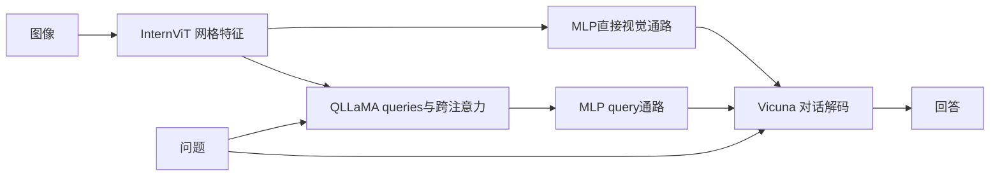

# InternVL：扩展视觉主干，并用语言中间件逐步对齐

InternVL把“视觉端只接一个小接口”之外的设计空间展开：从头训练约6B的 **InternViT-6B**，与多语言LLaMA先做对比对齐，再加入query与cross-attention构成约8B的 **QLLaMA**，最后按任务选择感知、检索、描述或外接对话LLM。**InternViT是本论文的组件，和InternVL共用S025，不另算一篇论文。** 作者对“视觉/语言规模失衡”的诊断是研究动机，不能直接等同于已证明的普遍性能瓶颈。[[raw/papers/models/internvl/InternVL.pdf#page=3|§3.1–3.2，PDF pp.3–5]]

## 身份与阅读范围

- *InternVL: Scaling up Vision Foundation Models and Aligning for Generic Visual-Linguistic Tasks*；Zhe Chen、Jiannan Wu、Wenhai Wang等，完整作者见原件首页；arXiv:2312.14238 **v3，2024-01-15**。[固定版本](https://arxiv.org/pdf/2312.14238v3)。本页仅覆盖该报告，不把后续InternVL版本实现回填本版。
- 原件：[[raw/papers/models/internvl/InternVL.pdf]]；SHA-256：`a948f7499c06b8a6cb0073149f1b8f41d3acd10c4bb29fe79f250806f32e5fab`。
- 2026-10-31 实际读正文PDF pp.1–9、附录实验/训练/清洗 pp.10–14、数据与评测说明 pp.15–18；原页视觉核对 pp.4–9、11–13的图3–5及架构/主结果/消融/冻结/预算表。参考文献pp.19–25未逐项追读，附录数据清单只用于本文设置，不升级为这些数据论文已读。代码、权重、复现未运行；Obsidian 内显示未测。

## 三个“语言角色”不能合并

InternViT-6B采用patch14的ViT，宽3200、48层、MLP宽12800、25个注意力头，表1精确参数5903M。它随机初始化；不同于直接复用CLIP视觉权重。QLLaMA继承多语言LLaMA-7B，并加96个可学习queries与约1B的cross-attention等新增参数，总计约8B。外部的Vicuna/InternLM则是**第三阶段可接入的对话解码器**，不是QLLaMA的另一个名字。[[raw/papers/models/internvl/InternVL.pdf#page=4|§3.2、表1，PDF p.4]] [[raw/papers/models/internvl/InternVL.pdf#page=6|§4.1，PDF p.6]]

| 使用方式 | 图像与文字经过哪里 | 交付/判定 |
| --- | --- | --- |
| 独立InternViT | 图像→空间特征，可加分类/分割头 | 分类或密集预测 |
| InternVL-C | 图像→InternViT→attention pooling；文字→QLLaMA语言路径→EOS状态 | 图文全局相似度 |
| InternVL-G | 图像→InternViT→QLLaMA queries→pooling；文字仍取EOS | 相似度；也可由QLLaMA自回归生成caption |
| Chat w/o QLLaMA | InternViT网格→MLP→外部Vicuna，拼入问题 | 对话文本 |
| Chat w/ QLLaMA | 直接图像特征与QLLaMA query特征分别经接口接入Vicuna，和问题一起输入 | 对话文本 |

据 [[raw/papers/models/internvl/InternVL.pdf#page=5|§3.2、图4，PDF p.5]]。图4(d)明确保留直接视觉分支，不能画成所有视觉信息必须穿过96-query瓶颈；图中QLLaMA还接收问题。QLLaMA在不同任务的注意力/输入角色不同，本文未完整展开所有mask实现，不能把“基于LLaMA”直接推出始终是同一种可见性配置。

这是依据图4(d)整理的带QLLaMA Chat信息流，不代表所有阶段参数都可训。去掉query通路则是图4(c)的另一接法。原图3用火焰/冰块区分训练/冻结，并在Vicuna处画两种选项，因此第三阶段不能写成唯一固定冻结方案。[[raw/papers/models/internvl/InternVL.pdf#page=4|图3，PDF p.4]]

## 渐进对齐：数据质量、目标与更新参数一起变化

| 阶段 | 数据/目标 | 可训练与冻结 | 真实计算条件 |
| --- | --- | --- | --- |
| 1 对比预训练 | 6.03B候选清洗为4.98B；batch内图文对称交叉熵 | InternViT随机初始化，多语言LLaMA继承预训练；两者全部训练，约13B | 196²起步且mask50%图像token；最后0.5B样本改224²无mask；batch164K、175K步、累计28.7B样本曝光；640×A100 80G |
| 2 生成预训练 | 进一步筛至1.03B；ITC+ITM+ITG | 冻结InternViT与QLLaMA继承的语言权重，只训新queries/cross-attention，约1B/总14B | 224²、batch20K、80K步、累计1.6B曝光；LR $5\times10^{-5}$；160×A100 80G |
| 3 Chat SFT | MLP路线558K对齐+665K指令；QLLaMA路线约4M自建混合 | 先训练MLP，再有开放LLM的配置；同时报告冻结解码器/仅MLP实验 | MLP路线各1 epoch；QLLaMA路线batch512；表9区分224与336 |

定位：[[raw/papers/models/internvl/InternVL.pdf#page=5|§3.3、表2–3，PDF pp.5–6]]；[[raw/papers/models/internvl/InternVL.pdf#page=12|附录A.3、表20，PDF p.12]]。4.98B/1.03B是数据集合规模，28.7B/1.6B是训练累计曝光，不是不同论文中可随意互换的“训练数据量”。阶段1图像/文本峰值LR分别$10^{-3}$/$10^{-4}$，不是给全部13B同一个学习率。

ITC为图文表示对齐，ITM区分匹配与不匹配，ITG用视觉条件预测文字。**“生成式训练”生成的是caption文本，不是图像像素；第二阶段视觉主干冻结，生成损失训练的是新接口。** 不能说InternViT本体在这一阶段继续由生成目标更新。作者借用BLIP-2三类目标；本页不从引用自行补出未展示的负采样或mask细节。[[raw/papers/models/internvl/InternVL.pdf#page=6|§3.3，PDF p.6]]

清洗第一阶段同时考虑CLIP相似度、水印、unsafe概率、美学、尺寸与caption长度，并报告剔除与ImageNet-1K/22K、Flickr30K、COCO重复数据；第二阶段强化caption完整性/可读性/模板文本过滤。这是作者报告的防重叠措施，不等于本库已审核所有训练字节。[[raw/papers/models/internvl/InternVL.pdf#page=13|附录A.4，PDF p.13]]

约4M SFT数据覆盖caption588K、VQA1.1M、OCR294K、grounding323K、grounded caption284K、conversation1.4M（取整）。非对话任务转为格式指令；评测VQAv2/GQA/TextVQA要求短语，VizWiz另允许Unanswerable。不同混合数据和任务样本单位必须与配置绑定。[[raw/papers/models/internvl/InternVL.pdf#page=5|表3，PDF p.5]] [[raw/papers/models/internvl/InternVL.pdf#page=17|附录表27–28，PDF pp.17–18]]

### 第三阶段文字、图与表怎样对读

正文§3.3说可以冻结外部LLM只训MLP，或MLP+QLLaMA；图3画视觉和QLLaMA冻结、MLP可训、Vicuna可冻/可训；附录A.3更具体写两步先MLP后微调LLM。表9同时列224/仅64M或90M可训、336/13B可训等行。因此保留为**多种实验配置**，不将正文一句概括套给所有行。未经代码审计，具体“MLP+QLLaMA”选项与表中每行的完整映射尚未确定。[[raw/papers/models/internvl/InternVL.pdf#page=6|§3.3–4.1，PDF p.6]] [[raw/papers/models/internvl/InternVL.pdf#page=8|表9，PDF p.8]] [[raw/papers/models/internvl/InternVL.pdf#page=12|附录A.3，PDF p.12]]

## 把结果放回各自评测对象

| 对象与设置 | 代表结果 | 能说明什么/不能说明什么 |
| --- | --- | --- |
| 冻结InternViT，ImageNet线性探测，224² | IN-1K top-1 88.2；ViT-22B 89.5（使用私有JFT） | 视觉表示有较好线性可读性；并非所有分类项超过22B |
| ADE20K，504² | 冻结+linear47.2 mIoU；冻结+UperNet54.9；全调58.9 | 不同训练范围不同成绩，不能混成单一“零样本分割” |
| InternVL-C→G，COCO英文5K检索 | I→T R@1 70.6→74.9；T→I 54.1→58.6 | 组合与第二阶段有收益；C/G计算和训练阶段不同 |
| MLP/Vicuna13B，336，558K+665K | VQAv2 80.2、MME1546.9、TextVQA58.7 | 与相近LLaVA1.5配置比，有提升也有TextVQA下降（61.3→58.7） |
| QLLaMA/Vicuna13B，336，1.0B PT+4M SFT | VQAv2 81.2、GQA66.6、MME1586.4、POPE87.6 | 更强完整系统，不能只归因于大视觉或QLLaMA一项 |

证据：[[raw/papers/models/internvl/InternVL.pdf#page=6|表4–5，PDF p.6]]；[[raw/papers/models/internvl/InternVL.pdf#page=7|表7，PDF p.7]]；[[raw/papers/models/internvl/InternVL.pdf#page=8|表9，PDF p.8]]。表9星号表示训练见过该数据集训练标注；caption用COCO/Flickr Karpathy test、NoCaps val，VQA用VQAv2 test-dev/GQA test-balanced/VizWiz test-dev/TextVQA val，不能混为同一零样本协议。图2“32项最好”还限定公共训练数据的比较对象，不能脱离此限定转成绝对领先。

表12更接近接口控制：冻结主体、只训MLP、同665K单阶段SFT，EVA-E→InternViT时MME970.5→1022.3；再用QLLaMA为1227.5。它支持这些预训练表示更容易由小接口用于所测任务。**本库分析：**“空间一致性”在这里由下游表现间接支持，不是对表示几何的直接测量，也不能完全分离预训练数据/预算差异。[[raw/papers/models/internvl/InternVL.pdf#page=9|§4.5、表12，PDF p.9]]

结构搜索在100M LAION-en子集上训练10K步，使用随机CLIP-L文本编码器加速，六个候选零样本IN top-1约65.8–66.2；不是完整多语言LLaMA训练的同条件最优证明。batch1与128吞吐排序不同，最终选48层兼顾稳定性，不能简化成“48层准确率必然最高”。[[raw/papers/models/internvl/InternVL.pdf#page=9|表11，PDF p.9]]

视频实验需特别防止过度解释。Kinetics表8有单中心帧与8帧、top-1与top-1/top-5平均两种口径；76.1是K400单帧的平均值，top-1为65.9。MSR-VTT8帧逐帧独立编码后平均embedding，不含时序注意力，因此检索提升不证明建模动作顺序。[[raw/papers/models/internvl/InternVL.pdf#page=7|表8，PDF p.7]] [[raw/papers/models/internvl/InternVL.pdf#page=10|附录A.1、表14，PDF p.10]]

效率表19测的是单A100、batch128、FlashAttention/bf16的**图文编码**：224下C20.4ms、G28.6ms；336下C40.1ms、G50.4ms。不是交互聊天首token延迟或自回归tokens/s，不能作为部署回答速度。[[raw/papers/models/internvl/InternVL.pdf#page=11|表19，PDF p.11]]

## 冻结旧稿：两份关注点并入同一身份

旧输入：[[raw/notes/多模态经典/2024-CVPR-InternVL.md]]、[[raw/notes/视觉编码器/InternViT总结.tex]]、[[raw/notes/视觉编码器/Latex_out/InternViT总结.pdf]]。本次对照Markdown及TeX正文；编译PDF未逐页复核。

1. 旧TeX写“三阶段196/224/364”：改为阶段1 196→224、阶段2 224，Chat有224/336配置；**364是另行Flickr检索微调**，不是SFT统一分辨率。[[raw/papers/models/internvl/InternVL.pdf#page=12|表20–21与A.3，PDF p.12]]
2. “InternViT融合对比和生成训练”改为整个InternVL系统的目标安排；第二阶段ViT权重冻结。QLLaMA也不等于“1B Q-Former”，约1B只是新增部分，总体约8B且有LLaMA初始化。
3. 旧TeX将后续系列代码中的RMSNorm、QK Norm、LayerScale、位置编码等归到本报告。本文已核页仅足够支持所列ViT结构、DropPath/FlashAttention实验设置；未核对应代码版本，其他细节保留为**后续实现待核**，不升级为v3论文事实。
4. 旧稿“QK Norm就是L2单位化、点积必在[-1,1]”与它自己展示的`InternRMSNorm`片段也不相符。**数学澄清（本库分析）：**RMS归一化并不令向量L2范数为1，且可学习缩放会再改变范数，不能直接给出余弦界限。这只纠正旧解释的逻辑，不证明当前正式代码实现。
5. 旧Markdown“眼睛不够大时后续微调补不回来”和QLLaMA后来普及程度超出本论文实验范围，本页不保留为原文结论。

## 待整合方向

视觉主题可区分“大视觉主干”与“大语言中间件”；架构主题解释直接视觉+query双路以及C/G/Chat的任务接口；训练主题按开放参数与数据曝光记账；评测主题分开线性探测、全调、zero-shot以及多帧平均。共享主题尚待协调整合；关于规模失衡是否因果瓶颈、SFT全部行的冻结映射、后续代码实现均保留为有边界的待核问题。
