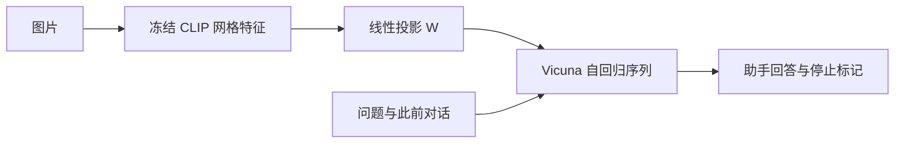

# LLaVA：把图文对改写成视觉指令训练

LLaVA 的核心问题不是再设计一个复杂视觉连接器，而是怎样让已有视觉表示和语言模型响应人的多样指令。它以 CLIP 网格特征、线性投影和 Vicuna 组成简单模型，再把图文描述改写成对话、详细描述、复杂推理三类训练数据。**合成数据的教师是只读文字的 GPT-4；学生才直接读取图片。** [[raw/papers/models/llava/LLaVA.pdf#page=3|§3，PDF pp.3–4]]

## 身份与读取范围

- *Visual Instruction Tuning*；Haotian Liu、Chunyuan Li、Qingyang Wu、Yong Jae Lee；NeurIPS 2023。本地为 arXiv:2304.08485 v2（2023-12-11），[固定版本](https://arxiv.org/pdf/2304.08485v2)。
- 原件：[[raw/papers/models/llava/LLaVA.pdf]]；SHA-256：`dc8bace378a282ea78caa9b5959306202fbfa3b8cedaf8a66541a9af18f4d3bf`。
- 2026-10-31 读正文 PDF pp.1–9、附录A/B说明 pp.14–16 与训练/数据/prompt pp.20–25；视觉核对 pp.4–5、7–9、21–22 的架构、公式、训练 mask、结果/消融、难例及合成提示。pp.17–19 更多演示未逐项核读，参考文献未追读。未查代码、未运行模型/评测；Obsidian 内显示未测。

## 数据：把已有标注变成什么监督

一张 COCO 图片的多条 caption 和物体类别/归一化 bounding boxes 以文字形式输入 GPT-4，辅以人工设计的少量示范。输出158K条样本：58K conversation、23K detailed description、77K complex reasoning。学生训练时看到原图片和问题，预测合成回答。**“教师看起来在看图”的回答语气不意味着教师拥有像素输入。** [[raw/papers/models/llava/LLaVA.pdf#page=3|§3、表1，PDF pp.3–4]] [[raw/papers/models/llava/LLaVA.pdf#page=23|附录F、表14，PDF p.23]]

举例说，caption 提供“人们在把行李装进车”，框提供人物与行李位置；合成问题可以从“什么车”延伸到“他们面临什么困难”。前者较接近给定标注，后者会引入常识推断。**本库分析：**这能扩展指令形式，但无法从文字替身中恢复缺失视觉细节，也不保证每个推理句都被图片证实。附录提示确实要求只问可确定回答的问题，却不是已执行的逐条质量检验；表16示范本身仍出现对滑雪类型的概率性猜测。[[raw/papers/models/llava/LLaVA.pdf#page=22|表13，PDF p.22]] [[raw/papers/models/llava/LLaVA.pdf#page=25|表16，PDF p.25]]

## 信息通路与两阶段冻结

图像经 CLIP ViT-L/14 得到网格特征 $Z_v=g(X_v)$，线性投影 $H_v=WZ_v$ 将其维度对齐 Vicuna 的 embedding，与指令 token 送入语言模型。这是连续特征投影，不是将图像转成可读文字，也没有 Q-Former 查询压缩。原文比较 CLIP 最后一层与倒数第二层特征。[[raw/papers/models/llava/LLaVA.pdf#page=4|§4.1、图1、式1，PDF p.4]]

本库据图1和表2整理；图像在首轮输入，后续回答通过上下文继续使用它。损失只覆盖助手回答和停止标记，不覆盖人类提问及图像输入。[[raw/papers/models/llava/LLaVA.pdf#page=5|§4.2、表2，PDF p.5]]

| 阶段 | 数据和任务 | 更新参数 | 作者预算 |
| --- | --- | --- | --- |
| Feature alignment | CC3M过滤595K，简短描述问题→原caption | 只训练 $W$，视觉/LLM都冻结 | 1 epoch，batch128，LR $2\times10^{-3}$ |
| Chatbot instruction tuning | 158K三类视觉指令 | $W$ 与 Vicuna；视觉仍冻结 | 3 epochs，batch32，LR $2\times10^{-5}$ |
| ScienceQA专门微调 | 问题/上下文→理由与选择答案 | 同样训练连接与语言部分 | 主结果12 epochs，与chatbot分支区分 |

定位：[[raw/papers/models/llava/LLaVA.pdf#page=5|§4.2–5，PDF p.5]]、[[raw/papers/models/llava/LLaVA.pdf#page=8|§5.2，PDF p.8]]、[[raw/papers/models/llava/LLaVA.pdf#page=20|附录C，PDF p.20]]。作者用8张A100，报告预训练约4小时、chat微调约10小时；这些不是包含基础 CLIP/Vicuna 预训练的全成本。主实验13B与7B消融区分。已读原文未明确给出像素输入尺寸/最终视觉token计数，不能把后续1.5的336/576设置回填本版。

CC3M筛选先抽名词短语，跳过频次小于3者，从低频词开始纳入含该词caption，高频词最多抽100条；595K是经概念覆盖策略筛选的子集，不是新增595K人工描述。[[raw/papers/models/llava/LLaVA.pdf#page=20|附录E，PDF pp.20–21]]

## LLaVA-Bench 测到了什么

**测量定位：**在固定图片、问题与文本描述参考的条件下，以文本 GPT-4 对候选回复的帮助性、相关性、准确性、细节评分，诊断视觉助手的开放式指令回答。它补充固定短答案 VQA，但不直接估计真实部署任务成功率。[[raw/papers/models/llava/LLaVA.pdf#page=6|§5.1 Quantitative Evaluation，PDF pp.6–7]]

| 集合 | 来源/规模 | 用途与结果 |
| --- | --- | --- |
| COCO | COCO-Val-2014随机30图，每图三类问题，共90问；沿用合成流程 | 数据消融：完整数据85.1、仅conversation73.8、无指令微调21.5，相对文本GPT-4评分 |
| In-the-Wild | 人工整理24张不同类型图像、60问，并提供详细描述 | 刻意选困难图来暴露弱点；LLaVA67.3±2.0、BLIP-2 38.1±1.0、OpenFlamingo19.1±0.4，三次推理 |

表据 [[raw/papers/models/llava/LLaVA.pdf#page=7|§5.1、表4–5，PDF p.7]]。COCO训练/测试虽取不同图像划分，题型生成方式相关；In-the-Wild小且有目的地选难例，不是随机真实使用样本。

一道题的链路是：**图片+问题给候选模型 → 生成自由文本 → 文字图像描述+问题给GPT-4生成参考 → 裁判GPT-4同时阅读描述、问题和两份回答 → 各给1–10整体分并解释 → 报相对参考的分数**。候选和参考的信息形式不同；作者把参考称为近似理论上界，但文字描述可能丢失信息、模型也会犯错，因此本库不把它当严格上界。85.1不是85.1%答对，更不是“达到多模态GPT-4 85.1%的能力”。[[raw/papers/models/llava/LLaVA.pdf#page=6|§5.1，PDF pp.6–7]]

冰箱例子问“是否有草莓味酸奶”：图中同时存在草莓和酸奶，正确回答仍须验证属性绑定。论文报告模型错误答是；这比只查“识别到草莓/酸奶”更能暴露组合问题。拉面店例子还混合OCR与品牌知识，分数不能纯解释为视觉推理能力。[[raw/papers/models/llava/LLaVA.pdf#page=8|表6及前页Limitations，PDF pp.7–8]]

人工在这里参与种子示例、In-the-Wild描述与选题；不是人类作答基线，也不是对同一答案的独立人工判分校准。表5固定同一批生成结果、三次问GPT-4得到66.7±0.3，证明的是**该范围裁判重复稳定性**，不是和人类一致性。已读范围未报告逐题人工对齐、顺序偏差控制或跨裁判验证；附录也承认幻觉和细粒度评估尚待扩展。教师、参考与裁判同类模型带来的风格偏好是待检验风险，不能据此直接判定所有评分无效。[[raw/papers/models/llava/LLaVA.pdf#page=7|表5，PDF p.7]] [[raw/papers/models/llava/LLaVA.pdf#page=14|附录A，PDF p.14]]

## ScienceQA 与消融需要单独解释

ScienceQA有12726/4241/4241训练/验证/测试样本。LLaVA13B专门微调后90.92%；文本GPT-4两示例为82.69%；模型分歧时再让GPT-4综合两份答案，组合达到92.53%。这里的GPT-4“judge”是**推理系统的一部分**，最终指标仍是选择题准确率，和上节开放回答评分裁判不是同一职责。不能把92.53归为LLaVA单模型。[[raw/papers/models/llava/LLaVA.pdf#page=8|§5.2，PDF pp.8–9、表7]]

表8中倒数第二层视觉特征90.92优于最后一层89.96；跳过对齐预训练85.81；7B为89.84。作者把特征差异解释为局部/全局信息差别，这是机制假说，表中未直接测局部信息。reasoning-first较快收敛的实验不等于最终准确率因“思维链”大幅改善，且表中答案顺序比较同时需留意视觉层配置。[[raw/papers/models/llava/LLaVA.pdf#page=9|§5.2 Ablations、表8，PDF p.9]]

## 冻结旧稿的校正与后续综合

旧笔记输入：[[raw/notes/多模态经典/2023-NeurIPS-LLaVA.md]]、[[raw/notes/多模态经典/2023-NeurIPS-LLaVA总结.tex]]、[[raw/notes/多模态经典/Latex_out/2023-NeurIPS-LLaVA总结.pdf]]。本次对照Markdown旧解释；另外两份作为同一冻结笔记包保留，未逐句复核排版副本。

旧稿把语言端简称LLaMA，本页按本文实现写Vicuna；“只保留确定问题”改为提示要求，未升级为逐条质量审核；“视觉冻结所以不会比CLIP看得更细”收窄为视觉权重不变，整体读出与任务回答仍可能改变；“85.1%/92.53%”补齐裁判、参考、系统与任务条件。演示中认出人物或写网页的个例不证明未污染或普遍泛化，作者网页演示还需要手动修正小错误（PDF p.16）。

待整合：训练主题可讨论符号化教师监督与视觉证据间的缺口；架构主题比较线性投影与查询压缩；评测主题区分裁判重复性、人类一致性和系统内决策器。当前共享主题尚待协调整合。
