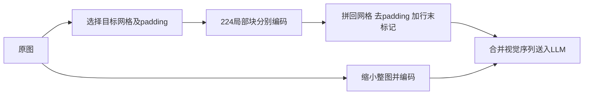

# LLaVA-1.5：简单接口、任务数据与明确输出格式

> [!note] 主归属（本库导航判断）
> 数据、响应格式、输入与 MLP 改动共同回答视觉指令适配配方问题，按训练入口组织；承认联合系统也是合理候选，不把联合提升归给单因素。 [[raw/papers/training/instruction-adaptation/LLaVA-1.5.pdf#page=3|pp.1–4，§3/Tables1–2]]

LLaVA-1.5 研究的是：为什么自然对话较好的模型未必擅长短答案 VQA，反之亦然，以及简单连接器能否支撑更强的多任务基线。其结果来自**输出格式提示、两层 MLP、更多学术任务数据、336像素视觉输入和语言模型变化**的组合；不能把相对初版的全部增益归因于 MLP。普通1.5与实验性1.5-HD也要分开。[[raw/papers/training/instruction-adaptation/LLaVA-1.5.pdf#page=3|§3，PDF pp.3–4]]

## 身份与核读范围

- *Improved Baselines with Visual Instruction Tuning*；Haotian Liu、Chunyuan Li、Yuheng Li、Yong Jae Lee；arXiv:2310.03744 **v2，2024-05-15**（工作始于2023）。[固定版本](https://arxiv.org/pdf/2310.03744v2)。
- 原件：[[raw/papers/training/instruction-adaptation/LLaVA-1.5.pdf]]；SHA-256：`b7074a6dad218e0dd109f2a80311548d447e1cf4b9e31c002696985784cc05b9`。
- 2026-10-31 实际读正文 PDF pp.1–8、附录A pp.9–10、B例子及C局限 pp.11–13；看图核对 pp.4–7、9–10（图2–4、表2–10及全局上下文消融）。额外多语言/写作案例只读文字，未逐图视觉验收；参考文献未追读，代码/模型未运行；Obsidian 内显示未测。

## “怎样回答”也是训练任务的一部分

学术 VQA 可能要求一个词，而自然聊天要求详细解释。同样的“问题→答案”格式容易让短答案风格泛化到所有问题。作者在短答案任务后加入明确格式指令，例如要求单词或短语；选择题要求直接输出选项字母。训练语言模型后，格式成为可被指令控制的条件，而不是仅靠视觉接口隐式决定回答长度。作者关于 InstructBLIP 的 Q-Former 容量不足解释是其假说，不是本文已独立证明的普遍原因。[[raw/papers/training/instruction-adaptation/LLaVA-1.5.pdf#page=3|§3.2、表1，PDF p.3]]

格式也影响评测：VizWiz特别提示信息不足时输出 `Unanswerable`；MME/POPE等使用短答提示；LLaVA-Bench和MM-Vet不附格式提示。论文报告不可回答问题的成绩由11.1%到67.8%，因此模型成绩必须和提示协议一起读。[[raw/papers/training/instruction-adaptation/LLaVA-1.5.pdf#page=7|§4.3，PDF p.7]] [[raw/papers/training/instruction-adaptation/LLaVA-1.5.pdf#page=9|附录A、表8，PDF p.9]]

## 接口与训练配方

普通 LLaVA-1.5 使用 CLIP ViT-L-336px → 两层 MLP → Vicuna-v1.5（7B或13B），保留完整空间网格而非用固定少量 queries 压缩。按336/14推算网格为24×24=576个patch位置；这是由分辨率和patch大小得到的本库计算，具体序列特殊token与实现未审代码，不额外断言。两阶段仍是连接对齐与指令微调，继承 LLaVA 的视觉冻结、先训练连接后训练连接+LLM设置。[[raw/papers/training/instruction-adaptation/LLaVA-1.5.pdf#page=3|§3.1–3.3，PDF pp.3–4]] [[raw/papers/training/instruction-adaptation/LLaVA-1.5.pdf#page=10|附录A.3，PDF p.10]]；冻结设置的原始说明见 [[raw/papers/training/instruction-adaptation/LLaVA.pdf#page=5|LLaVA §4.2，PDF p.5]]。

| 项目 | 本版报告的配置 |
| --- | --- |
| 对齐数据 | 表3明确为558K，不沿用初版595K数字 |
| 指令数据 | 共665K：LLaVA158K、ShareGPT40K、VQAv2 83K、GQA72K、OKVQA9K、OCRVQA80K、A-OKVQA66K、TextCaps22K、RefCOCO48K、VG86K（表内为取整数） |
| 对齐超参数 | batch256、LR $10^{-3}$、1 epoch、DeepSpeed stage2 |
| 指令超参数 | batch128、LR $2\times10^{-5}$、1 epoch、DeepSpeed stage3 |
| 共同设置 | AdamW、cosine、warmup0.03、weight decay0；评测greedy decoding |
| 成本 | 作者报告8张A100，对齐约6小时、指令微调约20小时 |

证据：[[raw/papers/training/instruction-adaptation/LLaVA-1.5.pdf#page=5|表3，PDF p.5]] [[raw/papers/training/instruction-adaptation/LLaVA-1.5.pdf#page=9|表7、附录A.2，PDF pp.9–10]] [[raw/papers/training/instruction-adaptation/LLaVA-1.5.pdf#page=4|Computational cost，PDF p.4]]。1.2M是本轮对齐+指令样本规模的近似和，不含CLIP/Vicuna的既有大规模预训练；跨论文数据量比较的样本单位、来源及已有主干成本不同。

同图多个QA合并成一段对话，ShareGPT超过2048 token截断；A-OKVQA按选项数重复增强。故665K不能当成互不重叠的图片数，也不能不加说明地与别家的原始QA条目数相除。[[raw/papers/training/instruction-adaptation/LLaVA-1.5.pdf#page=9|附录A.2，PDF pp.9–10]]

## 逐步实验：每项变化的证据有多强

| 表2相邻变化（均按该阶段已累计配置） | GQA | MME | MM-Vet |
| --- | ---: | ---: | ---: |
| +VQAv2 → 再加format prompt，7B/224 | 47.0→46.8 | 1197.0→1323.8 | 27.7→26.3 |
| 再将linear换MLP | 46.8→47.3 | 1323.8→1355.2 | 26.3→27.8 |
| 已加region数据后，224→336 | 50.3→51.4 | 1426.5→1450.0 | 30.8→30.3 |
| 完整数据7B→13B，336 | 62.0→63.3 | 1510.7→1531.3 | 31.1→36.1 |

[[raw/papers/training/instruction-adaptation/LLaVA-1.5.pdf#page=4|§3.3、表2，PDF p.4]]。这是按特定顺序累加的实验，提供条件性的增量证据；不是全因素实验，也不能假设每项在任意配方上效果可加。加GQA之后标星表示训练看过GQA训练图片，不应当成该数据集零样本结果。格式prompt和升分辨率都有某项下降，原文“提升能力”的概括需保留此异质性。

主表中336/13B的VQAv2 80.0、GQA63.3、VizWiz53.6、SQA-IMG71.6、TextVQA61.3；MME1531.3、MMBench67.7、MM-Vet36.1。SQA-IMG是零样本图像子集，**不同于初版LLaVA专门训练的ScienceQA全测试92.53组合成绩**。POPE报F1，MME为perception分数，开放对话由GPT-4评判；SEED视频只抽中间一帧，不能把该列视为视频时序理解。[[raw/papers/training/instruction-adaptation/LLaVA-1.5.pdf#page=5|§4.1、表3–4，PDF pp.5–6]]

本页不把这些表扩展为今天的排行榜，也不由本文作者比较推断所有复杂连接器都无效。附录反而指出完整视觉patch序列增加训练计算，未来仍需要数据高效的resampler。[[raw/papers/training/instruction-adaptation/LLaVA-1.5.pdf#page=13|附录C，PDF p.13]]

## 1.5-HD：切块解决尺寸，不等于普通1.5配置

HD用 **224像素基础编码器**分别编码局部切块，将空间特征拼回网格，移除纯padding位置、在每行加row-end token再展平；另把缩小的整图特征拼入，提供全局关系。这样无需让ViT自己在更长网格上做位置插值，也不额外做高分辨率对齐预训练。[[raw/papers/training/instruction-adaptation/LLaVA-1.5.pdf#page=4|图2、§3.4，PDF pp.4–5]] [[raw/papers/training/instruction-adaptation/LLaVA-1.5.pdf#page=9|附录A.1，PDF p.9]]

依图2/附录A整理的信息流。7B消融加全局图后GQA62.9→63.8、MME1425.8→1497.5、MM-Vet31.9→35.1，支持全局信息在该配置的效用。[[raw/papers/training/instruction-adaptation/LLaVA-1.5.pdf#page=6|Global context消融，PDF p.6]]

**原文范围差异保留：**主表用448²标记HD；附录列至多6块的1×1至1×6、2×2、2×3及转置，并同时称最大672×448或448×672。列出的1×6与这一“最大尺寸”表述不能作为单一边长上限同时成立；未审代码，保留为文档需核实项，不擅自修正。切块是实现能力，不保证无限分辨率的内存与效果。

HD并非每项都更好：相对336/13B，MM-Vet36.1→39.4、TextVQA61.3→62.5，但MME1531.3→1500.1、SQA-IMG71.6→71.0、LLaVA-Wild72.5→72.0。[[raw/papers/training/instruction-adaptation/LLaVA-1.5.pdf#page=5|表3–4，PDF p.5]]

## 解释边界与冻结旧稿校正

作者提出细粒度描述超过模型可见细节时可能促使幻觉，并展示升分辨率后改善；这是有观察支持的解释，未单独排除数据噪声、语言先验等全部原因。50%训练数据保留超过98%相对表现是该混合数据、任务和下采样实验的发现，不是通用压缩率保证。跨语言迁移也有韩语错误案例，不能以中文单一集合宣称普遍多语言能力。[[raw/papers/training/instruction-adaptation/LLaVA-1.5.pdf#page=7|图3–4，PDF pp.7–8]] [[raw/papers/training/instruction-adaptation/LLaVA-1.5.pdf#page=12|图5与附录B.2，PDF pp.12–13]]

旧笔记输入：[[raw/notes/多模态经典/2023-LLaVA-1.5总结.tex]]、[[raw/notes/多模态经典/Latex_out/2023-LLaVA-1.5总结.pdf]]。本次对照TeX正文，编译副本未逐页复核。本页纠正其把Dynamic High-Resolution笼统归入普通1.5的写法，区分336基线与224切块的HD；补齐数据总量/格式/预算与逐项增益条件。旧稿引用初版“倒数第二层更好”消融，不能由此声称所有模型/任务必然如此；“最后层更全局”仍是作者假说。

本库整合：视觉主题讨论局部块与整图互补及token成本；训练主题讨论回答格式和样本单位；模型演进按数据/连接/视觉尺寸/语言模型四轴比较。实际共享主题关系见页末。

## 实际整合关系

支撑MLP/网格、回答格式、任务数据与普通336/实验HD的多轴变化，逐步实验不作全因素归因。

- [[wiki/architecture/Visibility-and-Connections|可见性、路由与连接：视觉信息在哪里与语言相遇？]]。
- [[wiki/training/Supervision-and-Stages|监督与阶段：数据、目标、开放参数和预算如何一起改变？]]。
- [[wiki/models/Family-Changes|家族变化轴：输入、接口、数据和计算怎样共同演进？]]。
