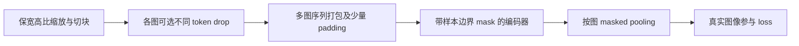

# NaViT：怎样让不同形状、不同 token 数的图像高效一起训练？

> [!summary] 核心理解
> Patch n’ Pack 把多张图像的patch序列装进固定长度容器，并在attention、pooling与loss三个环节保持样本边界。它支持保留宽高比的混合分辨率训练，使同预算下能处理更多样本，并允许推理时调整分辨率。**打包不是跨图信息融合，Native也不意味着所有实验都不缩放原始图像。**[[raw/papers/vision/encoders/NaViT.pdf#page=2|p.2 图2]]；[[raw/papers/vision/encoders/NaViT.pdf#page=17|p.17 A.1]]

## 来源身份与实际范围

- **论文**：Mostafa Dehghani、Basil Mustafa、Josip Djolonga 等，*Patch n’ Pack: NaViT, a Vision Transformer for any Aspect Ratio and Resolution*。本地原件为 arXiv:2307.06304 **v1，2023-07-12**，26页；标题、作者和版本据首页核对；[固定版本](https://arxiv.org/pdf/2307.06304v1)。本页不把该arXiv版本冒称会议最终版。
- **原件**：[[raw/papers/vision/encoders/NaViT.pdf]]；SHA-256 `d4421cab93fe27a49c64120faa46822dc95a563ed70f5495b25112b35619a396`。
- **读取日期/范围**：2026-10-31；正文pp.1–12；关键附录A–E pp.17–23、F的协议与表5（p.23）；实际渲染查看pp.2、3、6、7、8、10、18、20，核对打包示意、分辨率/丢token/位置消融、下游表、训练表及坐标图。
- **未读/未做**：参考文献未逐篇追读；pp.24–26额外OOD、公平性属性图未逐图核读；未运行实现或复现；Obsidian内显示未测。
- **冻结旧笔记**：[[raw/notes/视觉编码器/NaViT总结.tex]]、[[raw/notes/视觉编码器/Latex_out/NaViT总结.pdf]]；本次对照TeX正文。旧稿提及的非官方实现未核读，不能替代论文或官方代码证据。

## 1. 固定 batch 形状不必等于每张图形状相同

[[wiki/papers/vision/encoders/ViT|ViT]]的Transformer本身能处理变长序列，训练硬件与batch却通常偏好固定形状。把每张图强行缩成方形会改变宽高比；为每张图填到同一个大矩形又浪费计算。NaViT把“固定形状”约束移到**打包后的容器**：容器长固定，内部每个样本长可变。不同图片仍有自己的坐标系和样本ID。[[raw/papers/vision/encoders/NaViT.pdf#page=3|p.3 §2–2.1]]

下面是**本库根据图2重组的流程**，箭头表示数据处理顺序，不代表原文新增模块：

最容易漏掉的是三个隔离层次：

| 环节 | 必须保证什么 | 漏掉后的问题（本库解释） |
| --- | --- | --- |
| Self-attention | query只能访问同一图的有效token；padding不参与 | 一张图的表示会依赖碰巧同包的其他图 |
| Pooling | 每张图分别汇聚自己的token | 整包会被误当成一个训练样本 |
| Loss | 假的padding样本不参与损失 | 人为加入不存在的标签/图文对应 |

位置逐点的MLP、残差、LayerNorm不需因packing改写。**注意力mask保证语义隔离，却不自动让普通dense attention跳过所有被mask的乘法**；论文专门分析长序列产生的attention开销，并指出大hidden dimension下MLP等成本占比更大，packing相对额外成本下降。[[raw/papers/vision/encoders/NaViT.pdf#page=2|p.2 图2]]；[[raw/papers/vision/encoders/NaViT.pdf#page=4|p.4 §2.3、图4]]

实际采用greedy first-fit：把样本放入第一个有足够余量的序列，剩余填padding；在作者控制的分辨率分布与序列长度下padding通常低于2%，不是任意输入分布下的保证。每序列最多输出$E_{max}$个图像表示；超出会丢掉多余样本的输出、浪费encoder计算，不足则补假表示。对比学习又有样本两两比较开销，因此使用chunked contrastive loss处理全局归一化，而非假定packing独自解决全部内存问题。[[raw/papers/vision/encoders/NaViT.pdf#page=5|p.5 Padding examples and contrastive loss]]；[[raw/papers/vision/encoders/NaViT.pdf#page=17|p.17 A.3]]

## 2. 位置如何跨宽高比和分辨率工作？

可学习的二维联合表为每个$(x,y)$学习向量，未见组合可能不可靠。factorized位置编码分别学习横纵坐标，再相加：

$$e_{pos}(x,y)=\phi_x(x)+\phi_y(y).$$

该式是对原文机制的紧凑转写。其组合可共享单轴经验，但**绝对坐标中从未见过的极端$x$或$y$仍可能缺少训练**，不能把“组合外推”写成无限坐标外推。fractional coordinates进一步把坐标按相应图像边长归一化到固定范围；代价是位置编码不再直接保留绝对宽高比，后者部分隐含在patch数量中。factorized（是否分轴）与fractional（如何归一化坐标）是两个不同设计轴，不是同一个概念。[[raw/papers/vision/encoders/NaViT.pdf#page=3|pp.3–4 §2.1]]；[[raw/papers/vision/encoders/NaViT.pdf#page=20|pp.20–21 B.1、图16、表3]]

位置消融用NaViT-B/16、JFT、200k steps、训练有效分辨率$R\sim U(160,352)$；基线ViT固定256，匹配**看过的图像数**。图10同时比较跨分辨率平均、最佳成绩和相对256分辨率的曲线，factorized相加表现较好；不能把这项结果混同于整篇的“等计算”主对照。[[raw/papers/vision/encoders/NaViT.pdf#page=8|p.8 §3.4、图10]]

## 3. 训练吞吐增加来自哪些选择？

**有效分辨率$R$表示面积约为$R^2$，不意味着宽高都等于$R$。**例如面积为$128^2$的图可保留成64×256。主监督实验NaViT采样$R\sim U(64,256)$并保留宽高比，ViT使用224×224。默认NaViT不作通常的方形拉伸和inception crop；它支持原始像素尺寸，但主实验主动重采样，目的是在细节与吞吐之间分配预算。[[raw/papers/vision/encoders/NaViT.pdf#page=5|p.5 §3]]；[[raw/papers/vision/encoders/NaViT.pdf#page=6|p.6 §3.2]]；[[raw/papers/vision/encoders/NaViT.pdf#page=17|p.17 A.1]]

训练时还可按图采样token dropping rate。与每张图丢相同比例相比，部分样本丢得多、部分样本更完整，可以在吞吐与训练/推理差异之间折中。作者测试Beta分布、分辨率相关drop和随训练进度改变的drop；NaViT-B/16的图8中固定drop为75.8%，递增为72.2%，递减两种日程为76.3/76.5%。这些是特定JFT设置中的结果，不能推出随机删token永远无损。[[raw/papers/vision/encoders/NaViT.pdf#page=7|pp.7–8 §3.3、图8–9]]

附录把日程写成

$$\rho(n)=\rho_{min}+(\rho_{max}-\rho_{min})\,\sigma((n-\mu)/\tau),$$

其中$n$是已处理图像次数，$\tau<0$对应递减drop；实验取$\rho_{min}=0.2,\rho_{max}=0.8$。直观上先看更多粗略图像，再增加单图信息，但这只是对日程的解释，不能独立证明其收益机制。[[raw/papers/vision/encoders/NaViT.pdf#page=18|pp.18–19 A.5、式(1)与图15]]

## 4. 主结果与下游证据保留哪些条件？

两条预训练路线分别为JFT-4B监督分类（sigmoid cross-entropy）和WebLI图文对比训练；前者主要用冻结表示的ImageNet **10-shot线性分类**，后者用zero-shot ImageNet及COCO检索。不要把它们合成同一个成绩。模型还含QK normalization、去bias、attention pooling等改进，不能把所有差异归结成单一packing操作。[[raw/papers/vision/encoders/NaViT.pdf#page=5|p.5 §3]]

| 证据 | 设置与结果 | 应如何理解 |
| --- | --- | --- |
| 图1、表2效率 | B/32、B/16、L/16，作者匹配计算预算；最佳ViT点可由约四分之一计算的NaViT匹配 | packing+分辨率采样+token drop的组合结果，不是注意力单算子快4倍 |
| 表2处理量 | L/16最大预算组：ViT序列196、1图/序列、约4B次；NaViT序列256、约4.88图/序列、约19B次 | 更多样本处理次数是作者主要解释；不是新增19B独立图片 |
| 图5/6 | 等FLOPs比较固定与混合分辨率；ImageNet微调可混合64–512 | 同一权重可在不同分辨率上使用，成绩与成本随token预算变化 |
| ADE20k | JFT预训练L/16、linear decoder；微调同像素面积，测试原生形状；NaViT在图13更好 | 支持该分割迁移设置，不能抽成所有密集任务无条件收益 |
| LVIS检测表1 | compute-matched L/14接OWL-ViT协议：AP23.3→28.3、rare AP17.2→24.3 | 原文明确预训练比原OWL-ViT短，不能冒称该任务最高绝对成绩 |

定位：[[raw/papers/vision/encoders/NaViT.pdf#page=2|p.2 图1]]；[[raw/papers/vision/encoders/NaViT.pdf#page=18|p.18 表2]]；[[raw/papers/vision/encoders/NaViT.pdf#page=6|pp.6–7 图5–6]]；[[raw/papers/vision/encoders/NaViT.pdf#page=10|pp.10–11 §3.6、图13、表1]]。

> [!warning] 原件报告疑点
> v1图1和表2的计算轴/列标为TPU hours却给出$10^{11}$–$10^{13}$量级；本页仅使用作者的匹配关系与相对倍数，不把这些值直接换算成真实训练小时。需要实际预算时须另核实现或作者勘误。另正文称校准误差0.045–0.047，但附录表4在384 tokens列为0.048；此差异不静默抹平。[[raw/papers/vision/encoders/NaViT.pdf#page=2|p.2 图1]]；[[raw/papers/vision/encoders/NaViT.pdf#page=18|p.18 表2]]；[[raw/papers/vision/encoders/NaViT.pdf#page=23|p.23 表4]]

## 5. 灵活输入不代表没有代价或自动泛化

**推理时的缩放与训练时随机丢token要区分**。附录C在ImageNet上发现，以缩放减少token比随机丢patch有效；不能直接把训练提速策略照搬到推理。也可先低token推理，再对低置信度图像用高token重算，这是测试时成本分配策略，不是原始packing必然具备的智能预算分配器。[[raw/papers/vision/encoders/NaViT.pdf#page=20|pp.20–22 C–D、图17–19]]

OOD成绩还依赖crop协议。作者的ObjectNet/ImageNet-A中心裁剪与不裁剪resize两组结果不同，说明保留上下文的收益受数据和预处理影响。公平性部分测的是FairFace/CelebA标签的预测准确率与相关显著性，不能改写成系统在所有人群上已公平。[[raw/papers/vision/encoders/NaViT.pdf#page=9|pp.9–10 §3.5]]；[[raw/papers/vision/encoders/NaViT.pdf#page=23|p.23 F、表5]]

**旧笔记校正**：把“按原始分辨率直接拼接”改为“支持原始尺寸，主要实验采用保比例重采样”；将最后一张图特调drop以填满容器标为作者讨论的可选做法，实际A.3是greedy+padding；位置参数量比较要包含向量维$D$（联合表约$L^2D$、相加分轴表约$2LD$），且不能据此承诺所有未见坐标都能外推；“始终优于ViT”改为本文条件下的结果。

**待整合主题**：视觉token预算与batch效率；分辨率、宽高比、patch大小三者区别；输入灵活性与位置外推；训练预算和推理预算的不同优化。主题尚待主代理统一落盘。**待检验问题**：在OCR等细节敏感任务上，低分辨率吞吐收益何时被信息损失抵消？本文没有给出所有任务可共用的最佳采样分布。
