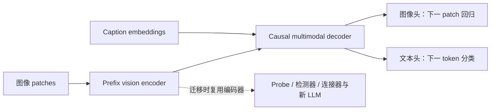

# AIMv2：用图像与文本的自回归预测，训练可复用的视觉编码器

> [!note] 主归属（本库导航判断）
> 目标是强视觉 encoder；多模态 decoder 服务预训练，不因此将来源主归图像生成接口。 [[raw/papers/vision/representation/AIMv2.pdf#page=2|pp.2–3，§2.1–2.2/Fig.1]]

> [!summary] 核心判断
> AIMv2的主要产物是**视觉编码器**。预训练时，它与一个causal multimodal decoder联合训练：图像特征在前、caption token在后，图像侧回归归一化patch像素，文本侧预测下一token。之后保留encoder，接分类probe、检测器或另一个LLM。实验支持这种联合目标在作者设置中学习到强视觉与多模态表示；不等于训练出的encoder自身就是能回答问题的完整MLLM，也不意味着各任务都胜过对比学习或自监督方法。[[raw/papers/vision/representation/AIMv2.pdf#page=2|p.2 §2.1、图1]]；[[raw/papers/vision/representation/AIMv2.pdf#page=7|p.7 §4.3.1]]

## 来源身份与实际核读

- **论文**：Enrico Fini、Mustafa Shukor、Xiujun Li 等，Apple，*Multimodal Autoregressive Pre-training of Large Vision Encoders*。归档为 arXiv:2411.14402 **v1，2024-11-21**，18页；标题/作者/版本按首页核对；[固定版本](https://arxiv.org/pdf/2411.14402v1)。
- **原件**：[[raw/papers/vision/representation/AIMv2.pdf]]；SHA-256：f86924b23fb81db4f190c82d416597c0cd9fd8d819c106bf32a11c24db815d4f。
- **实际读取**：2026-10-31；正文pp.1–9，附录A–D pp.15–18的方法、训练设置、评估协议与结果；视觉核对pp.2、3、4、5、6、8、15、16、18的架构/公式/表格与消融。
- **未读/未做**：引用论文未沿引文扩读；p.17图C1定性例子未逐图视觉核验，不以这些例子支持泛化或精度主张；[官方主仓库 apple/ml-aim](https://github.com/apple/ml-aim)据论文首页登记，代码本次未审查/运行；未复现，Obsidian内显示未测。AIM v1不另行摄入，其在本文中的对照只作为本文作者实验记录。
- **冻结旧笔记输入**：[[raw/notes/视觉编码器/AIMv2总结.tex]]、[[raw/notes/视觉编码器/Latex_out/AIMv2总结.pdf]]；本次对照TeX正文，不把旧稿代码段当官方实现证据。

## 1. 为何同时预测图像与caption？

仅用caption监督可以教会视觉表示哪些内容有助于语言描述，但caption不必覆盖图像每处细节。作者希望图像级自回归损失提供更密集的视觉信号，同时保留文本监督对语义的帮助。**这是作者的设计动机**；“因此必然学会全部细节”不是已证明结论。对比学习需要的训练设置、规模困难也只是本文背景与比较范围，不是所有判别式方法的普遍缺陷。[[raw/papers/vision/representation/AIMv2.pdf#page=1|p.1 §1]]

AIMv2把图像patch的连续像素回归与文本离散token分类放到同一序列建模流程里，而不是先训练一个图像离散码本。视觉侧不是词表分类，两个输出头的维数和损失不同。图像在前，文字可依赖视觉特征；预训练视觉encoder并不接收caption作为输入，因此仍可独立抽取图像表示。[[raw/papers/vision/representation/AIMv2.pdf#page=2|p.2 §2.1与图1]]

## 2. 三个组件、两种注意力和两项损失

**视觉encoder**采用ViT，加入RMSNorm与SwiGLU，训练时使用prefix attention。**联合decoder**接收线性投影后的图像表示和文本embedding，使用causal self-attention。**两个线性输出头**分别预测下一patch像素与下一文本token；没有为这条预训练路径另加图文cross-attention模块。[[raw/papers/vision/representation/AIMv2.pdf#page=3|p.3 §2.2]]；[[raw/papers/vision/representation/AIMv2.pdf#page=9|p.9 Captioning讨论]]

以下为本库根据原文图1重组的训练/迁移关系，箭头表示数据流或组件复用：

若图像含$I$个patch、caption含$T$个token，原文以统一序列的条件分解说明自回归目标：

$$P(S)=\prod_{j=1}^{I+T}P(S_j\mid S_{<j}).$$

原文的概括式分别写为

$$
L_{\rm img}=\frac1I\sum_{i=1}^{I}
\|\hat x_i(x_{<i};\theta)-x_i\|_2^2,\qquad
L_{\rm text}=-\frac1T\sum_{t=I+1}^{I+T}\log P(x_t\mid x_{<t};\theta),
$$

$$L=L_{\rm text}+\alpha L_{\rm img}.$$

这里$x_i$的回归目标经过patch normalization；它不是未归一化的原始RGB预测，也不是CLIP式图文相似度损失。图像块的输出维度由patch像素数决定，$I$是块的数量，不能把单个patch写成“$\mathbb R^I$”。文本token是离散索引，经embedding后才成为连续输入。[[raw/papers/vision/representation/AIMv2.pdf#page=2|p.2 Objective function]]

**概括公式还要与实际mask规则合读**：§2.2随机采样prefix长度$M\in\{1,\ldots,I-1\}$，像素损失仅在$i>M$的非prefix块计算。prefix attention允许作为上下文的前缀内部交互，后续位置按自回归约束读取上下文；推理时encoder可用双向attention，无需为此再调参。因此“每个patch在每步都贡献像素loss”不准确，图1简化伪代码也没有展开这条mask细节。本文未给出实现级有效patch归一化的全部细节，本页不推断未核代码的分母处理。[[raw/papers/vision/representation/AIMv2.pdf#page=3|p.3 Prefix Attention]]

## 3. 模型、训练数据与分辨率阶段

| 组件/阶段 | 原文条件 | 阅读时避免混淆 |
| --- | --- | --- |
| Encoder家族 | L/H/1B/3B约0.3/0.6/1.2/2.7B参数；width1024/1536/2048/3072，24层；patch14 | 名称“3B”不是精确3.0B；这里统计encoder |
| 预训练decoder | 默认width1024、depth12；各encoder共用同容量decoder | 它是为预训练配置的联合decoder，不能直接叫Llama-3或下游LLM |
| 预训练 | 224²，约12B次图文样本，batch8192、1.5M iterations、fully decoupled AdamW | 12B为处理次数，数据由公开/私有及原caption/合成caption混合 |
| 高分辨率适配 | 336²、448²；同源池另采2B次，不用合成caption，weight decay=0 | 89.5%的高分辨率结果带有额外适配预算 |

依据：[[raw/papers/vision/representation/AIMv2.pdf#page=3|p.3 表1–2、§2.3–2.4]]；[[raw/papers/vision/representation/AIMv2.pdf#page=8|p.8 表9e–f]]；[[raw/papers/vision/representation/AIMv2.pdf#page=15|p.15 表A1]]。

数据混合表2包括DFN原caption与合成caption各30%，COYO 9%，HQITP原caption28%、合成caption3%。部分合成caption和HQITP不是公开数据；所以不能将开源模型等同于预训练数据完全公开、可原样重建。文本采用SigLIP tokenizer，截断到77 tokens。[[raw/papers/vision/representation/AIMv2.pdf#page=3|p.3 表2]]；[[raw/papers/vision/representation/AIMv2.pdf#page=15|p.15 A]]

> [!note] 原件表格的列标问题
> v1表1把decoder的$d_{dec}$/$L_{dec}$列分别排成12/1024，与表9e默认width1024、表9f默认depth12冲突。本页采用明确的width/depth消融表解释默认decoder，保留这一排版疑点；未用未审查代码静默覆盖原文。[[raw/papers/vision/representation/AIMv2.pdf#page=3|p.3 表1]]；[[raw/papers/vision/representation/AIMv2.pdf#page=8|p.8 表9]]

**Native resolution是另一种适配，不是NaViT packing。**每批采样目标面积$A$，保宽高比缩放，必要时零填充。令$A_i$为第$i$批中每张图的patch数（含必要填充），$B_i$为该批图像数，$C$为整批patch数；调整$B_i$，使总patch预算$C=A_iB_i$固定。采样目标面积$A$与计数变量$A_i$须区分，不能把像素面积直接代入patch预算公式。作者明确说该实现无需sequence packing启发式、额外attention mask或custom pooling。它与[[wiki/papers/vision/representation/NaViT|NaViT]]都允许变尺寸，但batch组织机制不同。固定总patch数也不能自动保证所有attention计算/内存完全恒定。[[raw/papers/vision/representation/AIMv2.pdf#page=4|p.4 §2.4续]]

## 4. 哪些实验比较更接近“目标函数带来的收益”？

表9的受控消融比跨论文排行榜更适合回答机制问题：ViT-L、224²、2B图文训练；IN-1k采用冻结encoder的attentive probe，VQAv2/TextVQA为后续指令训练后验证集准确率。[[raw/papers/vision/representation/AIMv2.pdf#page=8|p.8 §5]]

| 目标/设置 | IN-1k | VQAv2 | TextVQA | 解释 |
| --- | --- | --- | --- | --- |
| caption-only，双向encoder | 85.1 | 76.2 | 34.4 | 参照项 |
| caption-only，prefix encoder | 85.4 | 76.8 | 36.5 | 注意力规则本身也改变结果 |
| AIMv2联合目标，prefix | 85.6 | 76.9 | 37.5 | 在相同prefix基线上加入图像目标仍有提升，但幅度须如实保留 |
| CLIP目标，batch16k | 85.2 | 74.8 | 26.3 | 同数据与含SwiGLU/RMSNorm的架构；不同训练目标和batch |
| CapPa，batch8k | 84.7 | 75.1 | 30.6 | 同一受控实验中的另一目标 |

上述数值来自[[raw/papers/vision/representation/AIMv2.pdf#page=8|p.8 表9a–b]]。它支持联合目标在这些指标上的收益，不把完整AIMv2与caption双向版本的全部差距都归因于像素loss。作者提出prefix迫使模型从部分图像形成有信息的上下文，这在原文明确是**待研究假设**。

$\alpha=0.2/0.4/0.6$时IN-1k均85.6，VQA/TextVQA仅小幅波动，因此0.4是该消融选择，不能称普适最优值。joint decoder与separate decoder接近且各有小优势；增大decoder并不单调提升encoder质量。[[raw/papers/vision/representation/AIMv2.pdf#page=8|p.8 表9c–f]]

## 5. 主结果按任务和评估流程拆开

**识别不是零样本，也不是整网微调。**表3训练attentive classifier而冻结主干，3B/14在224²的ImageNet为88.5%，448²适配后为89.5%。ImageNet probe训练100 epochs，batch1024，搜索学习率/weight decay；50k张评估图像。Attentive probing不是简单linear probe，不能直接与[[wiki/papers/vision/representation/SoViT|SoViT]]的线性探测或整网微调分数排高低。DINOv2在若干医学/细粒度识别任务仍强；表3不能概括为“全面超过自监督”。[[raw/papers/vision/representation/AIMv2.pdf#page=5|p.5 表3、§4.1]]；[[raw/papers/vision/representation/AIMv2.pdf#page=15|p.15 表A2、B1]]

**Zero-shot需另做LiT。**表5中AIMv2-L以12B预训练＋3B LiT后，ImageNet zero-shot77.0%；对照SigLIP为80.4%、报告40B训练。它说明兼容文本对齐适配，但既不全面胜过SigLIP，也不能将不同总预算当严格目标消融。[[raw/papers/vision/representation/AIMv2.pdf#page=5|p.5 表5]]；[[raw/papers/vision/representation/AIMv2.pdf#page=6|p.6 Zero-shot via LiT]]

**MLLM成绩需要新的连接器、LLM和指令数据。**默认冻结视觉encoder，2层MLP连接器接Llama-3.0 8B，使用LLaVA SFT数据单阶段训练连接器与LLM一个epoch，连接器学习率为LLM的8倍。表7所有AIMv2为336²、576patch；L模型VQAv2为79.7%、TextVQA53.6%，同表OpenAI CLIP-L为78.0/47.5，AIMv2-3B为80.9/58.2。这些不是裸encoder结果；不同规模基线还有752或3034patch，不要称整张表完全等token、等算力。[[raw/papers/vision/representation/AIMv2.pdf#page=6|p.6 表7]]；[[raw/papers/vision/representation/AIMv2.pdf#page=7|p.7 §4.3.1]]

问答指标也不是统一accuracy：VQAv2/TextVQA等使用Val accuracy，DocVQA/InfoVQA为Test ANLS，ChartQA为Test relaxed accuracy，COCO/TextCaps/NoCaps为Val CIDEr；图6把MMEp除以2000用于显示，不能抄成原始MME分数。附录C1的LLaVA SFT设置为batch128、5000 iterations，LLM/connector学习率分别$10^{-5}$/$8\times10^{-5}$。[[raw/papers/vision/representation/AIMv2.pdf#page=16|p.16 表C1–C2]]；[[raw/papers/vision/representation/AIMv2.pdf#page=7|p.7 图6]]

提高输入到672/1008时，先分2×2/3×3的336² tiles；这不是把单个encoder输入原样变成1008²。TextVQA等文字密集任务获益明显，附录也说明COCO、NoCaps、TextCaps、MMEp没有一致收益。[[raw/papers/vision/representation/AIMv2.pdf#page=7|p.7 High-Resolution via Tiling]]；[[raw/papers/vision/representation/AIMv2.pdf#page=16|pp.16–17 C.2、表C3]]

**检测与grounding需区分开放和封闭词表。**MM-Grounding-DINO/ViTDet流程在统一grounding混合数据上微调，表4 AIMv2为COCO AP60.2、LVIS AP31.6；RefCOCOg P@1为88.9，低于DINOv2的89.1。更不能忽略附录D3：COCO17闭词表Mask-RCNN、1024输入、window16、100epochs、batch64下，AIMv2检测AP54.0/分割AP46.7，DINOv2为55.5/48.3。任务与训练流程不同，两个结论不矛盾。[[raw/papers/vision/representation/AIMv2.pdf#page=5|p.5 表4]]；[[raw/papers/vision/representation/AIMv2.pdf#page=6|p.6 §4.2]]；[[raw/papers/vision/representation/AIMv2.pdf#page=18|p.18 D.2、表D3]]

**Scaling只在实验范围内成立。**图2研究0.3–约3B encoder、0.5–6.4B处理样本；更大模型在小计算预算下可能训练不足。图3分辨率和容量趋势也不保证每个数据集每一步都单调。作者认为密集监督解释效率优势，但跨数据/模型主对照没有完全隔离所有因素。[[raw/papers/vision/representation/AIMv2.pdf#page=3|pp.3–4 图2–4、§3]]

## 6. 对冻结旧稿的明确纠正与主题建议

1. 旧式$L_{\rm text}+\alpha L_{\rm text}$应为$L_{\rm text}+\alpha L_{\rm img}$；补齐平均损失及non-prefix mask的边界。
2. “未归一化像素块”改为论文明确的normalized patch回归；Casual应为Causal。
3. “NaViT架构进行packing后训练”改为本文独立的面积采样＋可变batch；固定336/448适配、native适配、下游tiling分开说明。
4. 旧稿代码里的bias、位置编码、scaled_dot_product_attention等实现陈述本次未核官方代码，不能直接升级为本页原文事实；不沿旧稿链接扩展比较其他模型。
5. “2025年初主流模型都是判别式”不是2024年v1能直接支撑的全体断言；“全面超过DINOv2/CLIP”“ICL超过整个MM1系列”改为具体任务、预算与作者所列对照。4/8-shot平均优势是本文表8报告；0-shot并未优于DFN-CLIP，且部分基线为引用报告。[[raw/papers/vision/representation/AIMv2.pdf#page=6|p.6 表8]]；[[raw/papers/vision/representation/AIMv2.pdf#page=7|p.7 §4.3.2]]

**本库整合主题**：视觉预训练目标（判别、caption、自回归像素）；训练decoder与部署encoder的分工；冻结表示评估、适配与多模态SFT的证据层次；native输入与tiling的不同成本。实际主题落点与双向链接见页末。

**待检验问题**：图像回归的局部增益能否在严格相同数据质量、总FLOPs、输入token与decoder预算下保持？prefix策略究竟改善了哪些空间信息？这些需要后续受控证据，当前不以作者解释替代验证。

## 实际整合关系

支撑prefix像素+文本目标、训练decoder/部署encoder分工，以及native变batch与tiling的不同机制。

- [[wiki/vision/Objectives-and-Transfer|视觉预训练：目标要求保留什么，迁移又读取什么？]]。
- [[wiki/vision/Resolution-and-Token-Budget|分辨率、packing与tiling：预算到底在哪个位置？]]。
- [[wiki/evaluation/Judges-and-Task-Success|裁判与任务成功：答案、解释、生成物和终态怎样分别取证？]]。
- [[wiki/training/Supervision-and-Stages|监督与阶段：数据、目标、开放参数和预算如何一起改变？]]。
