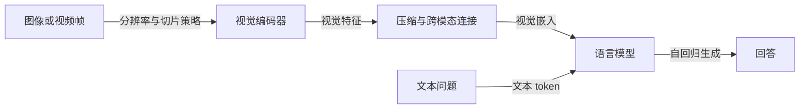

# Efficient Multimodal Large Language Models: A Survey

**这篇综述最有用的视角，是把 MLLM 的效率问题拆到信息流与训练流程中：图像怎样变成特征，多少视觉 token 进入语言模型，哪些参数参与计算和更新，以及任务要求保留什么信息。** 小语言模型只是其中一个入口；高分辨率、长视频和文档理解还要求控制视觉信息进入 LLM 的方式。作者的目标是降低资源消耗、扩大可用场景，同时尽量减小性能损失；这不是一个单一的参数量指标。[[raw/surveys/Efficient Multimodal Large Language Models A Survey.pdf#page=2|S001 · §1 · pp.2–4、Fig.3]]

> [!info] 本页证据与状态
> 已通读本地版本正文 PDF pp.1–24，核对下列关键原页图表；参考文献从 p.25 开始，未逐项追索原论文。本文是综述，下面模型案例在本页均依据**综述转述**，本页阅读不增加被引原论文的已读来源数；其他唯一来源页是否已独立核读，见 [[wiki/index|索引]]。`read` 只表示完成这里登记的阅读范围；本页已通过登记范围的独立内容审查，已接入初始主题与索引；全库及最终验收仍待收尾，摄入状态为 `integrating`。未运行代码、复现实验或实测部署；Obsidian 内显示未测。

## 先理解瓶颈：效率改变的是哪一段计算

综述采用常见的三组件接口：视觉编码器得到 $Z_v=g(X_v)$，连接器得到 $H_v=P(Z_v)$，语言模型接收视觉嵌入 $H_v$ 与文本 token $H_q$，按已有输出前缀自回归生成回答。这解释了为什么“视觉编码器参数占比小”与“视觉输入造成很大计算压力”可以同时成立：前者谈模型权重构成，后者还涉及输入序列长度及后续 LLM 处理。后一句是本库依据不同章节做出的机制归纳。[[raw/surveys/Efficient Multimodal Large Language Models A Survey.pdf#page=4|§2.1–2.3 · pp.4–7、Eq.1–3]]

这是本库依据 Fig.3 与 §2 的信息流重组，箭头表示数据传递。压缩与连接可能由同一模块承担，也可能分开；图中没有把所有模型强制规定为额外增加一个压缩层。训练阶段则决定这些组件中谁冻结、谁更新。[[raw/surveys/Efficient Multimodal Large Language Models A Survey.pdf#page=4|§2 · Fig.3 · p.4]] [[raw/surveys/Efficient Multimodal Large Language Models A Survey.pdf#page=18|§5 · Fig.14 · p.18]]

按这个信息流，可复用的比较问题是：**节省了哪种资源，节省发生在哪个阶段，保留能力的代价由谁承担？** 下表是本库对综述的重组，不是作者提供的统一测量框架。

| 改动对象 | 主要希望减少什么 | 不能仅凭此推出什么 | 综述依据 |
| --- | --- | --- | --- |
| 更小的语言骨干、轻量视觉编码器 | 权重规模及相应计算负担 | 参数更少不直接确定相同硬件上的端到端延迟，也不保证细粒度视觉能力不变 | [[raw/surveys/Efficient Multimodal Large Language Models A Survey.pdf#page=5\|§2.1、2.3 · pp.5–7]] |
| 视觉 token 压缩、动态裁剪、合并与重采样 | 进入 LLM 或在后续层保留的视觉序列长度 | token 更少不等于原始图像信息无损；前端编码和压缩本身也有成本 | [[raw/surveys/Efficient Multimodal Large Language Models A Survey.pdf#page=7\|§2.4–2.5 · pp.7–10]] |
| MoE、Mamba、共享 KV 头等计算结构 | 单次激活计算、序列处理或解码内存带宽等不同开销 | 激活参数不等于总参数；复杂度描述不等于任意长度与硬件下的实测加速 | [[raw/surveys/Efficient Multimodal Large Language Models A Survey.pdf#page=9\|§2.5 · pp.9–10]]；[[raw/surveys/Efficient Multimodal Large Language Models A Survey.pdf#page=14\|§4.1–4.2 · pp.14–16]] |
| 冻结参数、PEFT、低内存优化器 | 可训练参数、优化器状态或训练内存 | 更新参数少不表示基础模型权重消失，也不能自动得出推理更快 | [[raw/surveys/Efficient Multimodal Large Language Models A Survey.pdf#page=16\|§4.3 · pp.16–17]]；[[raw/surveys/Efficient Multimodal Large Language Models A Survey.pdf#page=19\|§5.4 · p.19]] |
| 数据质量、配比、阶段和分辨率课程 | 在给定训练预算内形成目标能力所需的成本 | 数据更少、阶段更少或更高质量的标签，不能脱离生成成本与目标任务直接判定整体更便宜 | [[raw/surveys/Efficient Multimodal Large Language Models A Survey.pdf#page=18\|§5 · pp.18–19]]；[[raw/surveys/Efficient Multimodal Large Language Models A Survey.pdf#page=20\|§6.1–6.2 · pp.20–21]] |

## 六个视角如何组成领域地图

引言明确给出六类：Architecture、Efficient Vision、Efficient LLMs、Training、Data and Benchmarks、Applications。它们的分类依据并不完全相同：前三类着重系统组件和可迁移技术，Training 讨论更新过程，Data and Benchmarks 讨论学习材料与评价，Applications 讨论任务约束。因此，同一个方法出现在多个入口是正常现象，不能把六类看成互斥算法集合。最后这个关系判断是本库归纳。[[raw/surveys/Efficient Multimodal Large Language Models A Survey.pdf#page=2|§1 · pp.2–4]]

| 综述视角 | 核心分类与阅读问题 | 与其他视角的接口 |
| --- | --- | --- |
| Architecture（§2） | 编码器、连接器、小语言模型、视觉 token 压缩、MoE/Mamba/推理加速；关注怎样组装一个高效 MLLM | 决定视觉信息进入 LLM 的形式，再由训练与数据使接口有效。[[raw/surveys/Efficient Multimodal Large Language Models A Survey.pdf#page=4\|pp.4–10、Fig.3]] |
| Efficient Vision（§3） | 紧凑架构、剪枝、知识蒸馏、量化；关注视觉侧有哪些效率工具 | 本章是可能用于 MLLM 的视觉技术地图，不表示所有条目已在完整 MLLM 上验证。[[raw/surveys/Efficient Multimodal Large Language Models A Survey.pdf#page=10\|pp.10–14、Fig.9–10]] |
| Efficient LLMs（§4） | Attention、Framework、Fine-Tuning；区分注意力开销、骨干结构和参数更新方式 | 提供语言侧可借鉴技术；相同“高效”标签可能指推理或训练。[[raw/surveys/Efficient Multimodal Large Language Models A Survey.pdf#page=14\|pp.14–17、Fig.11]] |
| Training（§5） | 多模态预训练、指令微调、不同阶段组织、参数高效迁移 | 冻结方案与数据质量、骨干规模、输入分辨率相互影响。[[raw/surveys/Efficient Multimodal Large Language Models A Survey.pdf#page=17\|pp.17–19、Fig.14]] |
| Data and Benchmarks（§6） | PT 数据、IT 数据、能力基准；区分学什么与怎样测 | 数据表说明来源与规模，性能表说明部分能力；都不能单独测出端到端效率。[[raw/surveys/Efficient Multimodal Large Language Models A Survey.pdf#page=20\|pp.20–22、Tables 2–4]] |
| Applications（§7） | 医学、文档、视频理解 | 任务把细节、上下文、领域监督、设备和隐私要求施加到前述设计。[[raw/surveys/Efficient Multimodal Large Language Models A Survey.pdf#page=22\|pp.22–23]] |

**原文图文存在一个导航差异：**Fig.2 只画出 Architecture、Training、Data and Benchmarks、Application 四条顶层分支；独立的 §3 和 §4 分别在 Fig.9、Fig.11 展开。本页以引言与实际章节为准，不把 Fig.2 当作完整六类总图。[[raw/surveys/Efficient Multimodal Large Language Models A Survey.pdf#page=3|Fig.2 · p.3]] [[raw/surveys/Efficient Multimodal Large Language Models A Survey.pdf#page=10|Fig.9 · p.10]] [[raw/surveys/Efficient Multimodal Large Language Models A Survey.pdf#page=14|Fig.11 · p.14]]

## 视觉效率的关键矛盾：细节需要更多信息，语言模型不宜接收无限 token

低分辨率可能遗漏小字、密集对象和局部关系；直接提高分辨率又会增加视觉 token。综述以 Transformer 的 token 两两交互开销解释这类压力。应把“平方增长”限定在这里讨论的注意力与序列长度关系，不能写成整个 MLLM 的所有计算都按图片边长平方增长。[[raw/surveys/Efficient Multimodal Large Language Models A Survey.pdf#page=7|§2.4 · p.7]] [[raw/surveys/Efficient Multimodal Large Language Models A Survey.pdf#page=14|§4.1 · p.14]]

**连接器既是对齐接口，也可能承担信息选择。** MLP 主要进行特征变换；Q-Former、Perceiver Resampler 用可学习 query 聚合视觉特征；LDPv2 将变换、池化降 token、位置增强组合起来；Honeybee 的 C-Abstractor 与 D-Abstractor 分别借助卷积和 deformable attention 保留局部上下文，并允许调整输出 token 数。这里值得保留的比较轴是“输出长度能否控制、局部关系如何保留、是否引入额外查询或采样”，而不是按模块名字排先进程度。[[raw/surveys/Efficient Multimodal Large Language Models A Survey.pdf#page=6|§2.2 · pp.6–7、Fig.5]]

多视图输入与 token 压缩解决不同环节的问题：全局缩略图加局部切片先提高可见细节，后续重采样、合并和空间组织再控制 LLM 输入。综述转述 LLaVA-UHD 将图像切片、压缩与空间 schema 结合；Mini-Gemini 用低分辨率特征作为 query 检索高分辨率信息；S2 把不同尺度送入同一个预训练视觉模型，合并、池化后在通道方向拼接。**S2 的“parameter-free”指该多尺度包装机制不额外训练参数，不表示无需额外视觉计算。** 后一句是依据原图多个编码路径所作的本库辨析。[[raw/surveys/Efficient Multimodal Large Language Models A Survey.pdf#page=8|§2.4 · pp.8–9、Fig.7]]

另一条路线是改变视觉信息被使用的位置：OCR/grounding 专家补充编码器不易保留的内容，视觉专家路由选择任务相关表示；FastV、VTW 则在 LLM 的较深层减少或移除视觉 token。它们不能合并成“视觉 token 普遍无用”的结论：前者增加外部或专门处理，后者依赖已有层中的跨模态处理，且综述没有在此提供跨全部任务的统一验证。[[raw/surveys/Efficient Multimodal Large Language Models A Survey.pdf#page=8|§2.4 · Vision Expert Agents · pp.8–9]] [[raw/surveys/Efficient Multimodal Large Language Models A Survey.pdf#page=10|§2.5 · Inference Acceleration · p.10]]

视觉编码器内部的压缩又是另一层：§3 以紧凑架构、剪枝、蒸馏和量化组织工具。剪枝需要说明移除的是权重、通道、头、层还是 token；蒸馏需要说明教师/学生结构及监督落在 logit、patch、module 还是 feature；量化需要区分 PTQ、QAT 和硬件适配。综述在这一章收集的是视觉侧方法，并明确说是“may be used”于 efficient MLLMs，故视觉分类任务上的压缩收益不能自动升级为跨模态任务结论。[[raw/surveys/Efficient Multimodal Large Language Models A Survey.pdf#page=10|§3 · pp.10–14、Fig.9–10]]

## 语言侧效率：小模型、少激活、少搬运与少更新不是一回事

作者将 SLM 视为降低参数规模的主要入口，因为在其典型框架中语言模型占多数参数；§2.3 的典型描述是使用小于 3B 的骨干，但 Table 1 同时列出更大骨干和激活参数标记，不能把 3B 当成本文严格筛选阈值。该综述更像围绕高效设计建立的案例集合，而不是依统一参数边界纳入的系统性样本。[[raw/surveys/Efficient Multimodal Large Language Models A Survey.pdf#page=5|Table 1 · p.5]] [[raw/surveys/Efficient Multimodal Large Language Models A Survey.pdf#page=7|§2.3 · p.7]]

MoE 的可用解释来自 §2.5：增加总容量时只激活部分专家，因此要分别记录总参数和 activated parameters；Mamba 路线则改变序列处理结构，Cobra、VL-Mamba 把这种骨干用于多模态，并涉及模态融合或二维视觉扫描的适配。两者回答不同问题：一个控制每次计算动用哪些参数，另一个改变如何表示和更新序列信息。它们在本页仍是综述转述，不能凭“大致线性”或“激活少”推出已在目标设备上更快。[[raw/surveys/Efficient Multimodal Large Language Models A Survey.pdf#page=9|§2.5 · pp.9–10、Fig.8]] [[raw/surveys/Efficient Multimodal Large Language Models A Survey.pdf#page=16|§4.2 · p.16]]

GQA/MQA 的共享对象是 Key/Value 头，Fig.12 直观展示从每个 query 头各用一组 KV，到一组 query 共享 KV，再到全部 query 共享一组 KV。综述将其连接到自回归解码的内存带宽优化；这与删除输入 token、减少总模型参数或采用线性序列骨干不应混用。[[raw/surveys/Efficient Multimodal Large Language Models A Survey.pdf#page=14|§4.1 · pp.14–15、Fig.12]]

训练效率则需要另记账：Adapter 等 PEFT 主要限制更新的参数集合；全参数微调还可通过优化器与梯度处理降低内存需求，综述以 LOMO、MeZO 为例。仅统计 trainable parameters 会漏掉冻结骨干的前向计算；仅统计权重规模也看不到训练状态的差别。后两句为本库分析，原文给出了两条路线及其内存动机，并未提供一张统一的训练资源对照表。[[raw/surveys/Efficient Multimodal Large Language Models A Survey.pdf#page=16|§4.3 · pp.16–17]]

> [!warning] 不直接沿用的技术解释
> §4 存在需要回到原论文核查的表述：p.15 把低秩注意力解释为求两个低维矩阵的逆，并把 MoE 的节省归于专家参数共享；p.17 把 LoRA 概括为分解原权重、从而缩小模型。前述 MoE 说法还与 p.9“增加总参数、控制激活参数”的叙述存在张力。本次仅确认这些文字确实出现在综述中，**没有追读 Linformer、MoE、LoRA 原论文，故不以这些句子建立教学定义或效率结论**。同样，p.16 对 Adapter 直接声称加快推理，尚缺具体实现与测量条件。[[raw/surveys/Efficient Multimodal Large Language Models A Survey.pdf#page=15|§4.1–4.2 · p.15]] [[raw/surveys/Efficient Multimodal Large Language Models A Survey.pdf#page=16|§4.3 · pp.16–17]]
>
> Fig.12 图注还将 grouped-query attention 误标为 [59]，该编号实际对应视觉问答 GQA 数据集；p.14 §4.1 正文使用的 [143] 才对应 GQA 注意力论文。本页的 KV 共享解释依据该正文与图中关系，未追读这两篇原论文。[[raw/surveys/Efficient Multimodal Large Language Models A Survey.pdf#page=15|Fig.12 · p.15]] [[raw/surveys/Efficient Multimodal Large Language Models A Survey.pdf#page=28|参考文献 [59] · p.28]] [[raw/surveys/Efficient Multimodal Large Language Models A Survey.pdf#page=33|参考文献 [143] · p.33]]

## 训练与数据：接口能力由哪些参数、什么监督共同形成

综述里的多模态 pre-training 主要指利用图文对做跨模态对齐，并不是重新训练整个基础语言模型。图像 caption 被组织为描述图像的单轮对话，再用自回归目标预测描述；常见设置只更新 projector。Instruction-tuning 继续采用自回归监督目标，监督内容变为任务指令及单轮/多轮回答，常见设置固定视觉编码器，更新连接器与 SLM。**两阶段可以使用相同的自回归训练目标，主要区别在数据内容、参数开放范围与希望获得的行为。**[[raw/surveys/Efficient Multimodal Large Language Models A Survey.pdf#page=19|§5.2 · p.19]] 其中 Eq.4 给出自回归训练目标，Eq.5 给出指令序列的组织方式。[[raw/surveys/Efficient Multimodal Large Language Models A Survey.pdf#page=18|§5.1–5.2 · p.18、Eq.4–5、Fig.14]]

Fig.14 是典型方案的示意，不是规范性流水线。紧邻正文就讨论了对齐时只训练连接器可能不足，引用 TinyLLaVA、VILA、ShareGPT4V 说明可以开放更多视觉或语言参数；Idefics2 分阶段提高输入分辨率；SPHINX-X、Cobra 使用单阶段方案，TinyGPT-V 则使用四阶段。这里的可复用问题是“当前数据和目标是否足以支撑所开放的参数与输入复杂度”，而不是“单阶段一定比两阶段高效”。[[raw/surveys/Efficient Multimodal Large Language Models A Survey.pdf#page=18|§5.1 · Which part to unfreeze?、Multi-stage pre-training · p.18]] [[raw/surveys/Efficient Multimodal Large Language Models A Survey.pdf#page=19|§5.3 · p.19]]

数据侧有两个相互连接的取舍。第一，网络图文对规模大，但 caption 可能短且有噪声；更强模型生成的细粒度描述可能有助对齐，同时带来生成成本。综述以 ShareGPT4V 的“先用强模型数据训练 captioner，再扩量”解释成本转移。第二，数据格式决定监督覆盖：独立图文对、交错图文、任务 QA、多轮指令和纯文本对话承担不同用途；VILA 的相关结果在综述中被用于说明交错预训练及混合文本指令的价值，但本次没有独立核验其消融。[[raw/surveys/Efficient Multimodal Large Language Models A Survey.pdf#page=20|§6.1–6.2 · pp.20–21、Tables 2–3]]

因此，Table 2 的图像数、文本数、图文对/实例数和 Table 3 的指令实例数不能直接相加为同一个“训练规模”。尤其交错语料的一个 instance 可以包含多个图文元素；这里只能据表头与脚注保存统计口径，不能由数据集名称判断每个模型实际训练了多少样本、重复了多少轮或消耗了多少 token。[[raw/surveys/Efficient Multimodal Large Language Models A Survey.pdf#page=20|Tables 2–3 · pp.20–21]]

## 怎样使用评测表，而不把它变成效率排行榜

Table 4 汇集不同模型在 14 个视觉语言基准上的报告分数；它主要展示能力覆盖与结果异质性，没有统一的硬件、时延、显存、能耗、训练成本和输入 token 列。因此，它可以帮助发现“接下来应核查哪些能力与设置”，不能回答“哪个模型在同样预算下最优”。这是对表格可见字段及脚注的本库判断，不是另做了一次基准实验。[[raw/surveys/Efficient Multimodal Large Language Models A Survey.pdf#page=21|§6.3 · pp.21–22、Table 4]]

| 读表时必须保留的条件 | 原文已有信息 | 本库使用边界 |
| --- | --- | --- |
| 数据划分与统计口径 | MMMU 两个数字为 val/test；SEED 两个数字为全体/image 子集；MME 分 perception/cognition，† 为两者合计 | 不把斜杠两侧或合计与单项直接比较。[[raw/surveys/Efficient Multimodal Large Language Models A Survey.pdf#page=22\|Table 4 脚注]] |
| 训练图像可见性 | * 表示训练时见过相应数据集训练图像 | 不把带星分数默认为严格未见数据泛化；脚注也不足以判断全部污染风险。[[raw/surveys/Efficient Multimodal Large Language Models A Survey.pdf#page=22\|Table 4 脚注]] |
| 模型与输入条件 | Table 1 提供部分骨干、编码器、分辨率和连接器；Table 4 有多处缺失结果 | 不把缺失当零分，不在未统一 recipe、分辨率和骨干条件下归因于某个组件。[[raw/surveys/Efficient Multimodal Large Language Models A Survey.pdf#page=5\|Table 1]]；[[raw/surveys/Efficient Multimodal Large Language Models A Survey.pdf#page=22\|Table 4]] |
| 效率指标与部署条件 | 引言与个别案例提到计算、内存或训练时间，但 Table 4 不提供统一资源测量 | 后续若比较效率，需另核硬件、精度、输入/输出长度、batch、视觉处理和计时范围；这是本库建议，本文未执行。[[raw/surveys/Efficient Multimodal Large Language Models A Survey.pdf#page=2\|§1 · p.2]]；[[raw/surveys/Efficient Multimodal Large Language Models A Survey.pdf#page=22\|Table 4]] |

原文以颜色标出某些列的最高分。本页不据此排名，也不把能力基准得分等同于真实部署的通用多模态能力。不同任务所需的细节与推理结构不同，效率判断应回到目标任务及可用资源，不能只比较参数量和一个平均分。

## 应用怎样反过来约束设计

**文档与图表理解**要求小字、版面和细粒度信息可见，因而同时牵涉高分辨率输入、视觉 token 压缩及任务监督。综述以 TinyChart 的 PoT 与 Visual Token Merging、TextHawk 的专门组件说明这些环节可能同时改变；不能将整套系统的结果只归因于压缩。这里仅保留综述的设计联系，未核读所引方法的消融。[[raw/surveys/Efficient Multimodal Large Language Models A Survey.pdf#page=23|§7.2 · p.23]]

**视频理解**把空间 token 压力扩展到时间维度。综述对比了稀疏帧采样加 abstractor、图像/视频表示对齐、每帧少量 token，以及在线处理加 memory bank 等路线。它们分别控制送入多少帧、每帧怎样表示、跨时间保留什么；减少同时进入上下文的信息可能改变事件细节的可访问性。这一风险是本库提出的待核问题，本文没有统一实验判断哪条路线最优。[[raw/surveys/Efficient Multimodal Large Language Models A Survey.pdf#page=23|§7.3 · p.23]]

**医学应用**在综述中连接领域标注成本、轻量适配与本地私有部署，案例为 MoE-TinyMed、LLaVA-Rad。相关性能及设备描述仍是综述转述；它们不构成临床安全、泛化或真实工作流程有效性的独立验证。[[raw/surveys/Efficient Multimodal Large Language Models A Survey.pdf#page=22|§7.1 · p.22]]

§8 的长上下文、更多输入/输出模态、高质量指令数据与边缘具身 Agent 是作者展望。它们帮助提出约束问题，但不是已验证的能力，也不是本库已经查新确认的研究空白。尤其“多数模型通常只接受单图”等描述属于该综述版本的判断，不能不加时间范围地充当整个当前领域现状。[[raw/surveys/Efficient Multimodal Large Language Models A Survey.pdf#page=23|§8.1–8.2 · pp.23–24]]

## 综述能支持什么，哪些结论需要另取证

本次阅读支持把“高效 MLLM”拆成组件、表示长度、激活计算、数值精度、参数更新、数据和任务约束之间的关系；它不支持一个统一的性能顺序，也不证明列出的单模态技术已经在完整 MLLM 中保持同样收益。§3 与 §4 自身定位为可借鉴技术综览，§8.2 也明确承认技术细节与近期工作覆盖有限。[[raw/surveys/Efficient Multimodal Large Language Models A Survey.pdf#page=10|§3 · p.10]] [[raw/surveys/Efficient Multimodal Large Language Models A Survey.pdf#page=14|§4 · p.14]] [[raw/surveys/Efficient Multimodal Large Language Models A Survey.pdf#page=24|§8.2 · p.24]]

**范围与时效性需要分开。** 首页标明 arXiv v3、2026-01-22；Fig.1 的时间轴止于 2024.03。本次未在正文中读到足以确定全部文献纳入时间窗、检索库、检索式和排除标准的说明。因此不能用版本日期宣称它系统覆盖到 2026 年，也不能只凭 Fig.1 断言全文只覆盖到 2024.03。[[raw/surveys/Efficient Multimodal Large Language Models A Survey.pdf#page=1|首页版本]] [[raw/surveys/Efficient Multimodal Large Language Models A Survey.pdf#page=2|Fig.1 · p.2]]

值得优先补证的不是再扩充模型名单，而是核实三个会改变理解的接口：视觉压缩保留哪些任务所需信息；效率结果是否包含全部视觉前端与语言解码成本；训练数据、开放参数和架构变化如何分别影响结果。这些是本库的后续阅读问题，尚未构成领域缺口或实验结论；本轮不据此扩展来源范围。

## 来源身份、实际读取与导航

| 项目 | 记录 |
| --- | --- |
| 来源 ID / 类型 | S001 / survey |
| 标题 | Efficient Multimodal Large Language Models: A Survey |
| 作者 | Yizhang Jin, Jian Li, Yexin Liu, Tianjun Gu, Kai Wu, Zhengkai Jiang, Muyang He, Bo Zhao, Xin Tan, Zhenye Gan, Yabiao Wang, Chengjie Wang, Lizhuang Ma；首页注明前两位 equal contribution |
| 版本 | 本地 PDF 首页：arXiv:2405.10739v3，2026-01-22，Preprint / Under review；未另核正式出版状态 |
| 原始标识与项目 | [arXiv 固定版本](https://arxiv.org/abs/2405.10739v3)；[作者所列综述项目](https://github.com/lijiannuist/Efficient-Multimodal-LLMs-Survey)。URL 据原文标识/首页转录，本次未联网核验项目当前内容 |
| 本地原件 | [[raw/surveys/Efficient Multimodal Large Language Models A Survey.pdf\|原始 PDF，36 页]]；5,055,945 bytes；本轮读取已提供的归档原件，未自行下载 |
| SHA-256 | `F62A5E5635507195C0571731AA46924E6336A13997C339DDC72C9E6B4AE83926` |
| 读取日期与正文 | 2026-10-31；实际通读 pp.1–24（摘要、§1–8），p.25 确认参考文献起点并读该页条目；审查修订时回读 pp.14–15、p.19，并核对 p.28 [59] 与 p.33 [143] 的书目条目及原页图像；页码从 PDF 首页起，与正文印刷页码一致 |
| 实际看图/表原页 | p.1 身份；p.2 Fig.1；p.3 Fig.2；p.4 Fig.3/Eq.1；p.5 Table 1/Eq.2；p.7 Fig.5/Eq.3；p.9 Fig.7；p.10 Fig.8–9；p.12 Fig.10；p.14 Fig.11；p.15 Fig.12；p.18 Fig.14/Eq.4–5；pp.20–22 Tables 2–4。以原页图像核对结构、字段和脚注，未逐项复算表内分数 |
| 未逐项核读 | pp.26–36 参考文献未通读；所有引用论文均未追索原文；Fig.4、6、13、15 的所在正文已读，但未作逐图视觉核验，不以其图内细节作证据 |
| 未做事项 | 未访问/审计综述代码仓库；未跑模型、测延迟/显存/能耗、训练或复现；未检查 Obsidian 渲染和 PDF 跳转 |
| 整合状态 | 已完成本页范围的独立内容审查和初始主题/索引整合；完整来源综合、结构与主 Agent 最终验收仍待收尾，状态保持 integrating |

页内阅读入口：[[#先理解瓶颈：效率改变的是哪一段计算|机制入口]] · [[#六个视角如何组成领域地图|分类地图]] · [[#怎样使用评测表，而不把它变成效率排行榜|评测边界]]。回查全文：[[raw/surveys/Efficient Multimodal Large Language Models A Survey.pdf|S001 原件]]。

## 本库主题落点

本页已经实际接入以下初始地图；模型机制在这些页面中仍按综述转述使用，未因跨页综合升级为原论文直接证据。

- [[wiki/overview|总览]] 与 [[wiki/foundations/Formalization|基础]]：编码器—连接器—语言模型的信息流、视觉 token 与可训练参数的区别。
- [[wiki/vision/Overview|视觉]] 与 [[wiki/architecture/Overview|架构]]：多视图、压缩、连接器以及信息进入语言计算的位置。
- [[wiki/training/Overview|训练]] 与 [[wiki/efficiency/Overview|效率]]：相同自回归目标下的数据/参数差异，以及训练、视觉前端和解码成本分账。
- [[wiki/evaluation/Overview|评测]] 与 [[wiki/models/Overview|模型演进]]：带划分和脚注读结果，按输入/接口/骨干/训练变化轴比较，避免把能力表当效率榜。

来源目录与施工进度见 [[wiki/index|索引]]。
