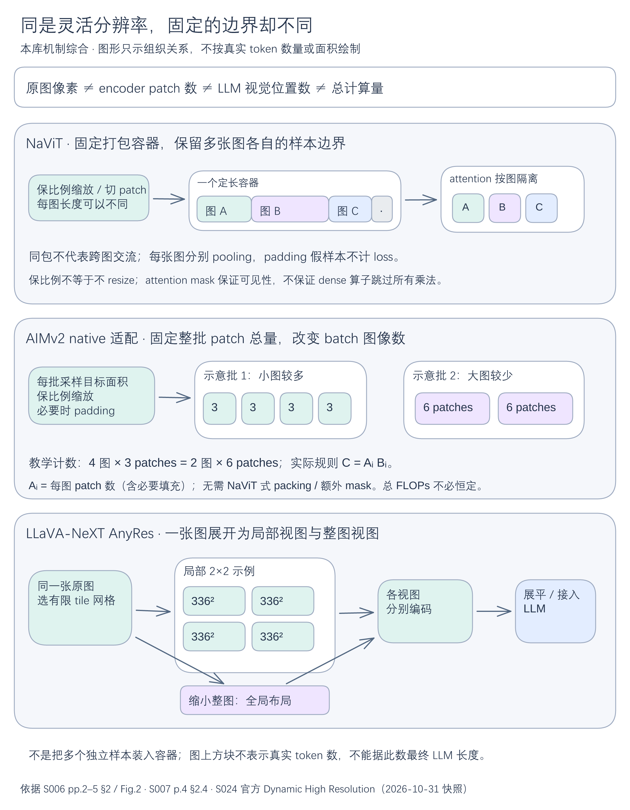

# 分辨率、packing与tiling：预算到底在哪个位置？

讨论“高分辨率”应先画出计数位置：**原图像素 → 视觉patch → 编码特征 → 接入LLM的位置**。resize、token drop、packing、query压缩和空间merger作用的位置不同。相同的“256 tokens”可能是一个encoder的输入长度，也可能是更大视觉序列的压缩输出，不能当作统一信息量。

## 从几何计数到计算位置

对整除、无padding、无额外标记的$H\times W$图像，patch边长$P$给出$N_{patch}=HW/P^2$。ViT的224²/16是196个patch，384²/16为576；position embedding也须适配新网格。边长增加会同时增加输入位置和attention交互，分类token并未包含在$N_{patch}$中。[[raw/papers/vision/representation/ViT.pdf#page=3|S004 · pp.3–4 §3.1–3.2]]

**本库算例：**一页窄长收据先被缩成224²，再在LLM里生成更多字，不能创造已被resize抹掉的笔画。保比例、增加局部视图或重新裁剪原件会改变证据输入，但其成本位置不同。以下比较的是机制，不是统一数据/算力下的效果排名。

| 策略 | 变长发生在哪里 | 保持/改变的边界 | 直接证据 |
| --- | --- | --- | --- |
| NaViT Patch n' Pack | 每张图patch数可变，多图装入定长容器 | attention按样本隔离、按图pooling、假padding样本不算loss | [[raw/papers/vision/representation/NaViT.pdf#page=2\|S006 · pp.2–5 Fig.2、§2]] |
| AIMv2 native适配 | 每批目标面积变化，调整batch图像数 | 保持整批patch预算；不依赖NaViT式packing | [[raw/papers/vision/representation/AIMv2.pdf#page=4\|S007 · p.4 §2.4]] |
| SigLIP2 NaFlex | 单图按目标长度保比例缩放并padding | attention和MAP屏蔽padding；另有分支训练预算 | [[raw/papers/vision/representation/SigLIP2.pdf#page=4\|S010 · pp.4–5 §2.4.2]] |
| LLaVA-NeXT AnyRes | 多个336²局部块，加缩小整图 | 每块各自编码，全局分支补跨块布局 | [S024官方Dynamic High Resolution](https://llava-vl.github.io/blog/2024-01-30-llava-next/#1-dynamic-high-resolution)，2026-10-31快照[[raw/web/S024-LLaVA-NeXT/official-blog.html]] |

NaViT的mask保证一张图不依赖同包的其他图；**它不是把多个训练样本拼成一个多图语义任务**。mask也不自动让dense算子省去所有被屏蔽乘法。AIMv2则用$C=A_iB_i$固定每批patch总数，其中$A_i$是每图patch数、$B_i$是图像数；这不等于所有attention代价严格恒定。NaFlex训练长度与评测长度须分开，且该分支没有标准SigLIP2的视觉自监督。[[raw/papers/vision/representation/NaViT.pdf#page=4|S006 · pp.4–5 §2.3]] [[raw/papers/vision/representation/AIMv2.pdf#page=4|S007 · p.4]] [[raw/papers/vision/representation/SigLIP2.pdf#page=5|S010 · pp.5–6]]

[编辑图源](../assets/diagrams/resolution-boundaries/resolution-boundaries.excalidraw)。本库机制综合：NaViT的独立样本packing、AIMv2 native的整批patch预算、AnyRes单图的局部+整图三者分开。图形不按真实token数或面积绘制，AIMv2的4×3与2×6为教学计数。依据S006 pp.2–5 §2 Fig.2、S007 p.4 §2.4和S024官方Dynamic High Resolution（原件/快照定位见上文）。PNG与图源同版本，Obsidian内显示未测。

## 多看细节后，压成多少位置？

Qwen-VL在224²阶段有256 patches，448²阶段有1024 patches，但position-aware query adapter都输出256视觉token。提高分辨率改变了压缩前信息与encoder成本，未增加每图LLM位置。查询数实验使用ViT-L/224而非最终bigG/448，因此256应读成作者的折中选择。[[raw/papers/models/qwen/Qwen-VL.pdf#page=3|S026 · pp.3–4 §2]] [[raw/papers/models/qwen/Qwen-VL.pdf#page=21|pp.21–22 AppendixE.2]]

Qwen2-VL改为相邻$2\times2$空间合并，输出随面积变化。在符合对齐要求时，教学计数为$N_v=(H/28)(W/28)$，224²对应64个特征位置，加两个边界符才为66。其动态方案平均1924 tokens相对固定3136，有些任务更好、有些稍差；fixed strategy本身也保留比例。动态不等于无限分辨率，也不保证每张图都省token。[[raw/papers/models/qwen/Qwen2-VL.pdf#page=4|S027 · p.4 §2.1]] [[raw/papers/models/qwen/Qwen2-VL.pdf#page=14|pp.14–15 §3.3.1、Table7、Fig.4]]

DeepSeek-VL（7B）把384² SigLIP与1024² SAM特征对齐到576位置后沿**通道**拼接，再映射到LLM。因此高分辨率支路增加视觉前端工作与每位置信息，却没有把LLM视觉位置翻倍；1.3B没有这条双支路。[[raw/papers/models/deepseek/DeepSeek-VL.pdf#page=10|S031 · p.10 §3.1]] [[raw/papers/models/deepseek/DeepSeek-VL.pdf#page=16|p.16 Table4]]

DeepSeek-VL2则每tile为729→196位置，加newline和view separator。局部先还原二维网格，再逐行展开；$m\times n$局部网格的整体长度为

$$N_v=210+1+14m(14n+1).$$

$3\times3$例为2017，不是196；普通最多9局部块，InfoVQA评估最多18块，超过2图时关闭动态切块。**单tile、单图、多图和任务例外的预算不能混用。**[[raw/papers/models/deepseek/DeepSeek-VL2.pdf#page=4|S032 · pp.4–5 §2、Fig.3]] [[raw/papers/models/deepseek/DeepSeek-VL2.pdf#page=11|p.11脚注2]]

## “压缩在前”为什么有意义

DeepSeek-OCR先用以窗口attention为主的SAM处理1024²的4096 patches，再以两层stride2卷积缩成256位置，才送入CLIP全局attention。它改变的是昂贵全局模块面对的序列长度；与DeepSeek-VL的双支路通道融合不同。Tiny/Small为64/100视觉位置，Gundam为$100n+256$；文档内容、分辨率、padding与模式决定实际信息密度。[[raw/papers/efficiency/context-compression/DeepSeek-OCR.pdf#page=5|S033 · pp.5–7 §3.2、Fig.3、Table1]]

该报告的有效位置$N_{valid}=\lceil N_{actual}\min(w,h)/\max(w,h)\rceil$估计非padding区域，不自动把实际计算位置从256改为182。其压缩比分子是本模型tokenizer的参考文本token，分母是视觉输出token；不是图像字节压缩率，更不是一般推理能力保存率。[[raw/papers/efficiency/context-compression/DeepSeek-OCR.pdf#page=6|S033 · p.6 Eq.1]] [[raw/papers/efficiency/context-compression/DeepSeek-OCR.pdf#page=10|p.10 §4.1、Table2]]

## 坐标与时间是预算之外的结构信息

NaViT把位置分轴，再可选归一到fractional坐标；这与保持绝对宽高比信息之间有取舍。Qwen2-VL分别在视觉encoder用2D-RoPE，在LLM用时间/高度/宽度的M-RoPE；帧序号并非实际秒数。Qwen3-VL进一步交错分配轴的频率通道，并在temporal patch前添加文本时间戳。它们解决“位置如何被表达”，不能代替保留足够像素或视频帧。[[raw/papers/vision/representation/NaViT.pdf#page=3|S006 · pp.3–4 §2.1、p.20 AppendixB.1]] [[raw/papers/models/qwen/Qwen2-VL.pdf#page=5|S027 · p.5 §2.1]] [[raw/papers/models/qwen/Qwen3-VL.pdf#page=3|S028 · pp.3–4 §2.1/2.3]]

本库待检验的问题是：在同任务、同总前端/LLM预算下，哪些输入保真与接口压缩组合更合适；单看视觉token不能回答。成本分账进入[[wiki/efficiency/Resource-Ledger|资源账本]]，接口选择进入[[wiki/architecture/Visibility-and-Connections|可见性与连接]]；上位地图为[[wiki/vision/Overview|视觉表示]]。本页未运行模型或测试Obsidian。

## 实际来源入口

[[wiki/papers/vision/representation/ViT|S004 ViT]] · [[wiki/papers/vision/representation/NaViT|S006 NaViT]] · [[wiki/papers/vision/representation/AIMv2|S007 AIMv2]] · [[wiki/papers/vision/representation/SigLIP2|S010 SigLIP2]] · [[wiki/sources/models/llava/LLaVA-NeXT|S024 LLaVA-NeXT]] · [[wiki/papers/models/qwen/Qwen-VL|S026 Qwen-VL]] · [[wiki/papers/models/qwen/Qwen2-VL|S027 Qwen2-VL]] · [[wiki/papers/models/qwen/Qwen3-VL|S028 Qwen3-VL]] · [[wiki/papers/models/deepseek/DeepSeek-VL|S031 DeepSeek-VL]] · [[wiki/papers/models/deepseek/DeepSeek-VL2|S032 DeepSeek-VL2]] · [[wiki/papers/efficiency/context-compression/DeepSeek-OCR|S033 DeepSeek-OCR]]。原始定位在上文；唯一页保存身份、读取范围和实验条件。
